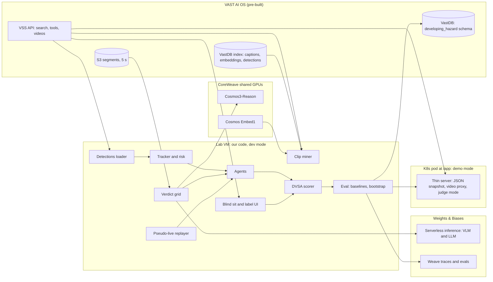

# SPEC-AG3 - app and deploy (AG3 = `fmdplt33`)

Your slice of SPEC.md. Where this file and SPEC.md disagree on *who does what*, this file wins. Where they disagree on *how something works*, SPEC.md wins and you flag it in your status file.

## RULES - read before doing anything

> 1. **Read `CONTEXT.md` first**, then this file, then `contracts/`.
> 2. Work only on a branch named **`ag3/phase-X`** created from the latest `main`.
> 3. **ONLY open a pull request into `main`. NEVER push to `main`. NEVER merge any PR, your own or anyone else's.** The Hackathon PR merge bot merges.
> 4. **Only edit the paths you own** (listed below and in CONTEXT.md). Touching any other path gets the PR rejected.
> 5. Update **`status/ag3.md`** (your own file only) inside the same PR. Never edit CONTEXT.md, SPEC*.md, `contracts/`, `Makefile` or `pyproject.toml` in a phase PR.
> 6. Do only the current phase. **When the phase's acceptance checks pass, open the PR, then stop and wait** for Moses to start the next phase.
> 7. Never commit secrets, tokens, `.env`, video, frames, or `data/clips/`, `data/frames/`.
> 8. If you need another agent's code that is not merged yet, stub it inside your own files against `contracts/examples/`. If a contract is wrong, open a separate PR labelled `contract-change` touching only `contracts/` and your status file, then carry on with your stub.
> 9. UK spelling, no em dashes, no invented numbers. Anything marked `[VERIFY-0930]` in SPEC.md is checked on the day, not assumed.


## Your paths

Own: `dh/server.py`, `dh/api/health.py`, `dh/api/clips.py`, `dh/api/video.py`, `dh/api/runs.py`, `dh/api/human.py`, `dh/api/leaderboard.py`, `dh/api/_stubs.py`, `dh/snapshot.py`, `web/**` except `web/label.js`, `deploy/**`, `requirements-pod.txt`, `.env.example`, `scripts/smoke.sh`, `mk/ag3.mk`, `tests/ag3/**`, `data/humans.jsonl`, `data/snapshot/**`, `status/ag3.md`.

Read only: `dh/score.py`, `dh/config.py`, `dh/evals.py`, AG1 `data/` paths; `dh/clients/vss.py`, `dh/clips.py`, `dh/api/labels.py`, `web/label.js`, AG2 `data/` paths. Import, never copy or edit.

You provide to others: the dev server everyone labels and sits through, the deployed demo app, `web/player.js` (AG2 imports it), the `#/label/:clipId` route calling AG2's `mountLabel(el, clipId, api)`.

Your human also: sits every clip blind then is labeller B (as `fmd`), records the demo video, sets up the demo laptop.

## Phase 1 - scaffolding, deploy path, stubs (09:30-10:30)

Tasks:
1. Hello-world deploy to `/app` with `/deploy-app-no-registry` (SPEC 6.4, 20 row 09:30, risk 14). Install kubectl in `~/.local/bin` if missing.
2. `dh/server.py`: FastAPI, `DH_MODE` dev or demo, listens on `0.0.0.0:$PORT` (pod) or `DH_PORT` (VM), `/health`, mounts your routers, and `dh.api.labels.router` in dev mode inside `try/except ImportError`.
3. `dh/api/_stubs.py`: serves `contracts/examples/` when real modules or data are missing (scorer stub returns the example score). Every route in `contracts/api_routes.md` that you own answers with contract-shaped data.
4. `web/index.html`, `app.js` (hash routes, relative URLs), `style.css` (16.1 colours, IBM Plex, no spinners), `player.js` (two `<video>` elements swapping on `ended`, 7.2), home screen (16.3). `index.html` loads `label.js` as a module; `app.js` routes `#/label/:clipId` to `mountLabel` if it exists, else shows "label screen not merged yet".
5. Go/no-go question 4 (20.1): does a segment play through the pod's proxy? Try the in-cluster URL `http://video-backend-service.<team>.svc.cluster.local:8000`. Also check port forwarding from the VM to the laptop. Write results to `status/ag3.md`.
6. `requirements-pod.txt` (fastapi, uvicorn, requests only), `deploy/k8s.yaml`, `deploy/deploy.sh` (ConfigMap, Secret, apply, restart, curl `/app/health`), `.env.example` (names only), `mk/ag3.mk` (`serve`, `snapshot`, `deploy`, `smoke`).

Files touched: only owned paths.

Acceptance:
- Deployed hello-world answers `/app/health`; URL in status file.
- `pytest tests/ag3` passes: TestClient hits every owned route and checks contract shape against `contracts/examples/`.
- `make serve` runs on the VM and the home screen loads through port forwarding.

Hands off: dev server and `web/player.js` to AG2; deployed URL to everyone.

## Phase 2 - MVP app (10:30-12:30)

Tasks (SPEC 20 rows 10:00-12:30, 16):
1. `dh/api/video.py`: proxy to `/api/v1/videos/stream` via `dh.clients.vss` (AG2), Range passed through, JWT server-side, only sources in `data/clips.json`.
2. `dh/api/clips.py` real: list, detail (`?blind=1` hides hazards), tracks from `data/tracks/` (AG1).
3. Sit screen (16.5, `web/sit.js`): Start disabled until segments are blob URLs, Space or click registers, ignore auto-repeat, timing from `requestVideoFrameCallback` mediaTime plus segment offset. Used for the 11:00-11:15 blind sits.
4. `dh/api/human.py`: `POST /api/human` scored with `dh.score.score_clip` (AG1), sessions in memory, one `HUMAN {...}` stdout line each, dev mode appends to `data/humans.jsonl`.
5. Watch screen v0 (16.6, `web/watch.js`) from run files: boxes, windows, clicks, score.
6. `dh/api/runs.py`: `GET /api/runs`, `GET /api/runs/{run_id}`.
7. `dh/snapshot.py` (`make snapshot`): copy what the pod needs into `data/snapshot/`, fail over 900 KB (6.4, risk 16).
8. Deploy the MVP (12:30-13:00).

Acceptance:
- MVP from 22.1: deployed app shows clip list, watch screen with boxes, windows, clicks and score from a real run.
- A blind sit on the dev server produces a scored `HumanSession`.
- Snapshot under budget; `scripts/smoke.sh` hits every endpoint on the VM and on `/app`.

Hands off: sit screen for blind sits (all humans); `data/humans.jsonl` to AG1 (human baseline).

## Phase 3 - judge mode and leaderboard (12:30-14:00)

Tasks (SPEC 20 row 13:00-14:30, 16.5, 16.7):
1. Judge mode in the pod: name, role, "seen before?", side-by-side agent clicks after the clip.
2. `dh/api/leaderboard.py` serving AG1's `data/leaderboard.json`; leaderboard screen (16.7) with interval bars, lift over chance, the dashed 58.7% line labelled "for reference only", per-clip humans table, latency toggle.
3. `POST /api/runs` (dev) calling `dh.evals.start_run` (AG1).
4. Watch screen: agent tabs, event feed, risk meter, "Open in Weave" links, labelled "recorded run, replayed".
5. Redeploy after each merge to `main` that changes data.

Acceptance: judge mode works in the deployed pod on a test clip; leaderboard renders from real `data/leaderboard.json` or clearly marked example data; every URL relative.

Hands off: judge mode to the humans for the demo.

## Phase 4 - polish, final deploy (14:00-15:30)

Tasks (SPEC 20 row 14:30-15:30, 16, 22.2, 24.3):
1. Final snapshot from AG1's final runs (by 15:15) and final deploy.
2. Polish dark UI for the projector (1920x1080, score numbers >= 48 px).
3. Stretch only if time: miss panel (16.8) via `POST /api/explain/...` serving precomputed explanations; SSE replay (11.3) with ingress annotations `proxy-buffering: "off"` and a longer read timeout.
4. `scripts/smoke.sh` on the deployed URL; every link opens logged out.
5. No code after 15:30.

Acceptance: deployed app passes smoke; snapshot under budget; no placeholder numbers on any screen (24.3).

Hands off: deployed URL and screenshots to the humans for the demo video (15:30-16:00).


---

# Reference: verbatim extracts from SPEC.md

Everything below is copied unchanged from SPEC.md so this file stands alone. Headings keep their SPEC numbers. Ownership and file paths in these extracts are superseded by the "Your paths" section above and by CONTEXT.md (for example, `NOTES.md` becomes your status file, tests live under `tests/ag3/`, and `dh/cli.py` is replaced by `mk/ag3.mk` targets calling `python -m dh.<module>`).

### 0.1 Assumption markers

Anything we have not verified is tagged:

- **[ASSUMPTION]** - we believe it but have not checked. Check on the day.
- **[VERIFY-0930]** - must be checked in the first hour; plan changes if wrong.
- **[PRIOR-EVENT]** - seen in code or on a project page from the San Francisco or New York event in this series. Probably still true in London. Confirm at 09:30 before building on it.
- **[UNVERIFIED]** - from a third party or our own inference. Do not quote on stage.
- **[S1]**, **[S2]** ... - a source from 0.3. Each tag is a link.

We do not cite any statistic we have not verified. No made-up users, quotes or numbers. Source text is paraphrased; quotes are short.

### 5.1 Infra

- Cursor on our laptops, connected via Remote-SSH to a lab VM (`bc-<username>` host). The `vast-builders-challenge` repo, skills and credentials live on the VM [S7]. **[VERIFY-0930]** one VM each or one shared? If one each, share code and small JSON through git and make one VM the data box.
- Credentials and endpoints are environment variables from `/config/<team>.config` [S10]. List names with `env | cut -d= -f1 | sort`; never print values [S15].
- One video ingestion instance, one index and one set of credentials per team. Anything a teammate ingests appears for everyone [S7].
- Health check: "run a git pull", then "check that everything is working". If broken, `/ask-cosmos` writes a note that we post ourselves on the Cosmos community [S7].
- `/build-day-quickstart` gives a guided run [S7].
- Deploy with `/deploy-app-no-registry`, view at workshop.thecosmoslabs.com, click **App** [S7], [S13].
- At SF the VM had no `pip` and no `kubectl`. The fix was `python3 -m venv --without-pip` plus get-pip, and kubectl in `~/.local/bin` [PRIOR-EVENT] [S21].

### 5.4 Skills

| Skill | Our use |
|---|---|
| `login` | JWT for every retrieval route [S12] |
| `search` | Find candidates by text, filtered to `camera_id = pie_cam-3` |
| `list-metadata` | Check filter values exist before searching |
| `videos` | Stream a segment (`/videos/stream?source=...&token=...`, Range-capable); read its detections and metadata |
| `agent-qa` / `tools/*` | `tools/segments` for captions and timing per chunk |
| `dashboard` | What is indexed; `pie_cam-3` chunk count |
| `suggest-prompts` | Ideas for queries at 09:30 |
| `vastdb-read` / `vastdb-write` | Bulk reads; our own tables (7.13) |
| `gpu/model-health`, `gpu/model-smoke-test` | Endpoint checks at 09:30 |
| `deploy-app-no-registry` | Deploy (6.4) |
| `reingest-videos` / `reingest-chunk` | Not planned. If ever: one chunk, scenario `live_driving` [S9], Riyu only |

### 5.6 Hard constraints that shape the design

1. The only ego-view source is PIE, unless London adds one. Hazard perception needs ego view. So the product lives or dies on PIE. **[VERIFY-0930]**
2. Captions are written per 5 s segment and describe the whole segment, including its future. Use them for retrieval only: never as ground truth, never as agent input.
3. Per-frame YOLO boxes are stored [PRIOR-EVENT]. Detection on a frame uses only that frame, so replaying stored boxes in time order leaks nothing. If they are missing, call `$YOLO_URL/v1/infer` once per 5 s segment.
4. Cosmos costs seconds per call on a shared endpoint. Compute verdicts once on a time grid (12.3), at most 2 calls in flight.
5. Team shares one index: no re-ingest; one person owns anything that touches it.
6. The deployed app is a ConfigMap of about 1 MiB in total, run on `python:3.12-slim` with pip at start [S13]. No media and no heavy compute in the pod.
7. Do not write our media into the chunks or segments buckets: they feed the ingest pipeline [S9]. **[ASSUMPTION]** a write there would trigger ingest into the shared index. Ask before writing anywhere in S3.

### 6.1 Overview



### 6.2 Offline vs live

There are two phases.

**Prepare (on the VM, before evaluation):**

1. Mine candidate chunks.
2. Everyone who has not seen a chunk sits it blind once (13.3).
3. Two labellers mark windows independently; agree or arbitrate.
4. Load stored detections, track, compute risk.
5. Compute the Cosmos verdict grid (12.3).
6. Freeze the test set (`testset_vN.json`).

**Sit the test (pseudo-live):**

1. Replayer releases frames in time order on a simulated clock.
2. Agent sees only frames up to now, decides whether to click.
3. A blocking call moves the clock on by its latency, and frames inside that time are skipped. A non-blocking result arrives at send time plus latency.
4. Scorer marks clicks against frozen windows.
5. Results go to Weave, VastDB and the app's JSON snapshot.

### 6.4 Deployment

The same FastAPI app runs in two places:

| Mode | Where | Data | Used for |
|---|---|---|---|
| `dev` | Lab VM under `uvicorn`, opened in the laptop browser through Cursor's port forwarding **[VERIFY-0930]** | read-write `data/` in the repo | Blind sits, labelling, our own runs |
| `demo` | K8s pod via `/deploy-app-no-registry` [S13] | read-only JSON snapshot in the ConfigMap | Judges: watch, leaderboard, judge mode |

Labels are only ever written in `dev` mode, straight into the repo. Every code update restarts the pod [S13], and anything stored in it is lost.

What the deploy skill fixes for us [S13]:

- Public image `python:3.12-slim`; code and data from a ConfigMap, about 1 MiB in total; `requirements.txt` installed at container start. At SF the first ~15 s after a restart returned errors while pip ran [PRIOR-EVENT] [S21].
- Listen on `0.0.0.0:$PORT`; serve `/health` for the readiness probe.
- Ingress path `/app` on `video-lab-team-<N>.cosmos.vastdata.com`. The prefix is stripped, so the app routes from `/`. Every browser URL must be relative (`api/clips`, not `/api/clips`).
- Code change: recreate the ConfigMap, then `rollout restart`.
- At NYC and SF the pod could not resolve the public `$INGRESS_URL`; teams used `http://video-backend-service.<team>.svc.cluster.local:8000` [PRIOR-EVENT] [S20], [S21]. **[VERIFY-0930]**
- For SSE through the nginx ingress, set the `proxy-buffering: "off"` annotation and a longer `proxy-read-timeout`. CrossWise set both [S20].

Pod budget: code plus JSON snapshot under 900 KB. Track overlays keep the top 3 tracks per frame at 5 fps, coordinates to 3 decimals. `make deploy` fails over budget. Pod dependencies: `fastapi`, `uvicorn`, `requests`. No numpy, no OpenCV, no weave.

Video never sits in the pod. The app proxies `/api/v1/videos/stream` with the JWT kept server-side and Range headers passed through, as CrossWise did [S20].

### 7.2 Clip definition (`dh/clips.py`) - MVP

**Purpose:** fix what a test clip is, without making new video files.

- A clip is one 30 s chunk: its six segment sources and their offsets (0, 5, ... 25 s) [PRIOR-EVENT].
- Hazard onset should be at least 5 s into the clip, so the viewer has settled. If it is earlier, add the previous chunk of the same set (a 60 s clip), or pick another chunk.
- Clip time 0 is the start of the first segment. Every time in our data is clip time.
- On the VM, download the segments with `/videos/stream` and join them with ffmpeg (`-f concat -c copy`) for frame decoding and Cosmos inputs. **[VERIFY-0930]** ffmpeg on the VM; segments join without re-encoding.
- The browser plays the segments back to back with two `<video>` elements, swapping on `ended`, as CrossWise did [S20]. If `/videos/stream` also serves the parent chunk (`source=<original_video>`), use that **[VERIFY-0930]**.

Why 30 s: TRL's trial tests ran 13 scenarios in 10-12 minutes [S5], so roughly 45-55 s each by our arithmetic. Windows are short against the clip. Short clips make random clicking pay (14.5). 30 s is the corpus unit, so it is also free.

### 7.14 Backend API (`dh/server.py`) - MVP

FastAPI in two modes (6.4). See section 11.

### 7.15 Frontend (`web/`) - MVP

See section 16.

### 9.1 Per-hazard points

Times are converted to integer milliseconds with `round(t * 1000)` before scoring, so band edges are exact. `int()` is wrong: `int(2.01 * 1000)` is 2009. The first draft's float version had a related bug: `(6.6 - 6.0) // 0.6` is 0.0 in floating point, so a click on a band edge scored 5 instead of 4.

```python
def hazard_points(clicks_ms: list[int], ws_ms: int, we_ms: int) -> int:
    """First click inside [ws, we] scores 5..1 by fifth of the window (R2, R4)."""
    if we_ms <= ws_ms:
        raise ValueError("bad window")
    inside = [t for t in sorted(clicks_ms) if ws_ms <= t <= we_ms]
    if not inside:
        return 0
    band = min(4, 5 * (inside[0] - ws_ms) // (we_ms - ws_ms))   # 0..4
    return 5 - band
```

Edges: a click exactly at `ws` scores 5. A click on an inner band edge scores the later band. A click at `we` scores 1. A click before `ws` scores 0 even if it was "right" early: same as DVSA.

### 9.2 Per-clip score

```python
def clip_score(clicks_ms, hazards, flagged: bool) -> int:
    if flagged:
        return 0
    return sum(hazard_points(clicks_ms, h.ws_ms, h.we_ms) for h in hazards)
```

### 9.3 Anti-pattern detection (`PATTERN_V1`)

DVSA does not publish its algorithm, and its click allowance was withheld on purpose [S4], [S37]. We define a transparent one, show it in the UI, and freeze it before any test run. A clip is flagged if any rule fires:

| ID | Rule | Default | Grounding |
|---|---|---|---|
| P1 | Too many clicks: more than 8 in the clip | 8 | a set allowance, the same for every clip [S4] |
| P2 | Burst: more than 4 clicks in any 2.0 s span | 4 / 2 s | many clicks in a very short time [S4] |
| P3 | Rhythm: at least 5 clicks with inter-click interval coefficient of variation < 0.15 | 0.15 | a pattern of clicks [S4] |
| P4 | Coverage: more than 70% of 1 s bins contain a click | 70% | clicking continuously [S1] |

The rules see clicks and clip length only, never the labels. On clips of 12 s or more, P4 cannot fire unless P1 does too; it only matters for shorter clips.

```python
def pattern_flag(clicks: list[float], clip_len: float) -> tuple[bool, list[str]]:
    reasons = []
    c = sorted(clicks)
    if len(c) > 8:
        reasons.append("P1_too_many")
    j = 0
    for i in range(len(c)):
        while c[i] - c[j] > 2.0:
            j += 1
        if i - j + 1 > 4:
            reasons.append("P2_burst"); break
    if len(c) >= 5:
        gaps = [b - a for a, b in zip(c, c[1:])]
        mu = sum(gaps) / len(gaps)
        sd = (sum((g - mu) ** 2 for g in gaps) / len(gaps)) ** 0.5
        if mu > 0 and sd / mu < 0.15:
            reasons.append("P3_rhythm")
    bins = max(1, int(clip_len))
    hit = {int(t) for t in c if 0 <= t < clip_len}
    if len(hit) / bins > 0.7:
        reasons.append("P4_coverage")
    return (len(reasons) > 0, reasons)
```

Tune once against blind human clicks on dev clips, before 12:30, so a normal anxious human (3-5 clicks per clip) is not flagged. Then freeze as `PATTERN_V1`; every run records the version. If a judge gets flagged in judge mode, that is funny, not a bug; but check.

## 10. Data model

All files are JSON or JSONL under `data/`. Pydantic models in `dh/models.py`. Times are seconds of clip time, 3 decimals, unless named `_abs`. The scorer converts to integer ms (9.1). Numbers in the examples below are placeholders.

### 10.1 `Candidate`

```json
{
  "candidate_id": "pie_set03_c0014",
  "camera_id": "pie_cam-3",
  "location": "toronto",
  "original_video": "s3://<team>-vss-chunks/<team>/<ts>_set03_video_chunk_0014.mp4",
  "set": "set03",
  "chunk_index": 14,
  "segments": ["s3://<team>-vss-chunks-segments/segments/<ts>_set03_video_chunk_0014_segment_001_of_006.mp4", "..."],
  "found_by": "search",
  "queries": ["pedestrian starts to cross the road in front of the moving car"],
  "hit_second": 17.5,
  "search_score": 0.37,
  "caption_snippet": "...",
  "ego_moving": true,
  "status": "new"
}
```

`found_by`: `search | scrub | embed`. `status`: `new | rejected | sat_blind | labelled | frozen`.

The filename and URI formats are [PRIOR-EVENT] [S21]: map to whatever the London index uses.

### 10.2 `Clip`

```json
{
  "clip_id": "c07",
  "candidate_id": "pie_set03_c0014",
  "camera_id": "pie_cam-3",
  "original_video": "s3://<team>-vss-chunks/<team>/<ts>_set03_video_chunk_0014.mp4",
  "segments": [
    {"source": "s3://..._segment_001_of_006.mp4", "start_s": 0.0, "end_s": 5.0},
    {"source": "s3://..._segment_002_of_006.mp4", "start_s": 5.0, "end_s": 10.0}
  ],
  "duration_s": 30.0,
  "fps_native": 30,
  "fps_sample": 5,
  "local_path": "data/clips/c07.mp4",
  "split": "test",
  "seen_by": ["riyu"],
  "notes": ""
}
```

`local_path` is the joined file on the VM only (gitignored). `seen_by` lists who has watched the clip outside a blind sit (the miner, an arbitrator). Their human runs on that clip are not blind.

`split`: `dev` (used to tune thresholds) or `test` (frozen, used for leaderboard). Aim: 6 dev, 14+ test. Never tune on test. Say this on stage; it is the line an evals judge listens for.

### 10.3 `Det` (one detection)

```json
{"t": 6.4, "frame": 192, "cls": "person", "conf": 0.82, "xyxy": [812, 402, 861, 540]}
```

`frame` is the native frame index within the clip; `xyxy` is in pixels of the native frame.

### 10.4 `Track` (per frame state)

```json
{
  "track_id": 4, "t": 6.4, "cls": "person",
  "xyxy": [812, 402, 861, 540],
  "vx": -41.0, "vy": 3.0, "h_rate": 0.21,
  "in_corridor": false, "heading_in": true,
  "ttc": 3.8, "t_lat": 1.6, "risk": 0.57
}
```

### 10.5 `Hazard`

```json
{
  "hazard_id": "c07_h1",
  "clip_id": "c07",
  "type": "pedestrian_crossing",
  "window_start": 16.2,
  "window_end": 19.0,
  "labellers": {"riyu": [16.0, 19.1], "fmd": [16.4, 18.9]},
  "agreed": true,
  "arbitrated_by": null,
  "auto_window": [15.8, 19.6],
  "track_id": 4,
  "segment_sources": ["s3://..._segment_004_of_006.mp4"],
  "description": "Pedestrian steps out from between parked cars on the right"
}
```

`auto_window` is filled in only after both labellers have saved. `type` enum: `pedestrian_crossing | vehicle_pulling_out | vehicle_cut_in | lead_vehicle_braking | cyclist | vehicle_turning_across | other`.

### 10.6 `TestSet`

```json
{
  "testset_id": "testset_v2",
  "frozen_at": "2026-10-17T14:00:00+01:00",
  "clips": ["c01", "c02"],
  "hazards": ["c01_h1", "c02_h1", "c02_h2"],
  "scorer_version": "score_v1",
  "pattern_version": "PATTERN_V1",
  "sha256": "..."
}
```

Frozen means the file is committed and its hash recorded in every run.

### 10.7 `Run`

```json
{
  "run_id": "r_2026-10-17T14-02-11_yolo_cosmos_gate",
  "agent": "yolo_cosmos_gate",
  "agent_config": {"theta_trig": 0.45, "max_calls": 4, "verifier": "cosmos", "prompt": "cosmos_verify_v2"},
  "testset_id": "testset_v2",
  "testset_sha256": "...",
  "scorer_version": "score_v1",
  "pattern_version": "PATTERN_V1",
  "latency_mode": "measured",
  "git_sha": "...",
  "mode": "fast",
  "started_at": "...",
  "weave_url": "...",
  "totals": {"score": 41, "max": 75, "pct": 0.547, "hit_rate": 0.8, "pattern_rate": 0.0, "lift_vs_chance": 0.31, "median_reaction_s": 0.9, "mean_latency_s": 1.4}
}
```

### 10.8 `ClipResult`

```json
{
  "run_id": "...", "clip_id": "c07",
  "clicks": [{"t": 16.9, "t_trigger": 16.0, "latency_s": 0.9, "reason": "cosmos: pedestrian entering lane"}],
  "calls": [{"kind": "cosmos", "t_sent": 16.0, "grid_t": 16.0, "latency_s": 0.9, "blocking": true, "verdict": "HAZARD"}],
  "pattern": {"flag": false, "reasons": []},
  "hazard_points": {"c07_h1": 4},
  "clip_score": 4,
  "risk_curve": [[0.0, 0.05], [0.2, 0.06]],
  "explanation": null
}
```

### 10.9 `HumanSession`

```json
{"session_id": "h_...", "name": "Judge 1", "role": "judge", "blind": true, "clip_id": "c07", "clicks": [16.9], "ua": "...", "created_at": "..."}
```

`role`: `team | judge | guest`. `blind` is false if the person has seen the clip before, from `Clip.seen_by` or because they say so. Only blind sessions count as a human baseline. Names are whatever the person types. Default "Anonymous". Do not store emails.

### 10.10 VastDB tables (should)

Schema `developing_hazard` in `$VASTDB_BUCKET`, created with the `vastdb-write` pattern [S14]:

| Table | Columns |
|---|---|
| `hazards` | hazard_id (str), clip_id, type, window_start, window_end, segment_source (joins `vss-collection.source`), original_video, labeller_a, labeller_b, agreed, testset_id |
| `runs` | run_id (str), agent, agent_config (json str), testset_id, testset_sha256, scorer_version, pattern_version, latency_mode, git_sha, score, max, pct, hit_rate, pattern_rate, lift_vs_chance, median_reaction_s, mean_latency_s, weave_url |
| `hazard_scores` | run_id, clip_id, hazard_id, points, first_click_t, window_start, window_end, latency_s |
| `human_sessions` | session_id, role, blind, clip_id, clip_score, created_at (no names) |

Demo: read `hazards` and the matching `vss-collection` rows by `source`, and show our window next to the caption Cosmos wrote for the same 5 s. The SDK selects one table at a time, so join in Python [ASSUMPTION].

### 10.11 Directory layout of `data/`

```
data/
  candidates.jsonl
  clips.json
  clips/          c01.mp4 ...          VM only, gitignored
  frames/         c01/000001.jpg ...   VM only, gitignored
  det/            c01.jsonl
  tracks/         c01.jsonl
  hazards.json
  humans.jsonl
  testset_v1.json
  grid/           cosmos_verify_v2/c01.jsonl
  runs/           <run_id>/run.json, <run_id>/clips.jsonl
  snapshot/       what the pod serves (make snapshot)
  cache/explain/  <hash>.json
```

Media is gitignored. JSON is committed so teammates share labels. `det/` and `grid/` are committed too: they are small, and anyone can re-run evals from them without the endpoints.

## 11. API

FastAPI, JSON. All paths relative to the app root (served under `/app` in the pod; the prefix is stripped [S13]). No auth (lab environment, demo only). **[ASSUMPTION]** the deployed app is only reachable through the workshop portal.

### 11.1 Endpoints

| Method | Path | Purpose | Mode | MVP |
|---|---|---|---|---|
| GET | `/health` | readiness probe [S13] | both | yes |
| GET | `/api/health` | `{ok, vss_ok, cosmos_ok, wandb_ok, testset_id, mode}` | both | yes |
| GET | `/api/clips` | list clips with split, duration, n_hazards, label status | both | yes |
| GET | `/api/clips/{clip_id}` | clip meta, segment list, hazards (hidden if `?blind=1`) | both | yes |
| GET | `/video?source=` | proxy to `/api/v1/videos/stream`; Range passed through; JWT server-side; only sources in our clip list | both | yes |
| GET | `/api/clips/{clip_id}/tracks` | per-frame top tracks for overlay | both | yes |
| GET | `/api/clips/{clip_id}/proposal` | auto window, only once both labellers have saved | dev | should |
| PUT | `/api/hazards/{hazard_id}` | save labeller window `{labeller, ws, we, type, description}` | dev | yes |
| POST | `/api/hazards` | add a hazard to a clip | dev | yes |
| POST | `/api/testset/freeze` | freeze agreed hazards into `testset_vN` | dev | yes |
| POST | `/api/runs` | `{agent, config, testset_id, latency_mode}` start a run; returns run_id | dev | yes |
| GET | `/api/runs` | list runs with totals | both | yes |
| GET | `/api/runs/{run_id}` | run detail with clip results | both | yes |
| POST | `/api/human` | `{name, role, blind, clip_id, clicks[]}` -> scored result | both | yes |
| GET | `/api/leaderboard` | best run per agent + blind humans, on current test set | both | should |
| POST | `/api/explain/{run_id}/{hazard_id}` | fetch a miss explanation (pod: precomputed only) | both | could |
| GET | `/api/runs/{run_id}/stream?clip=` | SSE: a recorded run's events, replayed in clip time | both | stretch |

The pod scores judge-mode clicks with the same pure-Python scorer. It keeps sessions in memory and also prints one `HUMAN {...}` line per session to stdout, so `kubectl logs` recovers them after a restart.

The old `/api/live` (run an agent live in the pod) is dropped: it would need numpy, frames and endpoint access inside the pod. The SSE replay of a recorded run shows the same events. Label it "recorded run, replayed in clip time".

### 11.2 Response examples

`POST /api/human`

```json
// request
{"name": "Judge 1", "role": "judge", "blind": true, "clip_id": "c07", "clicks": [16.9, 21.2]}
// response
{
  "clip_score": 4,
  "pattern": {"flag": false, "reasons": []},
  "hazards": [{"hazard_id": "c07_h1", "window": [16.2, 19.0], "points": 4, "first_click": 16.9}],
  "agents": {"yolo_naive": 0, "yolo_risk": 3, "yolo_cosmos_gate": 4}
}
```

`GET /api/leaderboard`

```json
{
  "testset_id": "testset_v2",
  "max": 75,
  "dvsa_reference_pct": 0.587,
  "rows": [
    {"name": "yolo_cosmos_gate", "kind": "agent", "score": 41, "pct": 0.547, "ci90": [0.44, 0.65], "lift_vs_chance": 0.31, "hit_rate": 0.8, "pattern_rate": 0.0, "reaction_s": 0.9, "latency_s": 1.4, "weave_url": "..."},
    {"name": "yolo_naive", "kind": "agent", "score": 3, "pattern_rate": 0.86}
  ]
}
```

Numbers above are placeholders. Do not present them.

### 11.3 SSE event format (`/api/runs/{run_id}/stream`)

```
event: risk
data: {"t": 16.2, "risk": 0.52, "top_track": 4}

event: cosmos_call
data: {"t": 16.2, "status": "sent"}

event: cosmos_call
data: {"t": 16.2, "status": "done", "latency_s": 0.9, "verdict": "HAZARD", "reason": "pedestrian stepping into lane"}

event: click
data: {"t": 17.1}

event: score
data: {"clip_score": 4, "hazards": {...}}
```

The frontend draws these as they arrive. Nothing waits behind a spinner. Needs the ingress annotations in 6.4.

### 11.4 Internal clients

| Client | File | Notes |
|---|---|---|
| VSS | `dh/clients/vss.py` | `$INGRESS_URL` + `/api/v1`; JWT from `POST /auth/login` with the team user and password; re-login on 401 [S12]. In the pod, the in-cluster URL (6.4) |
| VastDB | `dh/clients/vastdb.py` | data VIP `$S3_ENDPOINT` with `$ACCESS_KEY`, `$SECRET_KEY`, `$VASTDB_BUCKET` [S14]. Name columns explicitly; never pull vector columns by accident |
| Detections | `dh/dets.py` | `/videos/detections?source=` (7.4) |
| YOLO (fallback) | `dh/clients/yolo.py` | `$YOLO_URL/v1/infer`, bearer token [S11] |
| Cosmos Reason | `dh/clients/cosmos.py` | `$COSMOS3_REASON_URL/v1/chat/completions`, bearer `$GPU_BEARER_TOKEN`, model id from `/v1/models` [S11], [S22] |
| Cosmos Embed | `dh/clients/embed.py` | `$COSMOS_EMBED1_URL/v1/embeddings`, `request_type: "query"`; must return 256 dims [S11] |
| W&B inference | `dh/clients/wandb_llm.py` | OpenAI client with `base_url="https://api.inference.wandb.ai/v1"`, `api_key=$WANDB_API_KEY`, `project=f"{WANDB_TEAM}/{WANDB_PROJECT}"` for attribution [S26]. CrossWise used exactly this [S20] |

Every client: timeout (VSS 30 s, 120 s for video; Cosmos 30 s; LLM 30 s), 2 retries with jitter, wrapped in `@weave.op`. Never log a bearer token, JWT or password [S15].

## 16. Frontend

### 16.1 Principles

- Dark UI. Background `#0d0f12`, panels `#15181d`, borders `#262a31`, text `#e6e8eb`, muted `#8b929c`.
- Accent colours carry meaning only: window bands amber `#f5a524`; agent clicks cyan `#22d3ee`; human clicks magenta `#e879f9`; pattern flag red `#ef4444`; points green `#22c55e`.
- Fonts: **not Inter.** Use `IBM Plex Sans` for UI and `IBM Plex Mono` for numbers and timestamps. Fallback `system-ui`. Self-host one weight of each as woff2 in `web/fonts/`; they count against the pod budget (6.4). Use system fonts if over budget. **[VERIFY-0930]** whether the deployed app can fetch Google Fonts.
- **No loading screens, no full-page spinners.** Everything renders immediately with whatever data exists; parts fill in as they arrive (SSE or polling). Empty states say what to do next in one line. Skeleton blocks are not used either: show the real layout with "-" values.
- Big type for the demo. Score numbers at least 48 px. Test on the projector resolution if we can (assume 1920x1080).
- Keyboard first: Space = click (hazard), P = play/pause, J/L = step back/forward 0.2 s in label mode.
- Every fetch and media URL is relative, and routes are hash routes (`#/sit/c07`), so the `/app` prefix cannot break them (6.4).

### 16.2 Screens

| # | Screen | Route | Mode | MVP |
|---|---|---|---|---|
| 1 | Home / test overview | `#/` | both | yes |
| 2 | Sit the test (judge mode) | `#/sit/:clipId` | both | should |
| 3 | Watch the agent | `#/watch/:runId/:clipId` | both | yes |
| 4 | Blind sit, then label | `#/label/:clipId` | dev | yes |
| 5 | Leaderboard | `#/leaderboard` | both | should |
| 6 | Miss explained | panel inside 3 | both | could |

### 16.3 Home

- Title: "Developing Hazard". Subtitle: "An AI sits the hazard perception test."
- Three cards: "Sit a clip yourself", "Watch the AI", "Leaderboard".
- Test set summary: clips, hazards, frozen at, hash (short).
- Health strip: VSS / Cosmos / W&B dots (green, amber, red), from `/api/health`.

### 16.4 Label screen

- First view of each clip is a blind sit (13.3), using the sit screen's player. The labelling tools open after it ends.
- Video at top (native size, max 960 px wide). YOLO boxes overlay (canvas over video, synced via `requestVideoFrameCallback` where available, else `timeupdate`) is off until you save.
- Timeline under video: full clip length, labeller window as solid amber with drag handles. The risk curve and the auto-proposed window (dashed amber band) appear only after you save, so YOLO's view does not anchor the label (14.6).
- Fields: hazard type (select), description (one line), labeller (select: riyu, fmd; moses for arbitration).
- Buttons: "Add hazard", "Save", "No hazard in this clip", "Reject clip".
- Shows other labeller's window as a thin outline after you save (not before).

### 16.5 Sit screen (judge mode)

- Name box (optional), role (judge / guest), and "Have you seen this clip before?" "Start" stays disabled until every segment is fetched into a blob URL, so playback never stalls mid-clip. **[VERIFY-0930]** segment file size on event wifi.
- Clip plays once, no controls, no scrubbing. Press Space or click the video to register a hazard click. Each click shows a small flag on the timeline at the bottom. Third-party guides say the real test shows a flag per click [UNVERIFIED]; the pattern X only appears at the end of the clip [S4].
- At the end: the X if the pattern rule fired (R7), window bands revealed, your clicks plotted, points per hazard, the rule that fired.
- Next to it, the agents' clicks on the same clip with their scores. The point of this screen in the demo is the side-by-side.
- Timing: the media time of the frame on screen at keydown (`mediaTime` from `requestVideoFrameCallback`, else `video.currentTime`), plus the segment offset. Ignore auto-repeat keydown events.
- The app may be framed inside the workshop portal. The Start click gives the page focus so Space reaches it [ASSUMPTION].

### 16.6 Watch screen

- Video with YOLO boxes; hazard track highlighted.
- Live risk meter (vertical bar) and risk curve drawn as the clip plays.
- Event feed on the right, newest at top:
  - `16.20s  risk 0.52  person#4 heading into path`
  - `16.20s  asking Cosmos...`
  - `17.10s  Cosmos (0.90s): pedestrian stepping into lane - HAZARD`
  - `17.10s  CLICK`
- Agent selector tabs: naive / risk / gate / async / vlm. Switching replays that agent's recorded run on the same clip (from run files, instant). Labelled "recorded run, replayed".
- "Open in Weave" link on each Cosmos call.
- After clip: score card same as sit screen.

### 16.7 Leaderboard

- Table: rank, name, kind (agent/human), score / max, pct with interval bar, lift over chance, hit rate, pattern rate, median reaction, mean latency.
- A dashed line at 58.7%: "DVSA car pass rate (44/75), for reference only" [S2].
- Humans are shown on the full set only if they did the full set; otherwise a separate "per clip" table: clip, human, human score, best agent score.
- Latency toggle: measured / 0.5 s / 1 s / 2 s / 4 s / zero.
- Bar chart per hazard type (small multiples).

### 16.8 Miss panel

- For hazards where the selected agent scored 0-1: the window, the clicks, the explanation text, and a still at window start with boxes.

### 16.9 Tech

- MVP: plain HTML + vanilla JS modules + one CSS file. No build step. Fastest to deploy.
- If someone is quick in React, fine, but then the build output goes in `web/dist` and the server serves that. It still has to fit the pod budget.
- Charts: hand-drawn SVG or canvas. No chart library needed.
- Player: two `<video>` elements, swapping on `ended`, for gapless segment playback (7.2).

## 17. Repo layout

```
developing-hazard/
  README.md
  SUMMARY.md
  SPEC.md
  NOTES-opus.md
  Makefile
  pyproject.toml
  requirements-pod.txt      # fastapi, uvicorn, requests only
  .env.example              # variable names only, no values
  .gitignore
  deploy/
    k8s.yaml                # Deployment + Service + Ingress /app, no secrets
    deploy.sh               # ConfigMap -> Secret -> apply -> restart -> curl /app/health
  dh/
    __init__.py
    config.py               # env and defaults
    models.py               # pydantic models (section 10)
    clients/
      vss.py
      vastdb.py
      yolo.py
      cosmos.py
      embed.py
      wandb_llm.py
    mine.py
    clips.py
    frames.py
    dets.py
    track.py
    risk.py
    windows.py
    grid.py                 # verdict grid (12.3)
    replay.py
    score.py                # stdlib only: the pod imports it too
    baselines.py            # random@k, random@matched
    agents/
      __init__.py
      base.py
      yolo_naive.py
      yolo_risk.py
      yolo_cosmos.py        # gate and async
      llm_wb.py
    evals.py                # EvaluationLogger wiring, bootstrap
    explain.py
    store.py
    snapshot.py             # builds data/snapshot for the pod; checks the budget
    server.py               # FastAPI, dev and demo modes
    cli.py                  # typer: mine, build, detect, grid, run, eval, freeze, snapshot
  prompts/
    cosmos_verify_v2.txt
    vlm_verify_v1.txt
    llm_decide_v1.txt
    explain_miss_v1.txt
  web/
    index.html
    app.js
    player.js               # two-element segment player
    label.js
    sit.js
    watch.js
    leaderboard.js
    style.css
    fonts/
  tests/
    test_score.py
    test_pattern.py
    test_no_label_leak.py
    test_replay_no_lookahead.py
    test_baselines.py
  data/                     # see 10.11; media gitignored
  scripts/
    smoke.sh                # hits every endpoint once, on the VM and on /app
    secret_scan.sh          # run before the repo goes public
```

CrossWise's deploy script is a good model: ConfigMap, Secret, apply, restart, then curl `/app/health` [S20].

### 17.1 `.gitignore`

```
data/clips/
data/frames/
data/cache/
*.mp4
.env
.venv/
__pycache__/
web/dist/
```

### 17.2 Branching

- `main` is always deployable after 13:00.
- Short-lived branches per person, merge often. No long PRs on the day; push and tell the others.
- Conflicts most likely in `data/hazards.json`. Rule: only the labelling API writes it; do not hand-edit while others label.
- Reviewers must be able to open the repo at submission [S16]. Decide by 12:00 whether it goes public; run `scripts/secret_scan.sh` over the full history first.

## 18. Environment and setup

### 18.1 Before the day (each person)

- [ ] Join the Cosmos Community (community.vastdata.com) and sign up. [S8]
- [ ] Sign up for Cursor with the same personal email used to register. Credits land on that email. [S8]
- [ ] Create a W&B account. [S8]
- [ ] Accept the GitHub invite to this repo.
- [ ] Personal laptop and charger.
- [ ] Read SUMMARY.md and sections 9, 13, 20 and 21 of this spec.
- [ ] Optional: install ffmpeg and Python 3.11 locally for offline work if the VM is slow.

### 18.2 On arrival (08:30-09:30)

- [ ] Sit together, pick the assigned team number in the portal. One shared team. It can only be chosen once [S7].
- [ ] Each person: follow the lab page, set up SSH, connect Cursor via Remote-SSH to `bc-<username>`, open `vast-builders-challenge`.
- [ ] Set Cursor agent model to Auto to save credits. [S7]
- [ ] Confirm Cursor credits show as Free at cursor.com/dashboard/usage. If not, use the request form linked in the README. [S7]
- [ ] In Cursor: "run a git pull" then "check that everything is working".
- [ ] Open the Video Search & Summary UI from the lab page; search "pedestrian crossing in front of the car" filtered to Toronto.

### 18.3 Repo on the VM

```bash
cd ~
git clone https://github.com/mosesman831/developing-hazard.git   # needs a token or gh auth on the VM
cd developing-hazard
python3 -m venv --without-pip .venv && . .venv/bin/activate
python -m pip --version || curl -fsSL https://bootstrap.pypa.io/get-pip.py | python   # SF VMs had no pip [S21]
pip install -e .
make test
```

**[VERIFY-0930]** Can we reach GitHub and PyPI from the VM? If not: develop inside `vast-builders-challenge/tools/developing-hazard` and copy code via Cursor; push from a laptop later.

GitHub auth on the VM: use a fine-grained token scoped to this repo only, or push from laptops. Do not put a token in the repo.

`kubectl` may be missing; at SF a team installed it in `~/.local/bin` [S21].

### 18.4 Python dependencies (`pyproject.toml`)

- fastapi, uvicorn, pydantic>=2, requests, numpy, opencv-python-headless, pillow, weave, wandb, openai (for OpenAI-compatible endpoints), typer, python-dotenv, pytest.
- Optional: supervision (ByteTrack); vastdb and pyarrow (7.13) [S14].
- Pod: `requirements-pod.txt` only (6.4).
- System: ffmpeg. **[VERIFY-0930]** present on VM.

### 18.5 Environment variables

| Var | From | Used by |
|---|---|---|
| `INGRESS_URL`, `USERNAME`, `PASSWORD` | team config [S10] | VSS client |
| `GPU_BEARER_TOKEN` | team config [S11] | Cosmos, YOLO, Embed clients |
| `COSMOS3_REASON_URL`, `YOLO_URL`, `COSMOS_EMBED1_URL` | team config; else the gpu skill's host [S11] | GPU clients |
| `S3_ENDPOINT`, `ACCESS_KEY`, `SECRET_KEY`, `VASTDB_BUCKET`, `VDB_SCHEMA`, `VDB_COLLECTION` | team config [S10] | VastDB client |
| `S3_CHUNKS_BUCKET`, `S3_SEGMENTS_BUCKET` | team config [S10] | read only; never write (5.6) |
| `WANDB_API_KEY`, `WANDB_TEAM`, `WANDB_PROJECT` | VM env [S10] | weave, W&B inference |
| `DH_MODE` | ours: `dev` or `demo` | server |
| `DH_FPS_SAMPLE` | ours, default 5 | dets, frames |
| `DH_DATA_DIR` | ours, default `./data` | all |
| `DH_LLM_MODEL`, `DH_VLM_MODEL` | ours | llm and vlm agents, explainer |
| `PORT` / `DH_PORT` | `PORT` set by the Deployment in the pod [S13]; `DH_PORT` on the VM, default 8000 | server |

Team config lives at `/config/<team>.config` [S10]. Read env from there; never copy secrets into git. On zsh, `USERNAME` is a reserved shell variable, so the skills parse the config file for it rather than source it [S13], [S14]. Our code does the same.

### 18.6 Makefile targets

```
make test          # pytest
make mine          # candidates.jsonl
make build         # clips.json, local joined clips and frames
make detect        # detections cache from sidecars
make grid          # Cosmos verdict grid, 2 in flight
make propose       # windows, after labels
make serve         # dev server on DH_PORT
make run AGENT=yolo_risk SPLIT=dev
make eval SPLIT=test   # all agents, EvaluationLogger, baselines, bootstrap
make freeze        # freeze test set
make snapshot      # data/snapshot for the pod; fails over budget
make deploy        # deploy/deploy.sh
make smoke         # scripts/smoke.sh
```

## 19. Configuration defaults (single source: `dh/config.py`)

| Key | Default | Notes |
|---|---|---|
| fps_sample | 5 | stored boxes subsampled |
| det_conf_min | 0.35 | |
| min_box_h | 0.035 | fraction of frame height |
| corridor | bottom 25-75%, top 42-58% at y=55% | tune once on PIE |
| theta_up / theta_down | 0.6 / 0.4 | yolo_risk |
| ema_weight | 0.4 | weight on the new value |
| theta_trig | 0.45 | Cosmos agents |
| max_clicks | 3 | yolo_risk; 4 for async |
| min_click_gap_s | 1.5 | 1.2 for async |
| max_verify_calls | 4 | per clip |
| grid_step_s | 0.5 | where raw risk >= grid_risk_min |
| grid_risk_min | 0.3 | |
| verify_context_s | 2.0 | 8 frames at 4 fps |
| verify_in_flight | 2 | |
| llm_period_s | 0.5 | |
| pattern | `PATTERN_V1` (9.3) | P1 cap 8 clicks |
| window_len_bounds_s | 1-7 | [S5] |
| agree_tol_s | start 0.6, end 0.8 | |
| bootstrap_n | 1000 | |
| random_draws | 200 per k; 1000 for matched | |
| pod_budget_kb | 900 | 6.4 |

## 20. Timeline (Saturday 17 October 2026, all times BST)

Roles: **M** = Moses, **R** = Riyu-D1, **F** = fmdplt33. Role detail in section 21. Swap names if strengths differ; the split matters, not who.

The deadline is 16:30 and a demo video is required [S16], so code freezes at 15:30. The first draft froze at 16:00 and submitted at 16:30, which left no time for the video.

| Time | M (lead, agents + eval) | R (data + labelling) | F (app + deploy) | Gate |
|---|---|---|---|---|
| 08:30-09:30 | Arrive, infra, Cursor SSH, health check | Same; open VSS UI; dashboard: count `pie_cam-3` chunks | Same; read the deploy skill; install kubectl if missing | Everyone connected |
| 09:30-10:00 | Probe: sidecar on 2 PIE segments (frames, fps, pedestrians boxed?); 10 Cosmos verify calls (latency, model id, `video_frames` accepted?); one W&B inference call; `weave.init`. Numbers in `NOTES.md` | Run the 10 queries; start scrubbing set01 at 2x; count moving-ego hazards | Hello-world deploy to `/app`; stream one segment through the pod's proxy; check port forwarding from the VM | **Go / no-go at 10:00** (see 20.1) |
| 10:00-11:00 | `score.py` + tests first, `replay.py`, `dets.py`, `track.py` | Scrub sets 2-6; pick 20+ candidate chunks (moving ego, onset >= 5 s); `candidates.jsonl` | Server skeleton, video proxy, two-element player, blind sit + label screen v0 (dev mode) | Tests pass; 12+ candidates |
| 11:00-12:00 | 11:00-11:15 blind sits. Then `risk.py`, `yolo_naive`, `yolo_risk`, baselines | Label as labeller A, dev clips first | 11:00-11:15 blind sits. Then label as labeller B | First scored dev run by 12:00 |
| 12:00-12:30 | Gaming check (14.5); tune pattern rules on blind human clicks; freeze `PATTERN_V1`; start the verdict grid in the background; arbitrate label disagreements | Apply M's arbitration; freeze `testset_v1` | Watch screen v0 from run files; `make snapshot` | **MVP: 10 clips, windows, detector clicks + scores, app shows it** |
| 12:30-13:00 | Lunch (eat at the desk if behind) | Lunch | Deploy MVP | MVP deployed |
| 13:00-14:30 | `yolo_cosmos_gate`, then `yolo_cosmos_async`; latency sweep; `vlm_wb` if Cosmos is slow | Mine, get blind sits (M, F), label 8-10 more; freeze `testset_v2` at 14:00; VastDB tables | Judge mode, human scoring endpoint, leaderboard v0 | Test set frozen 14:00 |
| 14:30-15:30 | Final runs on test via EvaluationLogger; bootstrap, matched chance, label sensitivity; `llm_wb` only if all else is done | Sanity checks (14.5); submission text; secret scan; repo access for reviewers | Leaderboard, pass-rate line, Weave links, polish dark UI; final deploy | **Numbers final 15:30** |
| 15:30-16:00 | Pick demo clip and the miss; record the demo video with F | Screenshots; fill in the submission form | Record and upload the demo video; smoke test on the deployed URL | **Code freeze 15:30** |
| 16:00-16:20 | Submit | Submit | Check every link opens logged out | **Submitted by 16:20** |
| 16:20-16:30 | Rehearse the table walkthrough | Rehearse | Rehearse | Buffer |
| 16:30-18:30 | Demos and judging | | | |

### 20.1 Go / no-go at 10:00

Answer four questions:

1. Are there at least 8 usable developing hazards in PIE with the camera car moving? If fewer: switch to **near-miss mode** (20.2).
2. Do per-frame boxes exist for PIE segments, with pedestrians boxed in most frames? If not: call `$YOLO_URL/v1/infer` per segment; if that is slow too, run agents at 2 fps and say so.
3. Is the median Cosmos verify call under ~3 s? If not: lead with `yolo_cosmos_async` and the latency curve, and bring `vlm_wb` forward as a second verifier. "Verification costs X points of latency" is still the finding.
4. Does a segment play through the pod's proxy? If not: demo clips play from the VM dev server through port forwarding, and the pod shows results only. Tell judges honestly.

### 20.2 Near-miss mode (fallback A)

Use any clip with a close interaction (pedestrian or vehicle close to the ego path), even if not calm first, and accept the camera car moving off from a stop. Window still from the first sign to the point it is obvious. Same scorer. Story unchanged.

### 20.3 Fallback B: wrong footage

If PIE is missing or not ego view: use SF street or neighbourhood cams with a fixed "virtual ego zone" (a polygon on the road) and ask "would a car at this spot need to react?". Weaker story. Decide by 10:15. **[ASSUMPTION]** we will not need it.

### 20.4 Fallback C: total infra failure

Stay on laptops with ffmpeg + a local YOLO (ultralytics `yolo11n`) on CPU on a few clips we can legally use. **We cannot use internet video**, so this only works if organisers let us download provided segments. Ask on Cosmos immediately via `/ask-cosmos`.

### 21.4 Shared rules

- Say in the team chat before touching someone else's file.
- Every 30 minutes, 1-line status in team chat: done, next, blocked.
- If blocked for 15 minutes, ask a teammate. 30 minutes, ask organisers / `/ask-cosmos`.
- Nobody re-ingests without telling Riyu.
- Nobody watches a clip outside a blind sit unless they mined it (13.1).

## 22. MVP vs stretch

### 22.1 MVP (by 12:30)

- 10 clips with agreed windows and two blind team runs each.
- `yolo_naive`, `yolo_risk` and the random baselines, scored with the full DVSA scorer including the pattern rules.
- Deployed app: clip list, watch screen with boxes, windows and clicks, score.
- Tests for the scorer.

If only MVP ships, the demo still works: "YOLO clicking on presence trips the allowance and scores 0; clicking on change scores X of Y, Z above a random clicker with the same clicks".

### 22.2 Stretch, in priority order

1. Verdict grid and `yolo_cosmos_gate` with latency counted.
2. Frozen 15-20 clip test set.
3. Weave EvaluationLogger comparison.
4. Judge mode in the pod.
5. Leaderboard screen with intervals and the pass-rate line.
6. Paired bootstrap and label sensitivity (cheap; high value for the evals judge).
7. `yolo_cosmos_async` and the points-versus-latency curve.
8. Results in VastDB.
9. `vlm_wb` second verifier.
10. Miss explanations via W&B LLM.
11. `llm_wb` agent.
12. SSE replay of a recorded run.
13. Cross-source test on I-24 (expected to fail; that is the point).

### 22.3 Cut list (if behind at 14:30)

Cut from the bottom of 22.2 upwards. Never cut: scorer tests, the matched-chance baseline, frozen test set, deploy, demo video.

## 23. Risks and mitigations

| # | Risk | Likelihood | Impact | Mitigation | Owner |
|---|---|---|---|---|---|
| 1 | Too few moving-ego developing hazards in ~90 min of PIE | Medium | High | Scrub all six sets 09:30-11:00; near-miss mode; accept moving-off cases | R |
| 2 | Cannot get segment video onto the VM | Low | High | `/videos/stream` worked at NYC [S20]; ask at 09:30 | R |
| 3 | Per-frame boxes missing, or pedestrians not boxed | Medium | High | Check at 09:30 (7.4); YOLO endpoint fallback; a detector scoring 0 on hazards it never saw is a finding | M |
| 4 | Shared endpoints slow or rate-limited | Medium | Medium | Verdict grid once, 2 in flight; cache; fewer grid points | M |
| 5 | Cosmos too slow for "real-time" | High | Medium | Async agent; latency curve; present as a finding | M |
| 6 | Cosmos says HAZARD to almost everything | Medium | Medium | Structured prompt (A.1); false-alarm check on dev (14.5); `vlm_wb` as comparison | M |
| 7 | Cosmos rejects `video_frames` or our extra parameters | Medium | Low | Fall back to a 2 s mp4 data URL with default sampling | M |
| 8 | Captions wrong | High | Low | Never use captions as truth or as agent input | R |
| 9 | Footage is Canadian, not UK | Certain | Low | Hazard perception concepts are universal; say it once | M |
| 10 | Windows are subjective | Certain | Medium | Two blind labellers, tolerance, agreement reported, label sensitivity (14.4) | R |
| 11 | Random clicking scores well | Medium | High | 30 s clips; gaming check before freeze; lift over matched chance on every row | M |
| 12 | Test set biased towards YOLO | Medium | Medium | Mine by search and scrubbing only; proposal hidden from labellers (14.6) | R |
| 13 | Pattern rule seen as invented or tuned to zero YOLO | Medium | Medium | Grounded in [S4]; tuned on blind human clicks only; frozen before test runs; shown in UI | M |
| 14 | Deploy path unfamiliar | Medium | High | Hello-world deploy at 09:30 | F |
| 15 | Pod cannot reach VSS or play video | Medium | High | In-cluster service URL (6.4); fallback: demo from the VM dev server | F |
| 16 | ConfigMap over ~1 MiB | Medium | Medium | Snapshot budget check; trim tracks; system fonts | F |
| 17 | Labels lost when the pod restarts | High if labelling in the pod | High | Label only in dev mode on the VM, straight into git | F |
| 18 | VM cannot reach GitHub / PyPI | Low-Med | Medium | Work in the pre-cloned repo folder; push from laptop; get-pip if pip is missing | F |
| 19 | Re-ingest breaks the shared index | Low | High | Do not re-ingest; if needed, one chunk, Riyu only | R |
| 20 | Our media written to a pipeline bucket gets ingested | Low | High | Never write to the chunks or segments buckets (5.6) | all |
| 21 | Overclaiming on stage | Medium | High | No unverified stats; say "small test set"; never say "pass" (8.2) | M |
| 22 | Missing the 16:30 deadline or the required video | Medium | High | Code freeze 15:30; video 15:30-16:00; submit by 16:20 | F |
| 23 | Wi-fi / projector issues at demo | Medium | High | The demo video doubles as backup; local copy of screenshots | F |
| 24 | "Internet video" rule ambiguity ([a prior team used Wikimedia footage](https://tokensand.com/p/vision-zero-agent-1)) | - | - | Do not use any. Ask organisers if we want to add anything | M |
| 25 | Running out of Cursor credits | Low | Medium | Model on Auto; top-up form in README | all |

## 24. Demo script

The first judging round is at our table [S7]. A stage final is possible [UNVERIFIED]. Prepare both.

### 24.1 Table walkthrough (90 s, then questions)

1. "Every UK learner sits this test. Can an AI pass it?" Hand a judge the laptop on a test clip in judge mode. 30 s.
2. Reveal their score and the window. Show the agents' clicks on the same clip.
3. Leaderboard: agents, blind humans, chance at matched clicks, the pass-rate line.
4. Let them drive: Weave, a trace, the latency curve.

### 24.2 Stage version (3 minutes)

Timings are targets. Rehearse with a timer twice.

**0:00-0:15 Hook (Moses)**
> "Every UK learner driver sits this test. You watch a clip and click when you see a developing hazard. Click early, up to five points. Click at everything, zero. Can an AI pass it?"

**0:15-0:50 Judge clicks live (judge on the laptop)**
- Open Sit screen on a pre-chosen 30 s test clip with a strong single pedestrian hazard. Hand the laptop to a judge or ask them to say "now" and we press Space.
- Reveal: their score and the window.

**0:50-1:30 The AI sits the same clip (Watch screen)**
- Play the best Cosmos agent on the same clip. Point at: boxes, the risk curve rising, "asking Cosmos", the answer, the latency, the click.
- One line: "Cosmos thinking time counts against it, like a driver's reaction time."

**1:30-1:50 The punchline (Watch screen, naive tab)**
- Switch to `yolo_naive`: clicks everywhere, the X, 0.
> "YOLO sees everything. That's the problem. Seeing isn't the same as knowing when to act."
- Then: "That one is a straw man on purpose. The fair detector is on the leaderboard."

**1:50-2:30 Leaderboard and the latency curve**
- Agents and blind humans, scores out of max, interval bars, and the line for a random clicker with the same number of clicks. Say how many clips, that the test set was frozen before evaluation, and that thresholds were tuned on a separate dev split.
- The dashed line is the DVSA car pass rate: "this isn't the DVSA test, so we don't call it a pass".
- The points-versus-latency curve: "this is how fast verification has to be to be worth it". Read whatever the data says.

**2:30-2:50 One miss explained**
- Pick a real miss. Show the still and the 2-line explanation, checked by us first.

**2:50-3:00 Close**
> "Built on VAST's index, Cosmos and YOLO on CoreWeave, scored and traced in Weave, written in Cursor. Any video agent that has to act in time can sit this test."

### 24.3 Demo prep checklist

- [ ] Demo clip chosen; every agent has a recorded run on it.
- [ ] Judge clip is a test clip, *not* in the dev set used for tuning, and new to the judge.
- [ ] Browser zoom set; dark theme readable on projector.
- [ ] Weave tab pre-opened and logged in.
- [ ] Demo video uploaded; the link opens logged out. It is also the backup.
- [ ] Every number on screen is from a real run. No placeholders.

### 24.4 Likely judge questions and honest answers

| Question | Answer |
|---|---|
| Who set the windows? | Two of us, independently, before seeing the auto proposal, with the start and end definitions the test was built with; x of y agreed. Scores under each labeller's windows are shown. |
| Isn't the footage Canadian? | Yes. Hazards are the same idea; we use DVSA scoring, not DVSA clips. |
| How is the anti-pattern rule defined? | DVSA does not publish theirs. A 2012 FOI answer says it is a fixed click allowance plus checks for bursts and patterns; the numbers were withheld in 2007 so candidates could not game them. Ours is four transparent rules shown in the app, tuned on blind human clicks and frozen before testing. |
| Isn't YOLO-only a straw man? | The naive one is, on purpose. The fair detector is `yolo_risk`, and every agent is shown against a random clicker with the same number of clicks. |
| Why not just run Cosmos on every frame? | Too slow and too costly; latency counts. That trade-off is the point, and the latency curve shows it. |
| Did the AI pass? | It scored X% against the DVSA car pass rate of 58.7%, but this is not the DVSA test, so we do not call it a pass. |
| How big is the test set? | n clips, n hazards. Small. Intervals shown, paired for the comparisons we make. |
| What would you do next? | More clips, more labellers, test other agents, publish the harness. |
| Could this be a product? | Possibly a test harness for alerting systems. We have not validated that with customers. |

## 25. Submission checklist

Submit at https://tokensand.com/vastlondon -> "Submit your project". Deadline 16:30 BST [S16].

Required [S16]:

- [ ] A GitHub repository reviewers can access (public, or reviewers added). Secret scan first.
- [ ] A short demo video with a shareable link. Recorded 15:30-16:00; check it opens logged out.
- [ ] What we built and the tools we used.
- [ ] Team names and contact emails.

Welcome [S16]:

- [ ] Working website: the workshop portal App link.
- [ ] Screenshots: sit screen result, watch screen with Cosmos answer, leaderboard, miss explained.

Ours:

- [ ] Project name: Developing Hazard
- [ ] One-liner: "An AI sits the UK hazard perception test on real dashcam footage."
- [ ] Team members and GitHub handles
- [ ] Weave project link (make shareable if required) **[VERIFY-0930]**
- [ ] Stack used: VAST AI OS (VSS search, videos, VastDB), Cosmos3-Reason, Cosmos Embed1, YOLO11 on CoreWeave, W&B inference + Weave, Cursor
- [ ] Short description (150 words, drafted in SUMMARY.md style)
- [ ] Honest limitations line: small test set, our own windows, non-UK footage

## Sources

[S1]: https://www.gov.uk/theory-test/hazard-perception-test
[S2]: https://www.gov.uk/theory-test/pass-mark-and-result
[S3]: https://www.gov.uk/government/news/hazard-perception-clips-get-a-modern-makeover
[S4]: https://assets.publishing.service.gov.uk/media/5a78e203e5274a2acd18a860/dsa-ia0043612a.pdf
[S5]: https://www.trl.co.uk/uploads/trl/documents/TRL558.pdf
[S6]: https://www.trl.co.uk/uploads/trl/documents/PPR2071-Validation-of-CGI-hazard-perception-clips.pdf
[S7]: https://github.com/vast-data/vast-builders-challenge/blob/main/README.md
[S8]: https://github.com/vast-data/vast-builders-challenge/blob/main/BEFORE_YOU_BUILD.md
[S9]: https://github.com/vast-data/vast-builders-challenge/blob/main/ARCHITECTURE_REFERENCE.md
[S10]: https://github.com/vast-data/vast-builders-challenge/blob/main/config.example
[S11]: https://github.com/vast-data/vast-builders-challenge/blob/main/.cursor/skills/gpu/README.md
[S12]: https://github.com/vast-data/vast-builders-challenge/tree/main/.cursor/skills/retrieval
[S13]: https://github.com/vast-data/vast-builders-challenge/blob/main/.cursor/skills/deployment/deploy-app-no-registry/SKILL.md
[S14]: https://github.com/vast-data/vast-builders-challenge/tree/main/.cursor/skills/vast-database
[S15]: https://github.com/vast-data/vast-builders-challenge/blob/main/.cursor/rules/build-day.mdc
[S16]: https://tokensand.com/vastlondon
[S17]: https://luma.com/vastlondon
[S18]: https://tokensand.com/vastsf/projects
[S19]: https://tokensand.com/vastnyc/projects
[S20]: https://github.com/sairamveereddy/CROSSWISE
[S21]: https://github.com/vaishnav-16/dashi
[S22]: https://docs.nvidia.com/nim/vision-language-models/1.7.0/examples/cosmos-reason3/api.html
[S23]: https://docs.nvidia.com/vss/latest/
[S24]: https://docs.coreweave.com/products/wandb/weave/guides/evaluation/evaluation_logger
[S25]: https://docs.coreweave.com/inference/models
[S26]: https://docs.coreweave.com/products/inference/serverless/api-reference
[S27]: https://pypi.org/project/weave/0.53.12/
[S28]: https://openaccess.thecvf.com/content_ICCV_2019/papers/Rasouli_PIE_A_Large-Scale_Dataset_and_Models_for_Pedestrian_Intention_Estimation_ICCV_2019_paper.pdf
[S29]: https://github.com/aras62/PIE
[S30]: https://tokensand.com/p/blackbox
[S31]: https://tokensand.com/p/warehouse-best-buddy
[S32]: https://tokensand.com/p/closecall
[S33]: https://tokensand.com/p/evidence-atlas
[S34]: https://tokensand.com/p/grabbit-mining-co
[S35]: https://arxiv.org/abs/2609.08130
[S36]: https://arxiv.org/abs/2601.03369
[S37]: https://ico.org.uk/media2/migrated/decision-notices/401338/fs_50115678.pdf
