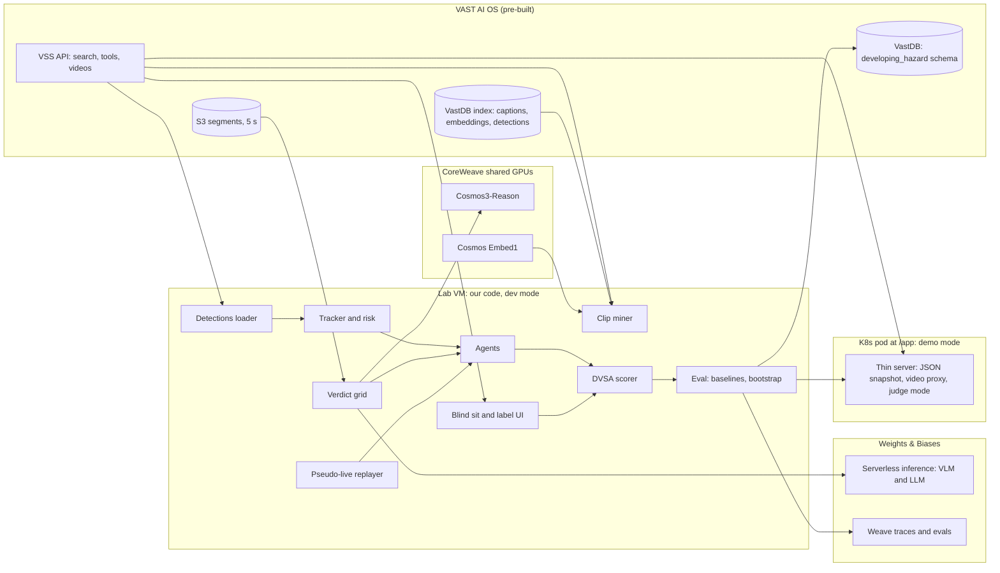

# SPEC-riyud1 - clips and labels (AG2 = `Riyu-D1`)

Your slice of SPEC.md. Where this file and SPEC.md disagree on *who does what*, this file wins. Where they disagree on *how something works*, SPEC.md wins and you flag it in your status file.

## RULES - read before doing anything

> 1. **Read `CONTEXT.md` first**, then this file, then `contracts/`.
> 2. Work only on a branch named **`ag2/phase-X`** created from the latest `main`.
> 3. **ONLY open a pull request into `main`. NEVER push to `main`. NEVER merge any PR, your own or anyone else's.** The Hackathon PR merge bot merges.
> 4. **Only edit the paths you own** (listed below and in CONTEXT.md). Touching any other path gets the PR rejected.
> 5. Update **`status/ag2.md`** (your own file only) inside the same PR. Never edit CONTEXT.md, SPEC*.md, `contracts/`, `Makefile` or `pyproject.toml` in a phase PR.
> 6. Do only the current phase. **When the phase's acceptance checks pass, open the PR, then stop and wait** for Moses to start the next phase.
> 7. Never commit secrets, tokens, `.env`, video, frames, or `data/clips/`, `data/frames/`.
> 8. If you need another agent's code that is not merged yet, stub it inside your own files against `contracts/examples/`. If a contract is wrong, open a separate PR labelled `contract-change` touching only `contracts/` and your status file, then carry on with your stub.
> 9. UK spelling, no em dashes, no invented numbers. Anything marked `[VERIFY-0930]` in SPEC.md is checked on the day, not assumed.


## Your paths

Own: `dh/clients/vss.py`, `dh/clients/vastdb.py`, `dh/clients/embed.py`, `dh/mine.py`, `dh/clips.py`, `dh/frames.py`, `dh/store.py`, `dh/api/labels.py`, `web/label.js`, `scripts/secret_scan.sh`, `mk/ag2.mk`, `tests/ag2/**`, `data/candidates.jsonl`, `data/clips.json`, `data/hazards.json`, `data/testset_v*.json`, `SUBMISSION.md`, `status/ag2.md`.

Read only: `dh/score.py`, `dh/config.py`, `data/proposals/`, `data/tracks/` (AG1); `dh/server.py`, `web/player.js`, `web/sit.js` (AG3, import only).

You provide to others (contract in `contracts/python_interfaces.md`): `dh.clients.vss.VSS`, `dh.clips` loaders, `dh.api.labels.router`, `web/label.js` exporting `mountLabel(el, clipId, api)`, and the files under your `data/` paths.

Your human also: scrubs the PIE sets, is labeller A on every clip, the only person who re-ingests anything (avoid it), writes the submission text, runs the secret scan.

Notes on the label screen: AG3 owns `web/index.html` and `web/app.js` and routes `#/label/:clipId` to your `mountLabel`. Reuse AG3's player by importing `./player.js`; do not copy or edit it. The server includes your router only in dev mode.

## Phase 1 - scaffolding, probes, stubs (09:30-10:30)

Tasks:
1. `dh/clients/vss.py` (SPEC 11.4): login, `search`, `stream`, `detections`, re-login on 401, timeouts 30 s / 120 s for video. `requests` only (the pod imports it). Never log the JWT or password.
2. `dh/clips.py`: loaders from `contracts/python_interfaces.md`, stdlib only, plus the 30 s chunk clip definition (7.2): six segments at offsets 0, 5, ... 25; onset at least 5 s in, else prepend the previous chunk.
3. Go/no-go probes (SPEC 20 row 09:30, 20.1 questions 1 and 4 with AG3): run the 10 queries from 7.1; open the VSS UI; count `pie_cam-3` chunks; start scrubbing set01 at 2x; count moving-ego developing hazards. Write numbers into `status/ag2.md`. If fewer than 8 usable hazards are likely, flag near-miss mode (20.2) to Moses by 10:00.
4. `dh/api/labels.py` skeleton: `router = APIRouter()` with the routes in `contracts/api_routes.md` owned by you, reading and writing `contracts/examples/` copies in a temp dir under test.
5. `web/label.js` v0: `export function mountLabel(el, clipId, api)` rendering the blind sit then timeline (16.4). Works against example data.
6. `mk/ag2.mk`: `mine`, `build`, `freeze`.

Files touched: only owned paths.

Acceptance:
- `python -c "import dh.clients.vss, dh.clips"` works with only `requests` installed.
- `pytest tests/ag2` passes: loaders read `contracts/examples/`; label routes round-trip a PUT and a POST with a FastAPI TestClient mounting only your router.
- Probe numbers and go/no-go answers 1 (and 4 if AG3 has it) in `status/ag2.md`.

Hands off: `dh.clients.vss` to AG1 (detections) and AG3 (video proxy); `dh.clips` to both; `mountLabel` to AG3.

## Phase 2 - real clips and labels (10:30-12:30)

Tasks (SPEC 20 rows 10:00-12:30, 13):
1. `dh/mine.py` (7.1): search plus scrubbing sets 2-6; 20+ candidate chunks (moving ego, onset >= 5 s) into `data/candidates.jsonl`. Never rank by YOLO risk.
2. `make build`: `data/clips.json` with dev/test split (aim 6 dev, 14+ test), joined local clips (`data/clips/`, gitignored) via ffmpeg concat.
3. `dh/frames.py` (7.3) at 5 fps into `data/frames/` (gitignored), for AG1's Cosmos inputs.
4. Label routes for real: PUT/POST hazards, clip status, testset freeze. Only the API writes `data/hazards.json`; no hand edits while others label (17.2). `auto_window` and the other labeller's window stay hidden until the caller has saved.
5. `web/label.js` full: blind sit first, then window drag handles, type, description, labeller select (riyu, fmd, moses), "Add hazard", "Save", "No hazard in this clip", "Reject clip"; J/L step 0.2 s; risk curve and proposal only after save.
6. Labelling (13): label as labeller A, dev clips first. Track blindness in `Clip.seen_by`.
7. Apply arbitration; freeze `testset_v1` (MVP set) by 12:30 via `POST /api/testset/freeze`.

Acceptance:
- 10+ clips with agreed windows (22.1) in `data/hazards.json`, validated against `contracts/hazard.schema.json` in `tests/ag2`.
- `data/testset_v1.json` committed with its sha256.
- Label screen works end to end on the dev server.

Hands off: `data/clips.json`, `data/hazards.json`, `data/testset_v1.json` to AG1 (runs) and AG3 (clip list, scoring windows).

## Phase 3 - more clips, test-set freeze (12:30-14:00)

Tasks (SPEC 20 row 13:00-14:30):
1. Mine more; get blind sits from Moses and fmd; label 8-10 more (13.7, 13.8 mix).
2. `GET /api/clips/{clip_id}/proposal` serving AG1's `data/proposals/` after both labellers saved.
3. Agreement stats (13.5) into your status file.
4. **Freeze `testset_v2` at 14:00** (10.6): commit file and hash. After this, no label or window changes.
5. `dh/store.py` and `dh/clients/vastdb.py` (7.13, 10.10): schema `developing_hazard`, table `hazards`. Never write to `vss-collection`, `vss-prompts-events`, or the chunks or segments buckets.
6. `dh/clients/embed.py` "more like this" (7.1 should) only if mining is short.

Acceptance: `data/testset_v2.json` merged by 14:05 with sha256; selection-bias rule (14.6) stated in the PR body.

Hands off: frozen test set to AG1 (final runs) and AG3 (judge clips).

## Phase 4 - checks, VastDB, submission (14:00-15:30)

Tasks (SPEC 20 row 14:30-15:30, 14.5, 25):
1. Sanity checks (14.5) with AG1's numbers; write results in your status file.
2. Write `runs` and `hazard_scores` tables to VastDB from AG1's run files (10.10), keyed by segment `source`.
3. `scripts/secret_scan.sh` over the full history; result in the PR body. Decide repo access for reviewers with Moses.
4. `SUBMISSION.md`: one-liner, 150-word description, stack, honest limitations line (25).

Acceptance: secret scan clean; `SUBMISSION.md` ready to paste; no label changes after 14:00.

Hands off: submission text to the humans for 15:30-16:20.


---

# Reference: verbatim extracts from SPEC.md

Everything below is copied unchanged from SPEC.md so this file stands alone. Headings keep their SPEC numbers. Ownership and file paths in these extracts are superseded by the "Your paths" section above and by CONTEXT.md (for example, `NOTES.md` becomes your status file, tests live under `tests/ag2/`, and `dh/cli.py` is replaced by `mk/ag2.mk` targets calling `python -m dh.<module>`).

### 0.1 Assumption markers

Anything we have not verified is tagged:

- **[ASSUMPTION]** - we believe it but have not checked. Check on the day.
- **[VERIFY-0930]** - must be checked in the first hour; plan changes if wrong.
- **[PRIOR-EVENT]** - seen in code or on a project page from the San Francisco or New York event in this series. Probably still true in London. Confirm at 09:30 before building on it.
- **[UNVERIFIED]** - from a third party or our own inference. Do not quote on stage.
- **[S1]**, **[S2]** ... - a source from 0.3. Each tag is a link.

We do not cite any statistic we have not verified. No made-up users, quotes or numbers. Source text is paraphrased; quotes are short.

### 5.1 Infra

- Cursor on our laptops, connected via Remote-SSH to a lab VM (`bc-<username>` host). The `vast-builders-challenge` repo, skills and credentials live on the VM [S7]. **[VERIFY-0930]** one VM each or one shared? If one each, share code and small JSON through git and make one VM the data box.
- Credentials and endpoints are environment variables from `/config/<team>.config` [S10]. List names with `env | cut -d= -f1 | sort`; never print values [S15].
- One video ingestion instance, one index and one set of credentials per team. Anything a teammate ingests appears for everyone [S7].
- Health check: "run a git pull", then "check that everything is working". If broken, `/ask-cosmos` writes a note that we post ourselves on the Cosmos community [S7].
- `/build-day-quickstart` gives a guided run [S7].
- Deploy with `/deploy-app-no-registry`, view at workshop.thecosmoslabs.com, click **App** [S7], [S13].
- At SF the VM had no `pip` and no `kubectl`. The fix was `python3 -m venv --without-pip` plus get-pip, and kubectl in `~/.local/bin` [PRIOR-EVENT] [S21].

### 5.4 Skills

| Skill | Our use |
|---|---|
| `login` | JWT for every retrieval route [S12] |
| `search` | Find candidates by text, filtered to `camera_id = pie_cam-3` |
| `list-metadata` | Check filter values exist before searching |
| `videos` | Stream a segment (`/videos/stream?source=...&token=...`, Range-capable); read its detections and metadata |
| `agent-qa` / `tools/*` | `tools/segments` for captions and timing per chunk |
| `dashboard` | What is indexed; `pie_cam-3` chunk count |
| `suggest-prompts` | Ideas for queries at 09:30 |
| `vastdb-read` / `vastdb-write` | Bulk reads; our own tables (7.13) |
| `gpu/model-health`, `gpu/model-smoke-test` | Endpoint checks at 09:30 |
| `deploy-app-no-registry` | Deploy (6.4) |
| `reingest-videos` / `reingest-chunk` | Not planned. If ever: one chunk, scenario `live_driving` [S9], Riyu only |

### 5.5 Footage [S9]

| Source | `camera_id` | Location | Indexed | Our use |
|---|---|---|---|---|
| PIE drives | `pie_cam-3` | toronto | 6 drive sets (`set01`-`set06`) | **Primary.** Ego-vehicle dashcam |
| I-24 / 3D traffic | `i24_cam-1` | nashville | ~51 multi-cam highway clips | Not ego view. Stretch: cross-source failure test |
| Neighbourhood cars | `neighborhood_cam-1` | neighborhood | 2 day merges | Not ego view. Not used for scoring |
| SF streets | `sf_streets_cam-1`..`4` | san_francisco | "ingesting soon" | Not ego view |
| Warehouse | `sdg_warehouse_cam-2` | warehouse3 | ~178 clips | Not used |
| Smart spaces | `smartspace_cam-1` | indoor | ~102 clips | Not used |

What earlier teams found on `pie_cam-3` [PRIOR-EVENT]:

- 180 chunks: 30 consecutive 30 s chunks per set, so about 90 minutes in all, named like `<timestamp>_set06_video_chunk_0003.mp4` [S21]. Evidence Atlas counted the same 1,080 clips [S33].
- YOLO is noisy on this footage (it reports cows, kites and airplanes) and person counts are low [S21].
- Captions rarely say what the camera car does. In one sample of 180 segments, 59% mentioned it, 18% said it slowed, 7% that it stopped and 2% that it yielded [S21].
- The top pedestrian hit they quoted shows the camera car stopped at a junction while people cross [S21]. That is not a developing hazard (13.2).

PIE is the Pedestrian Intention Estimation dataset (York University): downtown Toronto, daytime, a dashboard camera with a 157 degree lens, 1920x1080 at 30 fps [S28]. The paper describes pedestrian boxes, crossing intention and per-frame ego speed from an OBD sensor [S28]; the annotations repo is MIT-licensed [S29]. None of it is in our index, and we do not use it without organiser approval (26).

The London corpus may differ. The `reingest-chunk` skill's example filename is a London walk, which hints at new sources [UNVERIFIED]. Check the dashboard at 09:30: UK driving footage would beat Toronto for a UK test.

Rule: **Don't ingest videos from the internet.** [S7] We use only the provided corpus.

### 5.6 Hard constraints that shape the design

1. The only ego-view source is PIE, unless London adds one. Hazard perception needs ego view. So the product lives or dies on PIE. **[VERIFY-0930]**
2. Captions are written per 5 s segment and describe the whole segment, including its future. Use them for retrieval only: never as ground truth, never as agent input.
3. Per-frame YOLO boxes are stored [PRIOR-EVENT]. Detection on a frame uses only that frame, so replaying stored boxes in time order leaks nothing. If they are missing, call `$YOLO_URL/v1/infer` once per 5 s segment.
4. Cosmos costs seconds per call on a shared endpoint. Compute verdicts once on a time grid (12.3), at most 2 calls in flight.
5. Team shares one index: no re-ingest; one person owns anything that touches it.
6. The deployed app is a ConfigMap of about 1 MiB in total, run on `python:3.12-slim` with pip at start [S13]. No media and no heavy compute in the pod.
7. Do not write our media into the chunks or segments buckets: they feed the ingest pipeline [S9]. **[ASSUMPTION]** a write there would trigger ingest into the shared index. Ask before writing anywhere in S3.

### 6.1 Overview



### 6.2 Offline vs live

There are two phases.

**Prepare (on the VM, before evaluation):**

1. Mine candidate chunks.
2. Everyone who has not seen a chunk sits it blind once (13.3).
3. Two labellers mark windows independently; agree or arbitrate.
4. Load stored detections, track, compute risk.
5. Compute the Cosmos verdict grid (12.3).
6. Freeze the test set (`testset_vN.json`).

**Sit the test (pseudo-live):**

1. Replayer releases frames in time order on a simulated clock.
2. Agent sees only frames up to now, decides whether to click.
3. A blocking call moves the clock on by its latency, and frames inside that time are skipped. A non-blocking result arrives at send time plus latency.
4. Scorer marks clicks against frozen windows.
5. Results go to Weave, VastDB and the app's JSON snapshot.

### 6.4 Deployment

The same FastAPI app runs in two places:

| Mode | Where | Data | Used for |
|---|---|---|---|
| `dev` | Lab VM under `uvicorn`, opened in the laptop browser through Cursor's port forwarding **[VERIFY-0930]** | read-write `data/` in the repo | Blind sits, labelling, our own runs |
| `demo` | K8s pod via `/deploy-app-no-registry` [S13] | read-only JSON snapshot in the ConfigMap | Judges: watch, leaderboard, judge mode |

Labels are only ever written in `dev` mode, straight into the repo. Every code update restarts the pod [S13], and anything stored in it is lost.

What the deploy skill fixes for us [S13]:

- Public image `python:3.12-slim`; code and data from a ConfigMap, about 1 MiB in total; `requirements.txt` installed at container start. At SF the first ~15 s after a restart returned errors while pip ran [PRIOR-EVENT] [S21].
- Listen on `0.0.0.0:$PORT`; serve `/health` for the readiness probe.
- Ingress path `/app` on `video-lab-team-<N>.cosmos.vastdata.com`. The prefix is stripped, so the app routes from `/`. Every browser URL must be relative (`api/clips`, not `/api/clips`).
- Code change: recreate the ConfigMap, then `rollout restart`.
- At NYC and SF the pod could not resolve the public `$INGRESS_URL`; teams used `http://video-backend-service.<team>.svc.cluster.local:8000` [PRIOR-EVENT] [S20], [S21]. **[VERIFY-0930]**
- For SSE through the nginx ingress, set the `proxy-buffering: "off"` annotation and a longer `proxy-read-timeout`. CrossWise set both [S20].

Pod budget: code plus JSON snapshot under 900 KB. Track overlays keep the top 3 tracks per frame at 5 fps, coordinates to 3 decimals. `make deploy` fails over budget. Pod dependencies: `fastapi`, `uvicorn`, `requests`. No numpy, no OpenCV, no weave.

Video never sits in the pod. The app proxies `/api/v1/videos/stream` with the JWT kept server-side and Range headers passed through, as CrossWise did [S20].

### 7.1 Clip miner (`dh/mine.py`) - MVP

**Purpose:** find 30 s chunks where the camera car is moving and something develops that would make a careful driver slow down or steer.

**Inputs:** VSS search, `tools/segments` captions, VastDB rows via `vastdb-read`, human scrubbing.

**Method:**

1. Run a fixed list of text queries via `POST /api/v1/search` with `metadata_filters: {"camera_id": "pie_cam-3"}`, `top_k: 30`, `llm_top_n: 1` and `min_similarity: 0.3` [S12]. `llm_top_n: 0` was rejected with a 422 at SF [PRIOR-EVENT] [S21]. Captions are written in US English, so the queries say "curb":
   - "the camera vehicle slows down as a pedestrian steps off the curb ahead"
   - "pedestrian starts to cross the road in front of the moving car"
   - "pedestrian walks out between parked cars"
   - "car pulls out of a side street in front of the camera vehicle"
   - "vehicle ahead brakes suddenly, brake lights on, gap closing"
   - "cyclist moves out into the lane ahead"
   - "the camera vehicle turns while pedestrians are crossing"
   - "vehicle cuts in front of the camera vehicle"
   - "parked car door opening into the road"
   - "bus pulling away from a stop ahead"
2. Group hits by parent chunk (`original_video`). Each search took about 6 s at SF [PRIOR-EVENT] [S21].
3. Similarity scores for good hits sat at 0.34-0.39 at SF and did not separate good from bad [S21]. Rank by caption keywords instead, after dropping negated sentences ("No pedestrians ... are visible") [S21]. Prefer captions that say the camera car is moving.
4. Output `candidates.jsonl`: one row per chunk, with the matching segment and second.

**Reliable path:** scrub. Each set is 30 consecutive chunks, about 15 minutes [PRIOR-EVENT] [S21]. Riyu watches all six sets at 2x in the VSS UI, about 45 minutes, and notes the chunk and second of every candidate. Search runs alongside and adds to the list.

**Should:** "more like this". Embed a confirmed hazard segment with Cosmos Embed1 (`request_type: "query"`, video as a base64 data URL [S11]) and rank `pie_cam-3` rows by cosine against their stored `vectors_visual`. Select that column explicitly: selecting all columns can crash the SDK [S14]. **[VERIFY-0930]** visual vectors exist for PIE rows.

**Not allowed:** ranking candidates by our own YOLO risk score. That picks the clips our YOLO agents are good at and biases the test towards them.

### 7.2 Clip definition (`dh/clips.py`) - MVP

**Purpose:** fix what a test clip is, without making new video files.

- A clip is one 30 s chunk: its six segment sources and their offsets (0, 5, ... 25 s) [PRIOR-EVENT].
- Hazard onset should be at least 5 s into the clip, so the viewer has settled. If it is earlier, add the previous chunk of the same set (a 60 s clip), or pick another chunk.
- Clip time 0 is the start of the first segment. Every time in our data is clip time.
- On the VM, download the segments with `/videos/stream` and join them with ffmpeg (`-f concat -c copy`) for frame decoding and Cosmos inputs. **[VERIFY-0930]** ffmpeg on the VM; segments join without re-encoding.
- The browser plays the segments back to back with two `<video>` elements, swapping on `ended`, as CrossWise did [S20]. If `/videos/stream` also serves the parent chunk (`source=<original_video>`), use that **[VERIFY-0930]**.

Why 30 s: TRL's trial tests ran 13 scenarios in 10-12 minutes [S5], so roughly 45-55 s each by our arithmetic. Windows are short against the clip. Short clips make random clicking pay (14.5). 30 s is the corpus unit, so it is also free.

### 7.3 Frame extractor (`dh/frames.py`) - MVP

- ffmpeg at 5 fps to JPEG (quality 3, 960 px wide). Configurable `FPS_SAMPLE`.
- Output `data/frames/<clip_id>/000001.jpg` plus `frames.json` with clip-time timestamps.
- Needed only for Cosmos inputs, contact sheets and thumbnails. Detection does not need frames (7.4).

### 7.7 Window proposer (`dh/windows.py`) - should

Auto-propose a scoring window per hazard from tracks. **Labellers do not see it until they have saved their own window.** That keeps labels free of YOLO's view and makes proposer-vs-human error an honest secondary result.

- **Hazard track:** the track whose risk peaks highest in the clip, above 0.6.
- **Window start (onset):** first frame where the hazard track heads into the ego path (heading_in for 3 consecutive sampled frames, or enters the outer corridor margin).
- **Window end:** first frame the hazard track is inside the inner corridor: the point where the hazard is obvious [S5], [S6]. Not closest approach; by then it has long been obvious.
- Clamp window length to 1-7 s, the range used when the test was built [S5]. Flag anything outside.
- Output proposed windows with confidence.

### 7.8 Blind sit and labelling UI (`/label` screen, dev mode) - MVP

See 13 for protocol and 16.4 for the screen. A labeller's first view of a clip is always a blind sit (13.3).

### 7.13 Persistence (`dh/store.py`) - should

- Local: JSON files under `data/`. Always. This is the source of truth.
- VastDB: the `vastdb-write` skill creates schemas and tables in the team bucket and recommends a new schema for app data [S14]. CrossWise wrote its decisions to its own table this way [S20]. We write schema `developing_hazard` (10.10) from the VM after each frozen run.
- Key rows by segment `source` so they join with `vss-collection` (captions, embeddings). That is the VAST story: the benchmark is a dataset next to the index.
- Never write to `vss-collection` or `vss-prompts-events` [S14].

## 8. DVSA rules as we implement them

### 8.1 Rules

| # | Rule | Source | Our implementation |
|---|---|---|---|
| R1 | Each developing hazard has a scoring window, from the earliest sign it is developing to the point it is obvious | [S5], [S6] | `Hazard.window_start`, `Hazard.window_end` |
| R2 | Window divided into five equal parts, 5 to 1 points | [S5] | integer-ms bands (9.1) |
| R3 | Click outside the window scores 0 for that hazard | [S5] | yes |
| R4 | Only the first response in the window is scored (it is also the best) | [S5] | first click in window |
| R5 | Clicking continuously or in a pattern scores 0 for the clip | [S1], [S4] | pattern rules (9.3) |
| R6 | The click allowance is a set number, the same for every clip | [S4] | P1 is a fixed cap, not tied to hazard count |
| R7 | The candidate learns of R5 only at the end of the clip, when an X appears | [S4] | sit screen shows the X after the clip |
| R8 | Every clip has at least one developing hazard; one has two | [S1], [S3] | every test clip has a hazard; at least one has two |
| R9 | One viewing only | [S1] | replayer is one pass; sit screen has no controls |

[ASSUMPTION] Live DVSA clips still use five equal bands. That is how the test was built [S5]; current clip parameters are not published.

### 8.2 Things DVSA does that we do not

- CGI clips since 2015 [S3]. Ours are real Toronto dashcam footage, 30 s each, with no UK road furniture.
- Windows set from trial participants' responses plus expert judgement [S5]. Ours are set by two of us, blind to each other and to the auto proposal (13).
- A pass mark: 44 of 75 for cars [S2]. Ours is not the DVSA test, so we never say "pass". The leaderboard shows 44/75 (58.7%) as a reference line labelled "DVSA car pass rate, for reference only".
- A click allowance kept secret on purpose [S4], [S37]. Ours is published in the app (9.3), so ours can be gamed in a way DVSA's cannot. The matched-chance baseline (14.3) is how we show nobody is gaming it.

### 8.3 Left-hand vs right-hand traffic

Toronto drives on the right. Hazard perception concepts (pedestrian stepping out, car pulling out) are the same. The ego corridor is symmetric so it does not matter for the risk model. Mention once if asked.

## 10. Data model

All files are JSON or JSONL under `data/`. Pydantic models in `dh/models.py`. Times are seconds of clip time, 3 decimals, unless named `_abs`. The scorer converts to integer ms (9.1). Numbers in the examples below are placeholders.

### 10.1 `Candidate`

```json
{
  "candidate_id": "pie_set03_c0014",
  "camera_id": "pie_cam-3",
  "location": "toronto",
  "original_video": "s3://<team>-vss-chunks/<team>/<ts>_set03_video_chunk_0014.mp4",
  "set": "set03",
  "chunk_index": 14,
  "segments": ["s3://<team>-vss-chunks-segments/segments/<ts>_set03_video_chunk_0014_segment_001_of_006.mp4", "..."],
  "found_by": "search",
  "queries": ["pedestrian starts to cross the road in front of the moving car"],
  "hit_second": 17.5,
  "search_score": 0.37,
  "caption_snippet": "...",
  "ego_moving": true,
  "status": "new"
}
```

`found_by`: `search | scrub | embed`. `status`: `new | rejected | sat_blind | labelled | frozen`.

The filename and URI formats are [PRIOR-EVENT] [S21]: map to whatever the London index uses.

### 10.2 `Clip`

```json
{
  "clip_id": "c07",
  "candidate_id": "pie_set03_c0014",
  "camera_id": "pie_cam-3",
  "original_video": "s3://<team>-vss-chunks/<team>/<ts>_set03_video_chunk_0014.mp4",
  "segments": [
    {"source": "s3://..._segment_001_of_006.mp4", "start_s": 0.0, "end_s": 5.0},
    {"source": "s3://..._segment_002_of_006.mp4", "start_s": 5.0, "end_s": 10.0}
  ],
  "duration_s": 30.0,
  "fps_native": 30,
  "fps_sample": 5,
  "local_path": "data/clips/c07.mp4",
  "split": "test",
  "seen_by": ["riyu"],
  "notes": ""
}
```

`local_path` is the joined file on the VM only (gitignored). `seen_by` lists who has watched the clip outside a blind sit (the miner, an arbitrator). Their human runs on that clip are not blind.

`split`: `dev` (used to tune thresholds) or `test` (frozen, used for leaderboard). Aim: 6 dev, 14+ test. Never tune on test. Say this on stage; it is the line an evals judge listens for.

### 10.3 `Det` (one detection)

```json
{"t": 6.4, "frame": 192, "cls": "person", "conf": 0.82, "xyxy": [812, 402, 861, 540]}
```

`frame` is the native frame index within the clip; `xyxy` is in pixels of the native frame.

### 10.4 `Track` (per frame state)

```json
{
  "track_id": 4, "t": 6.4, "cls": "person",
  "xyxy": [812, 402, 861, 540],
  "vx": -41.0, "vy": 3.0, "h_rate": 0.21,
  "in_corridor": false, "heading_in": true,
  "ttc": 3.8, "t_lat": 1.6, "risk": 0.57
}
```

### 10.5 `Hazard`

```json
{
  "hazard_id": "c07_h1",
  "clip_id": "c07",
  "type": "pedestrian_crossing",
  "window_start": 16.2,
  "window_end": 19.0,
  "labellers": {"riyu": [16.0, 19.1], "fmd": [16.4, 18.9]},
  "agreed": true,
  "arbitrated_by": null,
  "auto_window": [15.8, 19.6],
  "track_id": 4,
  "segment_sources": ["s3://..._segment_004_of_006.mp4"],
  "description": "Pedestrian steps out from between parked cars on the right"
}
```

`auto_window` is filled in only after both labellers have saved. `type` enum: `pedestrian_crossing | vehicle_pulling_out | vehicle_cut_in | lead_vehicle_braking | cyclist | vehicle_turning_across | other`.

### 10.6 `TestSet`

```json
{
  "testset_id": "testset_v2",
  "frozen_at": "2026-10-17T14:00:00+01:00",
  "clips": ["c01", "c02"],
  "hazards": ["c01_h1", "c02_h1", "c02_h2"],
  "scorer_version": "score_v1",
  "pattern_version": "PATTERN_V1",
  "sha256": "..."
}
```

Frozen means the file is committed and its hash recorded in every run.

### 10.7 `Run`

```json
{
  "run_id": "r_2026-10-17T14-02-11_yolo_cosmos_gate",
  "agent": "yolo_cosmos_gate",
  "agent_config": {"theta_trig": 0.45, "max_calls": 4, "verifier": "cosmos", "prompt": "cosmos_verify_v2"},
  "testset_id": "testset_v2",
  "testset_sha256": "...",
  "scorer_version": "score_v1",
  "pattern_version": "PATTERN_V1",
  "latency_mode": "measured",
  "git_sha": "...",
  "mode": "fast",
  "started_at": "...",
  "weave_url": "...",
  "totals": {"score": 41, "max": 75, "pct": 0.547, "hit_rate": 0.8, "pattern_rate": 0.0, "lift_vs_chance": 0.31, "median_reaction_s": 0.9, "mean_latency_s": 1.4}
}
```

### 10.8 `ClipResult`

```json
{
  "run_id": "...", "clip_id": "c07",
  "clicks": [{"t": 16.9, "t_trigger": 16.0, "latency_s": 0.9, "reason": "cosmos: pedestrian entering lane"}],
  "calls": [{"kind": "cosmos", "t_sent": 16.0, "grid_t": 16.0, "latency_s": 0.9, "blocking": true, "verdict": "HAZARD"}],
  "pattern": {"flag": false, "reasons": []},
  "hazard_points": {"c07_h1": 4},
  "clip_score": 4,
  "risk_curve": [[0.0, 0.05], [0.2, 0.06]],
  "explanation": null
}
```

### 10.9 `HumanSession`

```json
{"session_id": "h_...", "name": "Judge 1", "role": "judge", "blind": true, "clip_id": "c07", "clicks": [16.9], "ua": "...", "created_at": "..."}
```

`role`: `team | judge | guest`. `blind` is false if the person has seen the clip before, from `Clip.seen_by` or because they say so. Only blind sessions count as a human baseline. Names are whatever the person types. Default "Anonymous". Do not store emails.

### 10.10 VastDB tables (should)

Schema `developing_hazard` in `$VASTDB_BUCKET`, created with the `vastdb-write` pattern [S14]:

| Table | Columns |
|---|---|
| `hazards` | hazard_id (str), clip_id, type, window_start, window_end, segment_source (joins `vss-collection.source`), original_video, labeller_a, labeller_b, agreed, testset_id |
| `runs` | run_id (str), agent, agent_config (json str), testset_id, testset_sha256, scorer_version, pattern_version, latency_mode, git_sha, score, max, pct, hit_rate, pattern_rate, lift_vs_chance, median_reaction_s, mean_latency_s, weave_url |
| `hazard_scores` | run_id, clip_id, hazard_id, points, first_click_t, window_start, window_end, latency_s |
| `human_sessions` | session_id, role, blind, clip_id, clip_score, created_at (no names) |

Demo: read `hazards` and the matching `vss-collection` rows by `source`, and show our window next to the caption Cosmos wrote for the same 5 s. The SDK selects one table at a time, so join in Python [ASSUMPTION].

### 10.11 Directory layout of `data/`

```
data/
  candidates.jsonl
  clips.json
  clips/          c01.mp4 ...          VM only, gitignored
  frames/         c01/000001.jpg ...   VM only, gitignored
  det/            c01.jsonl
  tracks/         c01.jsonl
  hazards.json
  humans.jsonl
  testset_v1.json
  grid/           cosmos_verify_v2/c01.jsonl
  runs/           <run_id>/run.json, <run_id>/clips.jsonl
  snapshot/       what the pod serves (make snapshot)
  cache/explain/  <hash>.json
```

Media is gitignored. JSON is committed so teammates share labels. `det/` and `grid/` are committed too: they are small, and anyone can re-run evals from them without the endpoints.

### 11.1 Endpoints

| Method | Path | Purpose | Mode | MVP |
|---|---|---|---|---|
| GET | `/health` | readiness probe [S13] | both | yes |
| GET | `/api/health` | `{ok, vss_ok, cosmos_ok, wandb_ok, testset_id, mode}` | both | yes |
| GET | `/api/clips` | list clips with split, duration, n_hazards, label status | both | yes |
| GET | `/api/clips/{clip_id}` | clip meta, segment list, hazards (hidden if `?blind=1`) | both | yes |
| GET | `/video?source=` | proxy to `/api/v1/videos/stream`; Range passed through; JWT server-side; only sources in our clip list | both | yes |
| GET | `/api/clips/{clip_id}/tracks` | per-frame top tracks for overlay | both | yes |
| GET | `/api/clips/{clip_id}/proposal` | auto window, only once both labellers have saved | dev | should |
| PUT | `/api/hazards/{hazard_id}` | save labeller window `{labeller, ws, we, type, description}` | dev | yes |
| POST | `/api/hazards` | add a hazard to a clip | dev | yes |
| POST | `/api/testset/freeze` | freeze agreed hazards into `testset_vN` | dev | yes |
| POST | `/api/runs` | `{agent, config, testset_id, latency_mode}` start a run; returns run_id | dev | yes |
| GET | `/api/runs` | list runs with totals | both | yes |
| GET | `/api/runs/{run_id}` | run detail with clip results | both | yes |
| POST | `/api/human` | `{name, role, blind, clip_id, clicks[]}` -> scored result | both | yes |
| GET | `/api/leaderboard` | best run per agent + blind humans, on current test set | both | should |
| POST | `/api/explain/{run_id}/{hazard_id}` | fetch a miss explanation (pod: precomputed only) | both | could |
| GET | `/api/runs/{run_id}/stream?clip=` | SSE: a recorded run's events, replayed in clip time | both | stretch |

The pod scores judge-mode clicks with the same pure-Python scorer. It keeps sessions in memory and also prints one `HUMAN {...}` line per session to stdout, so `kubectl logs` recovers them after a restart.

The old `/api/live` (run an agent live in the pod) is dropped: it would need numpy, frames and endpoint access inside the pod. The SSE replay of a recorded run shows the same events. Label it "recorded run, replayed in clip time".

### 11.4 Internal clients

| Client | File | Notes |
|---|---|---|
| VSS | `dh/clients/vss.py` | `$INGRESS_URL` + `/api/v1`; JWT from `POST /auth/login` with the team user and password; re-login on 401 [S12]. In the pod, the in-cluster URL (6.4) |
| VastDB | `dh/clients/vastdb.py` | data VIP `$S3_ENDPOINT` with `$ACCESS_KEY`, `$SECRET_KEY`, `$VASTDB_BUCKET` [S14]. Name columns explicitly; never pull vector columns by accident |
| Detections | `dh/dets.py` | `/videos/detections?source=` (7.4) |
| YOLO (fallback) | `dh/clients/yolo.py` | `$YOLO_URL/v1/infer`, bearer token [S11] |
| Cosmos Reason | `dh/clients/cosmos.py` | `$COSMOS3_REASON_URL/v1/chat/completions`, bearer `$GPU_BEARER_TOKEN`, model id from `/v1/models` [S11], [S22] |
| Cosmos Embed | `dh/clients/embed.py` | `$COSMOS_EMBED1_URL/v1/embeddings`, `request_type: "query"`; must return 256 dims [S11] |
| W&B inference | `dh/clients/wandb_llm.py` | OpenAI client with `base_url="https://api.inference.wandb.ai/v1"`, `api_key=$WANDB_API_KEY`, `project=f"{WANDB_TEAM}/{WANDB_PROJECT}"` for attribution [S26]. CrossWise used exactly this [S20] |

Every client: timeout (VSS 30 s, 120 s for video; Cosmos 30 s; LLM 30 s), 2 retries with jitter, wrapped in `@weave.op`. Never log a bearer token, JWT or password [S15].

## 13. Labelling protocol

### 13.1 Who

- Riyu mines, so she has seen every clip. She is labeller A and never counts as a blind human.
- fmdplt33 sits each clip blind, then labels it. Labeller B.
- Moses sits each clip blind and does not label. He arbitrates disagreements, after his blind sit.

Every clip gets two independent windows and two blind team runs. If roles change, keep the rule: nobody labels or arbitrates a clip before their blind sit of it.

### 13.2 Definition of a developing hazard (our working definition)

> Something that would make a careful driver of the camera car change speed or direction, and that develops over time in view (it does not appear from nowhere in the last few frames).

Adapted in our own words from the DVSA definition [S1]. DVSA's own example: a parked car is not a developing hazard; once its indicator comes on and it starts to pull away, it is [S1]. Include:

- Pedestrian moving from kerb into the road ahead.
- Vehicle pulling out of a side road or driveway into or across our path.
- Lead vehicle braking hard.
- Cyclist moving out into our lane.
- Vehicle turning across our path at a junction.
- Pedestrian crossing the road we are turning into.

Exclude (these are "potential" not "developing"):

- Pedestrian standing on the pavement who does not move towards the road.
- Parked cars that stay parked.
- Traffic in other lanes keeping its lane.
- Oncoming traffic that stays its side.
- Anything that happens while our car is stopped and stays stopped, such as people crossing in front of us at a red light. We do not change speed or direction. If we are moving off, it counts.

### 13.3 Blind first view

Everyone's first view of a clip is a blind sit on the label screen: the clip plays once, no controls, Space to click, as in the real test [S1]. The clicks are saved as a `HumanSession` with `blind: true`. Only then does the labelling view open.

Why: it costs about 35 s per clip per person and gives every test clip two blind human runs before anyone has seen a window. It also follows how the test was built: windows were checked against where people actually responded [S5].

### 13.4 Window rules

Use the definitions from when the test was built [S5], [S6]:

- **Start:** the earliest frame at which a careful driver could see the hazard starting to develop: the pedestrian turns towards the road or steps to the kerb edge; the car's front starts to move out; the indicator starts; brake lights come on with the gap closing. If the hazard is hidden and then emerges, the first frame it can be seen [S5].
- **End:** the frame at which the hazard has become obvious: the pedestrian is in the carriageway, the car is in our lane, the gap is visibly collapsing [S5], [S6]. Not closest approach, and not the last moment to brake.
- Expect 1-7 s [S5]. The UI warns outside that range; the labeller can override with a note.
- Play at 0.5x. J/L step 0.2 s. Drag handles.
- Write a one-line description.
- Do not look at the auto proposal or the other labeller's window until yours is saved.

### 13.5 Agreement

- Two windows agree if start differs by <= 0.6 s and end by <= 0.8 s. Final window = mean.
- If they disagree, Moses picks one, edits it, or moves the hazard to dev. Record it in `arbitrated_by`.
- If neither labeller finds a clear developing hazard, move the clip to `dev` as a no-hazard control or reject it. DVSA clips always contain a hazard [S1], so no-hazard clips never enter the test score. They measure false clicks on calm footage.
- Report agreement simply as "x of y windows agreed within tolerance". Do not over-sell.
- Keep both labellers' windows: 14.4 rescores every run with each.

### 13.6 Blindness

- Agents never see labels. `ClipMeta` has no hazard fields, scoring is a separate step that the sitting code never calls (12.1), and a test checks that nothing in `dh/agents/` imports the label store, the VSS client or caption fields (Appendix F).
- Captions and segment-level counts summarise a whole 5 s segment, future included. No agent may read them.
- Labellers label after their blind sit, and before seeing any agent result on that clip.

### 13.7 Time budget

- Blind sit: about 35 s per clip per person, so about 12 minutes each for Moses and fmdplt33 over 20 clips.
- Labelling: target 3 minutes per clip per labeller including scrubbing. 20 clips x 2 labellers = 2 person-hours. That is why labelling is split across the morning (section 20).

### 13.8 Mix of clip types (target)

| Type | Target count |
|---|---|
| Pedestrian crossing / stepping out | 8 |
| Vehicle pulling out / turning across | 5 |
| Lead vehicle braking | 3 |
| Cyclist | 1-2 if found |
| Two-hazard clip | at least 1 |
| No-hazard control (dev only) | 2-3 |

Accept whatever the footage gives. PIE is pedestrian-heavy by design [S28]. At SF, Dashi's search found no convincing hits for pulling out from the kerb or following distance, and one for turning across a crossing [S21]. Vehicle hazards will come from scrubbing, if at all.

### 14.4 Uncertainty and label noise

With ~15-20 hazards, differences of a few points are noise. We show:

- Bootstrap 90% interval on each agent's pct (1000 resamples over clips).
- **Paired** bootstrap for every comparison that goes on stage: resample clips once, score both agents on the same sample, report the interval of the difference. Overlapping marginal intervals do not answer "is A better than B"; this does (Appendix E).
- **Label sensitivity:** rescore every run with labeller A's windows and with labeller B's. Show the range. If two agents swap places between them, say so.
- We say "small test set" out loud. It is more credible than pretending.

### 14.5 Sanity checks before showing anything

- **Gaming check, on dev, before 12:30.** Plot `random@k` against k. Our own simulation of one hazard in a random place: with 6 random clicks, a 15 s clip with a 5 s window gives about 3.4 of 5 points on average; a 30 s clip gives about 2.2 [UNVERIFIED: our simulation, not data]. That is why clips are 30 s (7.2). If `random@6` gets close to `yolo_risk` on dev, windows are too wide or clips too short. Fix it before freezing.
- `yolo_naive` should have a high pattern_rate. If it does not, the corridor is too small or the rules too loose; check, but do not rig.
- **Verifier false alarms.** On dev grid points with no labelled hazard within 3 s, what share does Cosmos call HAZARD? At NYC a team that asked Cosmos directly whether a clip showed a near miss got yes on 168 of 180 clips [S31]. If ours looks like that, the gate is useless, and we say so.
- Blind humans should score reasonably. If blind teammates score near 0, our windows are wrong.
- Window proposal vs human-agreed window: report mean absolute error of start and end. Valid only because labellers did not see the proposal (7.7). A secondary result: "YOLO tracks can propose a hazard window to within x s".

### 14.6 Selection bias

- Clips are found by caption search and human scrubbing, never by our YOLO risk (7.1).
- Windows are set by humans who have not seen the proposal (13.4).
- Hazards YOLO cannot see stay in the test. A detector scoring 0 on a hazard it never boxed is a finding.

### 16.1 Principles

- Dark UI. Background `#0d0f12`, panels `#15181d`, borders `#262a31`, text `#e6e8eb`, muted `#8b929c`.
- Accent colours carry meaning only: window bands amber `#f5a524`; agent clicks cyan `#22d3ee`; human clicks magenta `#e879f9`; pattern flag red `#ef4444`; points green `#22c55e`.
- Fonts: **not Inter.** Use `IBM Plex Sans` for UI and `IBM Plex Mono` for numbers and timestamps. Fallback `system-ui`. Self-host one weight of each as woff2 in `web/fonts/`; they count against the pod budget (6.4). Use system fonts if over budget. **[VERIFY-0930]** whether the deployed app can fetch Google Fonts.
- **No loading screens, no full-page spinners.** Everything renders immediately with whatever data exists; parts fill in as they arrive (SSE or polling). Empty states say what to do next in one line. Skeleton blocks are not used either: show the real layout with "-" values.
- Big type for the demo. Score numbers at least 48 px. Test on the projector resolution if we can (assume 1920x1080).
- Keyboard first: Space = click (hazard), P = play/pause, J/L = step back/forward 0.2 s in label mode.
- Every fetch and media URL is relative, and routes are hash routes (`#/sit/c07`), so the `/app` prefix cannot break them (6.4).

### 16.4 Label screen

- First view of each clip is a blind sit (13.3), using the sit screen's player. The labelling tools open after it ends.
- Video at top (native size, max 960 px wide). YOLO boxes overlay (canvas over video, synced via `requestVideoFrameCallback` where available, else `timeupdate`) is off until you save.
- Timeline under video: full clip length, labeller window as solid amber with drag handles. The risk curve and the auto-proposed window (dashed amber band) appear only after you save, so YOLO's view does not anchor the label (14.6).
- Fields: hazard type (select), description (one line), labeller (select: riyu, fmd; moses for arbitration).
- Buttons: "Add hazard", "Save", "No hazard in this clip", "Reject clip".
- Shows other labeller's window as a thin outline after you save (not before).

### 17.2 Branching

- `main` is always deployable after 13:00.
- Short-lived branches per person, merge often. No long PRs on the day; push and tell the others.
- Conflicts most likely in `data/hazards.json`. Rule: only the labelling API writes it; do not hand-edit while others label.
- Reviewers must be able to open the repo at submission [S16]. Decide by 12:00 whether it goes public; run `scripts/secret_scan.sh` over the full history first.

## 18. Environment and setup

### 18.1 Before the day (each person)

- [ ] Join the Cosmos Community (community.vastdata.com) and sign up. [S8]
- [ ] Sign up for Cursor with the same personal email used to register. Credits land on that email. [S8]
- [ ] Create a W&B account. [S8]
- [ ] Accept the GitHub invite to this repo.
- [ ] Personal laptop and charger.
- [ ] Read SUMMARY.md and sections 9, 13, 20 and 21 of this spec.
- [ ] Optional: install ffmpeg and Python 3.11 locally for offline work if the VM is slow.

### 18.2 On arrival (08:30-09:30)

- [ ] Sit together, pick the assigned team number in the portal. One shared team. It can only be chosen once [S7].
- [ ] Each person: follow the lab page, set up SSH, connect Cursor via Remote-SSH to `bc-<username>`, open `vast-builders-challenge`.
- [ ] Set Cursor agent model to Auto to save credits. [S7]
- [ ] Confirm Cursor credits show as Free at cursor.com/dashboard/usage. If not, use the request form linked in the README. [S7]
- [ ] In Cursor: "run a git pull" then "check that everything is working".
- [ ] Open the Video Search & Summary UI from the lab page; search "pedestrian crossing in front of the car" filtered to Toronto.

### 18.3 Repo on the VM

```bash
cd ~
git clone https://github.com/mosesman831/developing-hazard.git   # needs a token or gh auth on the VM
cd developing-hazard
python3 -m venv --without-pip .venv && . .venv/bin/activate
python -m pip --version || curl -fsSL https://bootstrap.pypa.io/get-pip.py | python   # SF VMs had no pip [S21]
pip install -e .
make test
```

**[VERIFY-0930]** Can we reach GitHub and PyPI from the VM? If not: develop inside `vast-builders-challenge/tools/developing-hazard` and copy code via Cursor; push from a laptop later.

GitHub auth on the VM: use a fine-grained token scoped to this repo only, or push from laptops. Do not put a token in the repo.

`kubectl` may be missing; at SF a team installed it in `~/.local/bin` [S21].

### 18.4 Python dependencies (`pyproject.toml`)

- fastapi, uvicorn, pydantic>=2, requests, numpy, opencv-python-headless, pillow, weave, wandb, openai (for OpenAI-compatible endpoints), typer, python-dotenv, pytest.
- Optional: supervision (ByteTrack); vastdb and pyarrow (7.13) [S14].
- Pod: `requirements-pod.txt` only (6.4).
- System: ffmpeg. **[VERIFY-0930]** present on VM.

### 18.5 Environment variables

| Var | From | Used by |
|---|---|---|
| `INGRESS_URL`, `USERNAME`, `PASSWORD` | team config [S10] | VSS client |
| `GPU_BEARER_TOKEN` | team config [S11] | Cosmos, YOLO, Embed clients |
| `COSMOS3_REASON_URL`, `YOLO_URL`, `COSMOS_EMBED1_URL` | team config; else the gpu skill's host [S11] | GPU clients |
| `S3_ENDPOINT`, `ACCESS_KEY`, `SECRET_KEY`, `VASTDB_BUCKET`, `VDB_SCHEMA`, `VDB_COLLECTION` | team config [S10] | VastDB client |
| `S3_CHUNKS_BUCKET`, `S3_SEGMENTS_BUCKET` | team config [S10] | read only; never write (5.6) |
| `WANDB_API_KEY`, `WANDB_TEAM`, `WANDB_PROJECT` | VM env [S10] | weave, W&B inference |
| `DH_MODE` | ours: `dev` or `demo` | server |
| `DH_FPS_SAMPLE` | ours, default 5 | dets, frames |
| `DH_DATA_DIR` | ours, default `./data` | all |
| `DH_LLM_MODEL`, `DH_VLM_MODEL` | ours | llm and vlm agents, explainer |
| `PORT` / `DH_PORT` | `PORT` set by the Deployment in the pod [S13]; `DH_PORT` on the VM, default 8000 | server |

Team config lives at `/config/<team>.config` [S10]. Read env from there; never copy secrets into git. On zsh, `USERNAME` is a reserved shell variable, so the skills parse the config file for it rather than source it [S13], [S14]. Our code does the same.

### 18.6 Makefile targets

```
make test          # pytest
make mine          # candidates.jsonl
make build         # clips.json, local joined clips and frames
make detect        # detections cache from sidecars
make grid          # Cosmos verdict grid, 2 in flight
make propose       # windows, after labels
make serve         # dev server on DH_PORT
make run AGENT=yolo_risk SPLIT=dev
make eval SPLIT=test   # all agents, EvaluationLogger, baselines, bootstrap
make freeze        # freeze test set
make snapshot      # data/snapshot for the pod; fails over budget
make deploy        # deploy/deploy.sh
make smoke         # scripts/smoke.sh
```

## 19. Configuration defaults (single source: `dh/config.py`)

| Key | Default | Notes |
|---|---|---|
| fps_sample | 5 | stored boxes subsampled |
| det_conf_min | 0.35 | |
| min_box_h | 0.035 | fraction of frame height |
| corridor | bottom 25-75%, top 42-58% at y=55% | tune once on PIE |
| theta_up / theta_down | 0.6 / 0.4 | yolo_risk |
| ema_weight | 0.4 | weight on the new value |
| theta_trig | 0.45 | Cosmos agents |
| max_clicks | 3 | yolo_risk; 4 for async |
| min_click_gap_s | 1.5 | 1.2 for async |
| max_verify_calls | 4 | per clip |
| grid_step_s | 0.5 | where raw risk >= grid_risk_min |
| grid_risk_min | 0.3 | |
| verify_context_s | 2.0 | 8 frames at 4 fps |
| verify_in_flight | 2 | |
| llm_period_s | 0.5 | |
| pattern | `PATTERN_V1` (9.3) | P1 cap 8 clicks |
| window_len_bounds_s | 1-7 | [S5] |
| agree_tol_s | start 0.6, end 0.8 | |
| bootstrap_n | 1000 | |
| random_draws | 200 per k; 1000 for matched | |
| pod_budget_kb | 900 | 6.4 |

## 20. Timeline (Saturday 17 October 2026, all times BST)

Roles: **M** = Moses, **R** = Riyu-D1, **F** = fmdplt33. Role detail in section 21. Swap names if strengths differ; the split matters, not who.

The deadline is 16:30 and a demo video is required [S16], so code freezes at 15:30. The first draft froze at 16:00 and submitted at 16:30, which left no time for the video.

| Time | M (lead, agents + eval) | R (data + labelling) | F (app + deploy) | Gate |
|---|---|---|---|---|
| 08:30-09:30 | Arrive, infra, Cursor SSH, health check | Same; open VSS UI; dashboard: count `pie_cam-3` chunks | Same; read the deploy skill; install kubectl if missing | Everyone connected |
| 09:30-10:00 | Probe: sidecar on 2 PIE segments (frames, fps, pedestrians boxed?); 10 Cosmos verify calls (latency, model id, `video_frames` accepted?); one W&B inference call; `weave.init`. Numbers in `NOTES.md` | Run the 10 queries; start scrubbing set01 at 2x; count moving-ego hazards | Hello-world deploy to `/app`; stream one segment through the pod's proxy; check port forwarding from the VM | **Go / no-go at 10:00** (see 20.1) |
| 10:00-11:00 | `score.py` + tests first, `replay.py`, `dets.py`, `track.py` | Scrub sets 2-6; pick 20+ candidate chunks (moving ego, onset >= 5 s); `candidates.jsonl` | Server skeleton, video proxy, two-element player, blind sit + label screen v0 (dev mode) | Tests pass; 12+ candidates |
| 11:00-12:00 | 11:00-11:15 blind sits. Then `risk.py`, `yolo_naive`, `yolo_risk`, baselines | Label as labeller A, dev clips first | 11:00-11:15 blind sits. Then label as labeller B | First scored dev run by 12:00 |
| 12:00-12:30 | Gaming check (14.5); tune pattern rules on blind human clicks; freeze `PATTERN_V1`; start the verdict grid in the background; arbitrate label disagreements | Apply M's arbitration; freeze `testset_v1` | Watch screen v0 from run files; `make snapshot` | **MVP: 10 clips, windows, detector clicks + scores, app shows it** |
| 12:30-13:00 | Lunch (eat at the desk if behind) | Lunch | Deploy MVP | MVP deployed |
| 13:00-14:30 | `yolo_cosmos_gate`, then `yolo_cosmos_async`; latency sweep; `vlm_wb` if Cosmos is slow | Mine, get blind sits (M, F), label 8-10 more; freeze `testset_v2` at 14:00; VastDB tables | Judge mode, human scoring endpoint, leaderboard v0 | Test set frozen 14:00 |
| 14:30-15:30 | Final runs on test via EvaluationLogger; bootstrap, matched chance, label sensitivity; `llm_wb` only if all else is done | Sanity checks (14.5); submission text; secret scan; repo access for reviewers | Leaderboard, pass-rate line, Weave links, polish dark UI; final deploy | **Numbers final 15:30** |
| 15:30-16:00 | Pick demo clip and the miss; record the demo video with F | Screenshots; fill in the submission form | Record and upload the demo video; smoke test on the deployed URL | **Code freeze 15:30** |
| 16:00-16:20 | Submit | Submit | Check every link opens logged out | **Submitted by 16:20** |
| 16:20-16:30 | Rehearse the table walkthrough | Rehearse | Rehearse | Buffer |
| 16:30-18:30 | Demos and judging | | | |

### 20.1 Go / no-go at 10:00

Answer four questions:

1. Are there at least 8 usable developing hazards in PIE with the camera car moving? If fewer: switch to **near-miss mode** (20.2).
2. Do per-frame boxes exist for PIE segments, with pedestrians boxed in most frames? If not: call `$YOLO_URL/v1/infer` per segment; if that is slow too, run agents at 2 fps and say so.
3. Is the median Cosmos verify call under ~3 s? If not: lead with `yolo_cosmos_async` and the latency curve, and bring `vlm_wb` forward as a second verifier. "Verification costs X points of latency" is still the finding.
4. Does a segment play through the pod's proxy? If not: demo clips play from the VM dev server through port forwarding, and the pod shows results only. Tell judges honestly.

### 20.2 Near-miss mode (fallback A)

Use any clip with a close interaction (pedestrian or vehicle close to the ego path), even if not calm first, and accept the camera car moving off from a stop. Window still from the first sign to the point it is obvious. Same scorer. Story unchanged.

### 20.3 Fallback B: wrong footage

If PIE is missing or not ego view: use SF street or neighbourhood cams with a fixed "virtual ego zone" (a polygon on the road) and ask "would a car at this spot need to react?". Weaker story. Decide by 10:15. **[ASSUMPTION]** we will not need it.

### 20.4 Fallback C: total infra failure

Stay on laptops with ffmpeg + a local YOLO (ultralytics `yolo11n`) on CPU on a few clips we can legally use. **We cannot use internet video**, so this only works if organisers let us download provided segments. Ask on Cosmos immediately via `/ask-cosmos`.

### 21.4 Shared rules

- Say in the team chat before touching someone else's file.
- Every 30 minutes, 1-line status in team chat: done, next, blocked.
- If blocked for 15 minutes, ask a teammate. 30 minutes, ask organisers / `/ask-cosmos`.
- Nobody re-ingests without telling Riyu.
- Nobody watches a clip outside a blind sit unless they mined it (13.1).

## 22. MVP vs stretch

### 22.1 MVP (by 12:30)

- 10 clips with agreed windows and two blind team runs each.
- `yolo_naive`, `yolo_risk` and the random baselines, scored with the full DVSA scorer including the pattern rules.
- Deployed app: clip list, watch screen with boxes, windows and clicks, score.
- Tests for the scorer.

If only MVP ships, the demo still works: "YOLO clicking on presence trips the allowance and scores 0; clicking on change scores X of Y, Z above a random clicker with the same clicks".

### 22.2 Stretch, in priority order

1. Verdict grid and `yolo_cosmos_gate` with latency counted.
2. Frozen 15-20 clip test set.
3. Weave EvaluationLogger comparison.
4. Judge mode in the pod.
5. Leaderboard screen with intervals and the pass-rate line.
6. Paired bootstrap and label sensitivity (cheap; high value for the evals judge).
7. `yolo_cosmos_async` and the points-versus-latency curve.
8. Results in VastDB.
9. `vlm_wb` second verifier.
10. Miss explanations via W&B LLM.
11. `llm_wb` agent.
12. SSE replay of a recorded run.
13. Cross-source test on I-24 (expected to fail; that is the point).

### 22.3 Cut list (if behind at 14:30)

Cut from the bottom of 22.2 upwards. Never cut: scorer tests, the matched-chance baseline, frozen test set, deploy, demo video.

## 23. Risks and mitigations

| # | Risk | Likelihood | Impact | Mitigation | Owner |
|---|---|---|---|---|---|
| 1 | Too few moving-ego developing hazards in ~90 min of PIE | Medium | High | Scrub all six sets 09:30-11:00; near-miss mode; accept moving-off cases | R |
| 2 | Cannot get segment video onto the VM | Low | High | `/videos/stream` worked at NYC [S20]; ask at 09:30 | R |
| 3 | Per-frame boxes missing, or pedestrians not boxed | Medium | High | Check at 09:30 (7.4); YOLO endpoint fallback; a detector scoring 0 on hazards it never saw is a finding | M |
| 4 | Shared endpoints slow or rate-limited | Medium | Medium | Verdict grid once, 2 in flight; cache; fewer grid points | M |
| 5 | Cosmos too slow for "real-time" | High | Medium | Async agent; latency curve; present as a finding | M |
| 6 | Cosmos says HAZARD to almost everything | Medium | Medium | Structured prompt (A.1); false-alarm check on dev (14.5); `vlm_wb` as comparison | M |
| 7 | Cosmos rejects `video_frames` or our extra parameters | Medium | Low | Fall back to a 2 s mp4 data URL with default sampling | M |
| 8 | Captions wrong | High | Low | Never use captions as truth or as agent input | R |
| 9 | Footage is Canadian, not UK | Certain | Low | Hazard perception concepts are universal; say it once | M |
| 10 | Windows are subjective | Certain | Medium | Two blind labellers, tolerance, agreement reported, label sensitivity (14.4) | R |
| 11 | Random clicking scores well | Medium | High | 30 s clips; gaming check before freeze; lift over matched chance on every row | M |
| 12 | Test set biased towards YOLO | Medium | Medium | Mine by search and scrubbing only; proposal hidden from labellers (14.6) | R |
| 13 | Pattern rule seen as invented or tuned to zero YOLO | Medium | Medium | Grounded in [S4]; tuned on blind human clicks only; frozen before test runs; shown in UI | M |
| 14 | Deploy path unfamiliar | Medium | High | Hello-world deploy at 09:30 | F |
| 15 | Pod cannot reach VSS or play video | Medium | High | In-cluster service URL (6.4); fallback: demo from the VM dev server | F |
| 16 | ConfigMap over ~1 MiB | Medium | Medium | Snapshot budget check; trim tracks; system fonts | F |
| 17 | Labels lost when the pod restarts | High if labelling in the pod | High | Label only in dev mode on the VM, straight into git | F |
| 18 | VM cannot reach GitHub / PyPI | Low-Med | Medium | Work in the pre-cloned repo folder; push from laptop; get-pip if pip is missing | F |
| 19 | Re-ingest breaks the shared index | Low | High | Do not re-ingest; if needed, one chunk, Riyu only | R |
| 20 | Our media written to a pipeline bucket gets ingested | Low | High | Never write to the chunks or segments buckets (5.6) | all |
| 21 | Overclaiming on stage | Medium | High | No unverified stats; say "small test set"; never say "pass" (8.2) | M |
| 22 | Missing the 16:30 deadline or the required video | Medium | High | Code freeze 15:30; video 15:30-16:00; submit by 16:20 | F |
| 23 | Wi-fi / projector issues at demo | Medium | High | The demo video doubles as backup; local copy of screenshots | F |
| 24 | "Internet video" rule ambiguity ([a prior team used Wikimedia footage](https://tokensand.com/p/vision-zero-agent-1)) | - | - | Do not use any. Ask organisers if we want to add anything | M |
| 25 | Running out of Cursor credits | Low | Medium | Model on Auto; top-up form in README | all |

## 25. Submission checklist

Submit at https://tokensand.com/vastlondon -> "Submit your project". Deadline 16:30 BST [S16].

Required [S16]:

- [ ] A GitHub repository reviewers can access (public, or reviewers added). Secret scan first.
- [ ] A short demo video with a shareable link. Recorded 15:30-16:00; check it opens logged out.
- [ ] What we built and the tools we used.
- [ ] Team names and contact emails.

Welcome [S16]:

- [ ] Working website: the workshop portal App link.
- [ ] Screenshots: sit screen result, watch screen with Cosmos answer, leaderboard, miss explained.

Ours:

- [ ] Project name: Developing Hazard
- [ ] One-liner: "An AI sits the UK hazard perception test on real dashcam footage."
- [ ] Team members and GitHub handles
- [ ] Weave project link (make shareable if required) **[VERIFY-0930]**
- [ ] Stack used: VAST AI OS (VSS search, videos, VastDB), Cosmos3-Reason, Cosmos Embed1, YOLO11 on CoreWeave, W&B inference + Weave, Cursor
- [ ] Short description (150 words, drafted in SUMMARY.md style)
- [ ] Honest limitations line: small test set, our own windows, non-UK footage

## Appendix D. Window proposer pseudocode

```python
def propose(tracks_by_id, corridor, clip_len):
    best = None
    for tid, states in tracks_by_id.items():
        peak = max(states, key=lambda s: s.risk)
        if peak.risk < 0.6:
            continue
        if best is None or peak.risk > best[1].risk:
            best = (tid, peak)
    if not best:
        return None
    tid, peak = best
    states = tracks_by_id[tid]
    onset, run = None, 0
    for s in states:
        run = run + 1 if (s.heading_in or s.in_outer_margin) else 0
        if run >= 3:
            onset = s.t - 0.4   # back to the first of the 3 frames at 5 fps
            break
    if onset is None:
        onset = peak.t - 3.0
    # end = first moment the hazard is obvious: inside the inner corridor [S5], [S6]
    obvious = next((s for s in states if s.t > onset and s.in_inner_corridor), peak)
    ws, we = max(0.0, onset), min(clip_len, obvious.t)
    conf = 1.0
    if not (1.0 <= we - ws <= 7.0):
        conf = 0.4
        we = min(ws + 7.0, max(we, ws + 1.0))
    return {"track_id": tid, "window": [ws, we], "confidence": conf}
```

## Sources

[S1]: https://www.gov.uk/theory-test/hazard-perception-test
[S2]: https://www.gov.uk/theory-test/pass-mark-and-result
[S3]: https://www.gov.uk/government/news/hazard-perception-clips-get-a-modern-makeover
[S4]: https://assets.publishing.service.gov.uk/media/5a78e203e5274a2acd18a860/dsa-ia0043612a.pdf
[S5]: https://www.trl.co.uk/uploads/trl/documents/TRL558.pdf
[S6]: https://www.trl.co.uk/uploads/trl/documents/PPR2071-Validation-of-CGI-hazard-perception-clips.pdf
[S7]: https://github.com/vast-data/vast-builders-challenge/blob/main/README.md
[S8]: https://github.com/vast-data/vast-builders-challenge/blob/main/BEFORE_YOU_BUILD.md
[S9]: https://github.com/vast-data/vast-builders-challenge/blob/main/ARCHITECTURE_REFERENCE.md
[S10]: https://github.com/vast-data/vast-builders-challenge/blob/main/config.example
[S11]: https://github.com/vast-data/vast-builders-challenge/blob/main/.cursor/skills/gpu/README.md
[S12]: https://github.com/vast-data/vast-builders-challenge/tree/main/.cursor/skills/retrieval
[S13]: https://github.com/vast-data/vast-builders-challenge/blob/main/.cursor/skills/deployment/deploy-app-no-registry/SKILL.md
[S14]: https://github.com/vast-data/vast-builders-challenge/tree/main/.cursor/skills/vast-database
[S15]: https://github.com/vast-data/vast-builders-challenge/blob/main/.cursor/rules/build-day.mdc
[S16]: https://tokensand.com/vastlondon
[S17]: https://luma.com/vastlondon
[S18]: https://tokensand.com/vastsf/projects
[S19]: https://tokensand.com/vastnyc/projects
[S20]: https://github.com/sairamveereddy/CROSSWISE
[S21]: https://github.com/vaishnav-16/dashi
[S22]: https://docs.nvidia.com/nim/vision-language-models/1.7.0/examples/cosmos-reason3/api.html
[S23]: https://docs.nvidia.com/vss/latest/
[S24]: https://docs.coreweave.com/products/wandb/weave/guides/evaluation/evaluation_logger
[S25]: https://docs.coreweave.com/inference/models
[S26]: https://docs.coreweave.com/products/inference/serverless/api-reference
[S27]: https://pypi.org/project/weave/0.53.12/
[S28]: https://openaccess.thecvf.com/content_ICCV_2019/papers/Rasouli_PIE_A_Large-Scale_Dataset_and_Models_for_Pedestrian_Intention_Estimation_ICCV_2019_paper.pdf
[S29]: https://github.com/aras62/PIE
[S30]: https://tokensand.com/p/blackbox
[S31]: https://tokensand.com/p/warehouse-best-buddy
[S32]: https://tokensand.com/p/closecall
[S33]: https://tokensand.com/p/evidence-atlas
[S34]: https://tokensand.com/p/grabbit-mining-co
[S35]: https://arxiv.org/abs/2609.08130
[S36]: https://arxiv.org/abs/2601.03369
[S37]: https://ico.org.uk/media2/migrated/decision-notices/401338/fs_50115678.pdf
