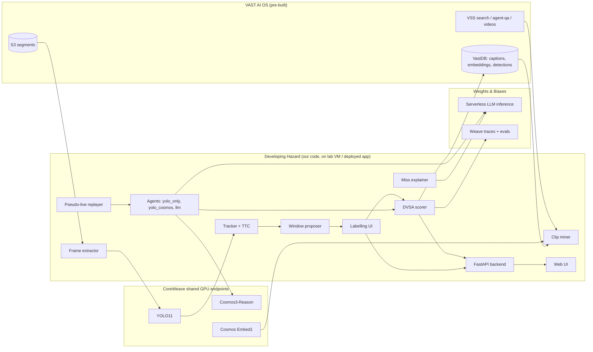
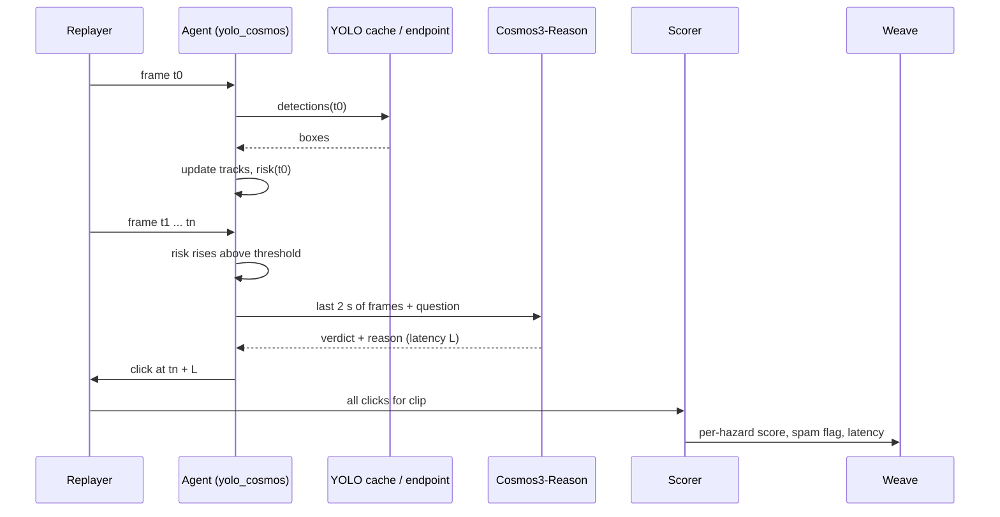

# Developing Hazard - full specification

> An AI sits the UK hazard perception test on real dashcam footage.

| Field | Value |
|---|---|
| Event | VAST Builders Challenge London - Real-Time Video Agents Hack |
| Date | Saturday 17 October 2026 |
| Doors | 08:30 |
| Build starts | 09:30 |
| Submissions / demos | from 16:30 (submit at https://tokensand.com/vastlondon, "Submit your project") |
| Close | 18:30 |
| Hosts | tokens& with VAST Data |
| Partners | NVIDIA, CoreWeave, Weights & Biases, Cursor, SpaceXAI |
| Team | Moses (mosesman831), Riyu-D1, fmdplt33 |
| Repo | github.com/mosesman831/developing-hazard (private) |
| Status | Pre-event spec. Written 15 Oct 2026. |

## 0. How to read this document

- **Sections 1-4**: why, who, judging fit.
- **Sections 5-12**: what we build: architecture, components, data, APIs, algorithms.
- **Sections 13-15**: labelling, evaluation, Weave.
- **Section 16**: frontend.
- **Sections 17-19**: repo, setup, config.
- **Sections 20-23**: day plan, roles, MVP vs stretch, risks.
- **Sections 24-26**: demo, submission, open questions.
- **Appendices**: prompts, pseudocode in full, glossary, checklists.

### 0.1 Assumption markers

Anything we have not verified is tagged:

- **[ASSUMPTION]** - we believe it but have not checked. Check on the day.
- **[VERIFY-0930]** - must be checked in the first hour; plan changes if wrong.
- **[SOURCE: x]** - taken from a named source.

Verified sources used for this spec:

- `vast-data/vast-builders-challenge` README.md (build day guide)
- `vast-data/vast-builders-challenge` BEFORE_YOU_BUILD.md
- `vast-data/vast-builders-challenge` ARCHITECTURE_REFERENCE.md
- DVSA public guidance on the hazard perception test (gov.uk). Exact wording to be re-checked; see 8.1.

We do not cite any statistic we have not verified. No made-up users, quotes or numbers.

### 0.2 Style rules for this repo

- UK spelling. Direct. No filler.
- No em dashes. Use hyphens.
- Code comments say why, not what.

---

## 1. Problem

### 1.1 The one-line problem

Video agents are usually judged on *what* they see. Real-time video agents also have to decide *when* to act, and acting too early, too late or too often are all failures. There is no simple, familiar benchmark that tests that timing.

### 1.2 The benchmark we borrow

Great Britain's driving theory test includes a hazard perception section run by DVSA. A candidate watches video clips filmed from a car and clicks when they see a *developing hazard*: something that would make the driver take action, such as changing speed or direction. [SOURCE: DVSA guidance]

Key properties of the scoring [SOURCE: DVSA guidance, re-check exact wording]:

- Each developing hazard has a scoring window.
- The window is split into five parts. Clicking in the first part scores 5, then 4, 3, 2, 1. Clicking outside the window scores 0 for that hazard.
- Only the best click in the window counts; you cannot lose points for clicking several times in a sensible way.
- If you click continuously or in a pattern, the clip scores 0 for that clip.
- You only see each clip once and cannot review it.
- The car test has 14 clips; one clip has two developing hazards, so 15 hazards, 75 marks maximum. [ASSUMPTION: from memory of public guidance; re-check before quoting the pass mark on stage. If unsure, do not quote a pass mark.]

This rule set is almost exactly what a real-time video agent needs:

- Reward early detection.
- Punish late detection.
- Punish spam (high recall, zero precision).
- One pass, no peeking at the future.

### 1.3 Why it matters beyond the joke

- Fleet dashcam vendors, driver-coaching tools and ADAS teams all need "warn at the right moment" behaviour. A system that warns constantly gets ignored.
- Video agent builders at this event mostly build search and summary. Our project tests the harder real-time decision on the same stack.
- It produces a scored, reproducible eval in Weave, which is what an evals-minded judge wants to see.

We do not claim any of these industries will buy this. The demo stands on the benchmark.

### 1.4 What we are not doing

- Not building a driving policy.
- Not claiming DVSA endorsement. We use the public scoring rules, not DVSA clips (we do not have them and must not use internet video).
- Not training a model. No time and no need.

---

## 2. Users and stakeholders

### 2.1 Primary user for the demo: the judge

They will see 3 minutes. They must understand the idea in one sentence and see a number go up or down.

### 2.2 Imagined users (framing only)

| User | What they want | What we give them |
|---|---|---|
| Video agent builder | A way to tell whether their agent acts at the right moment | A DVSA-style scorer and a harness that replays clips as pseudo-live |
| Driver coaching / fleet safety product teams | Evidence their alerting is early but not noisy | Per-hazard timing scores and spam detection |
| Learner drivers (playful) | "Can I beat the AI?" | Judge mode: human clicks the same clip |

[ASSUMPTION] These are framings. We have not spoken to any of these users. Say so if asked.

### 2.3 Stakeholders on the day

- Judges (section 4).
- tokens& organisers: want working apps deployed on the stack and submitted on time.
- Sponsors: want their product visibly used.

---

## 3. Goals and non-goals

### 3.1 Goals (must)

1. A set of at least 10 test clips pulled from the team index, each with a scoring window.
2. A pseudo-live replay harness: the agent only sees frames up to time t.
3. At least one agent (YOLO-only) that clicks and is scored by a faithful DVSA-style scorer including the anti-pattern rule.
4. A deployed web app via `/deploy-app-no-registry` that shows a clip, its window, and the agent's clicks and score.

### 3.2 Goals (should)

5. YOLO + Cosmos Reason verification agent with latency counted.
6. Weave evaluation and leaderboard across agents.
7. Judge mode: a human clicks while the clip plays, scored the same way.

### 3.3 Goals (could)

8. W&B-hosted LLM agent as a third competitor.
9. Miss explanations written by an LLM from the trace.
10. Results persisted to VastDB.
11. Cross-source test (I-24 or neighbourhood cam) to show generalisation or failure.

### 3.4 Non-goals

- Re-ingesting the corpus at volume.
- Training or fine-tuning.
- Perfect labels. ~20 clips hand-labelled by two people is the target.
- Mobile layout.

---

## 4. Judging fit

### 4.1 Judges [SOURCE: event page, as researched before the event]

| Judge | Org | What they will likely care about |
|---|---|---|
| Abubakr Karali | NVIDIA (Metropolis) | Real-time video analytics, smart-city and traffic use, proper use of Cosmos and detection |
| Brian Verkley | VAST Data | Using the VAST AI OS: index, VastDB, DataEngine; data as a product |
| Ram Bansal | VAST Data | Same as above; a working app on their stack |
| Junaid Butt | Weights & Biases | Evaluation design, Weave traces, honest comparisons |

[ASSUMPTION] "likely care about" is inferred from their roles, not from anything they said.

### 4.2 Criteria we scored the idea against

Out of 80 (8 criteria x 10) in our pre-event ranking, Developing Hazard scored 65, the top of 10 ideas. Criteria:

1. Judge fit (London judges).
2. Fits the time (one day, not too small, not too big).
3. Advanced.
4. Unique (vs prior VAST hack projects).
5. Sponsor stack fit.
6. Demo-ability.
7. Measurable result.
8. Risk (inverse).

### 4.3 How each judge sees the stack in the demo

| Moment in demo | Judge it lands with |
|---|---|
| Clips found by semantic search over the VAST index | Verkley, Bansal |
| YOLO tracks drawn on the clip; Cosmos Reason verdict before click | Karali |
| Weave leaderboard with per-hazard scores, latency, traces | Butt |
| App deployed on the workshop stack | Everyone |

### 4.4 Uniqueness check

Prior VAST hack projects seen on tokens& project pages before this event: CrossWise, Drive Recap, BLACKBOX, Vision Zero Agent, ViZ Agent. They covered crossings, drive summaries, incident recording and road-safety analytics. None, as far as we found, scored an agent on timing against the DVSA rule. [ASSUMPTION: we read titles and summaries, not every repo.] Do not claim "first ever" on stage. Say "we haven't seen anyone do this at a VAST hack".

---

## 5. What the platform gives us

All from the build day guide and architecture reference. [SOURCE: vast-builders-challenge]

### 5.1 Infra

- Cursor on our laptops, connected via Remote-SSH to a lab VM (`bc-<username>` host). The repo `vast-builders-challenge`, skills and credentials live on the VM.
- One video ingestion instance, one index and one set of credentials per team. Anything a teammate ingests appears for everyone.
- Health check: "run a git pull", then "check that everything is working". If broken, `/ask-cosmos` writes a note that we post ourselves on the Cosmos community.
- `/build-day-quickstart` gives a guided run.
- Deploy with `/deploy-app-no-registry`, view at workshop.thecosmoslabs.com, click **App**.

### 5.2 Models (shared GPU endpoints on CoreWeave)

| Model | Role | Env var |
|---|---|---|
| NVIDIA Cosmos3-Reason (`nvidia/cosmos3-reason`) | Video understanding over segments | `$COSMOS3_REASON_URL` |
| YOLO11 (`yolo11s`) | Object detection | `$YOLO_URL` |
| NVIDIA Cosmos Embed1 | 256-dim text and visual embeddings | `$COSMOS_EMBED1_URL` |
| NVIDIA Canary-1B | ASR, not wired in | `$CANARY_1B_URL` |

- Each model has its own host and port. No auth token needed. See `.cursor/skills/gpu/` for how to call them.
- Endpoints are shared by every team. Expect contention. **[VERIFY-0930]** latency of a single YOLO call and a single Cosmos Reason call.

### 5.3 Pipeline

`S3 chunks -> Segmenter -> S3 segments -> Detector (YOLO11, classes, counts, bbox sidecars) -> Reasoner (Cosmos Reason) -> Embedder (Cosmos Embed1) -> VastDB writer`.

- The corpus is pre-segmented into short fixed-length clips. **[VERIFY-0930]** segment length (we assume about 5 s; the reference mentions ~5 s triptych neighbours).
- Re-ingest re-runs Detector to VastDB on existing segments only. We are told it takes a few minutes; in our planning we treat it as unreliable and avoid depending on it.
- `vastdb-read` skill queries the database directly.

### 5.4 Skills

| Skill | Our use |
|---|---|
| `search` | Find calm-then-hazard candidates by text, filter by `camera_id`, `location`, object class |
| `agent-qa` | Sanity questions about a clip |
| `videos` | Play a clip; read captions and detections; summarise a video |
| `dashboard` | Check what is indexed and ingest health |
| `suggest-prompts` | Ideas for queries at 09:30 |
| `reingest-videos` / `reingest-chunk` | Only if a key clip has no detections; one person only |
| `vastdb-read` | Pull detections and metadata in bulk |

### 5.5 Footage [SOURCE: architecture reference]

| Source | `camera_id` | Location | Indexed | Our use |
|---|---|---|---|---|
| PIE drives | `pie_cam-3` | toronto | 6 long drive sets (`set01`-`set06`) | **Primary.** Ego-vehicle dashcam, pedestrians at crossings |
| I-24 / 3D traffic | `i24_cam-1` | nashville | ~51 multi-cam highway clips | Not ego view. Stretch: cross-source failure test |
| Neighbourhood cars | `neighborhood_cam-1` | neighborhood | 2 day merges | Not ego view. Not used for scoring |
| SF streets | `sf_streets_cam-1`..`4` | san_francisco | "ingesting soon" | Not ego view |
| Warehouse | (see reference) | - | - | Not used |
| Smart spaces | `smartspace_cam-1` | indoor | ~102 clips | Not used |

Re-ingest scenarios available: `surveillance`, `traffic`, `live_driving`, `retail`, `warehouse`, `egocentric`, `sports`, `nhl`, `general`. If we must re-ingest a PIE chunk, use `live_driving`.

"PIE" is, we believe, the Pedestrian Intention Estimation dataset from York University, filmed in Toronto. [ASSUMPTION] Its original annotations (pedestrian crossing intention) are almost certainly not in our index. Do not rely on them.

Rule: **Don't ingest videos from the internet.** [SOURCE: README] We use only the provided corpus.

### 5.6 Hard constraints that shape the design

1. Only ego-view footage is the PIE set. Hazard perception needs ego view. So the product lives or dies on PIE. **[VERIFY-0930]**
2. Stored captions are written per segment by Cosmos following a generic prompt. They may not mention hazards and can be wrong. Use them for retrieval only, never as ground truth.
3. Stored YOLO detections may be per segment rather than per frame. **[VERIFY-0930]** If per frame bbox sidecars exist, use them. If not, call `$YOLO_URL` ourselves on sampled frames.
4. Shared GPU endpoints: we cannot run YOLO on every frame of every clip if latency is high. Sample at 5 fps for MVP.
5. Team shares one index: one person owns any re-ingest.

---

## 6. Architecture

### 6.1 Overview



### 6.2 Offline vs live

There are two phases.

**Prepare (offline, before demo):**

1. Mine candidate clips.
2. Extract frames.
3. Run YOLO, track, compute TTC.
4. Propose scoring windows.
5. Humans confirm or edit windows.
6. Freeze the test set (`testset_v1.json`).

**Sit the test (pseudo-live):**

1. Replayer releases frames in time order at real speed or faster (configurable).
2. Agent sees only frames up to now, decides whether to click.
3. Any verification latency is added to the click time.
4. Scorer marks clicks against frozen windows.
5. Everything is traced in Weave.

### 6.3 Sequence: one agent sits one clip



### 6.4 Deployment

- Dev: code on the lab VM in `~/developing-hazard` (cloned from our repo) alongside `vast-builders-challenge`.
- Backend: FastAPI (Python 3.11+). Single process.
- Frontend: static build served by FastAPI. Plain HTML + a small amount of JS (or Vite + React if someone is fast with it). **No loading screens** (section 16).
- Deploy with `/deploy-app-no-registry` from Cursor on the VM. **[VERIFY-0930]** what it expects: a Dockerfile? a port? a path prefix (`/app`)? The reference mentions "Deploy on K8s at `/app`". Build all routes relative so a path prefix does not break them.

### 6.5 Why this shape

- Caching YOLO output once and replaying it means agents are cheap to re-run and comparisons are fair (same detections for every agent).
- Cosmos calls are the expensive part, and they only happen at decision points, not every frame.
- Frozen test set means numbers do not drift during the afternoon.

---

## 7. Components

Each component lists: purpose, inputs, outputs, owner (see section 21), MVP or stretch.

### 7.1 Clip miner (`dh/mine.py`) - MVP

**Purpose:** find candidate clips where the scene is calm for a few seconds and then something develops.

**Inputs:** VSS search, VastDB rows via `vastdb-read`, Cosmos Embed text embeddings.

**Method:**

1. Run a fixed list of text queries via the `search` skill / API, filtered to `camera_id = pie_cam-3`:
   - "pedestrian stepping off the kerb in front of the car"
   - "person crossing the road ahead of the vehicle"
   - "pedestrian walking into the road"
   - "car pulling out from a side road"
   - "vehicle cutting in ahead"
   - "cyclist moving into the lane"
   - "vehicle braking suddenly ahead"
   - "pedestrian waiting at the kerb about to cross"
   - "parked car door opening"
   - "bus pulling away from a stop"
2. Keep top-k hits per query (k = 20). Deduplicate by segment id.
3. For each hit, also fetch the 1-2 segments before it (same video, adjacent timestamps). We need calm lead-in, and a hazard right at the start of a segment has no window start.
4. Rank candidates by: search score, number of person/vehicle detections rising across segments, and caption keywords. Do not trust captions for truth.
5. Output `candidates.jsonl`.

**Fallback:** if search is weak, scroll PIE sets in the `videos` skill and pick by eye. A human can find 10 good clips in 45 minutes of scrubbing at 2x. **[ASSUMPTION]**

### 7.2 Clip builder (`dh/clips.py`) - MVP

**Purpose:** turn 2-3 adjacent segments into one test clip of 10-25 s.

- Fetch segment files from S3 (via `videos` skill or the S3 env creds). **[VERIFY-0930]** how to download raw segment video.
- Concatenate with ffmpeg (`-f concat`, re-encode to H.264 if codecs differ).
- Record `clip_id`, source segment ids, `t0` offset of each segment within the clip.
- Target: hazard onset at least 4 s after clip start. DVSA clips are about a minute; ours are shorter. That is fine, say so.

### 7.3 Frame extractor (`dh/frames.py`) - MVP

- ffmpeg at 5 fps to JPEG (quality 3). Configurable `FPS_SAMPLE`.
- Output `data/frames/<clip_id>/000001.jpg` plus `frames.json` with timestamps.
- Also keep the clip's native fps for playback sync.

### 7.4 Detector client (`dh/yolo.py`) - MVP

- First try stored detections from VastDB / bbox sidecars. If per-frame boxes exist, map them to our frame timestamps.
- Else call `$YOLO_URL` per frame. Batch if the endpoint supports it. **[VERIFY-0930]** request format (see `.cursor/skills/gpu/`).
- Classes kept: person, bicycle, car, motorcycle, bus, truck, traffic light, stop sign, dog. Everything else dropped.
- Cache to `data/det/<clip_id>.jsonl`. Never call YOLO twice for the same frame.
- Concurrency limit 4 to be polite to the shared endpoint.

### 7.5 Tracker (`dh/track.py`) - MVP

- Simple IoU tracker with a constant-velocity Kalman (or ByteTrack-lite). We do not need SOTA. Write it in 80 lines or use `supervision`'s ByteTrack if installable. **[VERIFY-0930]** pip access on VM.
- Track state per frame: bbox, centre, width, height, velocity (px/s), scale rate (d log h / dt).

### 7.6 Ego path and risk features (`dh/risk.py`) - MVP

No calibration, no depth. Image-space heuristics only. Good enough for timing.

- **Ego corridor:** a trapezoid in the bottom-centre of the frame. Default: bottom edge from 25% to 75% of width; top edge from 42% to 58% at 55% of height. Tune per source once by eye. **[ASSUMPTION]**
- **Lateral heading:** is the track's centre x moving towards the corridor centre line? `heading_in = sign(cx - corridor_cx_at_y) != sign(vx)` and `|vx| > v_min`.
- **Inside corridor:** bottom-centre of bbox within trapezoid.
- **Looming / TTC proxy:** for an object of image height h, `TTC ~= h / (dh/dt)`. Smoothed over 0.6 s. Only meaningful when `dh/dt > 0`.
- **Lateral time to corridor:** `t_lat = distance_to_corridor_edge / |vx|` when heading in.
- **Risk score** in [0, 1] per track:

```
risk = w1 * inside_corridor
     + w2 * sigmoid((T_ttc - ttc) / s_ttc)
     + w3 * heading_in * sigmoid((T_lat - t_lat) / s_lat)
     + w4 * class_weight[cls]
```

Defaults: w1 = 0.3, w2 = 0.35, w3 = 0.25, w4 = 0.1; T_ttc = 3 s, s_ttc = 0.7; T_lat = 2 s, s_lat = 0.5. class_weight: person 1.0, bicycle 1.0, motorcycle 0.9, car 0.7, bus 0.7, truck 0.7, dog 1.0. All numbers are starting guesses. **[ASSUMPTION]**

- **Scene risk** = max over tracks.

### 7.7 Window proposer (`dh/windows.py`) - MVP

Auto-propose a scoring window per hazard from tracks, for a human to confirm.

- **Hazard track:** the track whose risk peaks highest in the clip, above 0.6.
- **Window start (onset):** first frame where the hazard track starts heading into the ego path (heading_in true for 3 consecutive sampled frames, or enters the outer corridor margin), minus 0 s.
- **Window end:** frame of closest point: max bbox height before it leaves the frame or exits the corridor, or the point the ego car visibly brakes (if we estimate ego motion; stretch).
- Clamp window length to 2-8 s. Flag anything outside for human review.
- Output proposed windows with confidence.

Why: DVSA windows start when a hazard first starts to develop and end when the driver would have to react too late. Our proxy is onset of heading-in to closest approach. State this proxy in the demo if asked.

### 7.8 Labelling UI (`/label` screen) - MVP

See 13 for protocol and 16.4 for the screen.

### 7.9 Replayer (`dh/replay.py`) - MVP

- Given a clip and an agent, emit frames in order with timestamps.
- Modes: `realtime` (sleep to match), `fast` (no sleep, simulated clock). Fast is used for evals; realtime for judge mode and the demo.
- Simulated clock: `t_sim` advances by the frame interval; when the agent makes a blocking call, `t_sim` advances by the measured wall latency of that call. This is how latency costs points without having to actually run slowly.
- The agent API only receives `(t, frame, detections_at_t)`. It cannot index ahead. Enforced by the replayer passing a generator, not a list.

### 7.10 Agents (`dh/agents/`)

All implement:

```python
class Agent(Protocol):
    name: str
    def reset(self, clip_meta: ClipMeta) -> None: ...
    def step(self, t: float, frame_path: str, dets: list[Det]) -> StepResult: ...
```

`StepResult = {click: bool, risk: float, note: str | None, calls: list[CallRecord]}`

#### 7.10.1 `yolo_naive` - MVP (the straw man)

Clicks whenever any person or vehicle is inside the corridor, with 0.5 s debounce. Expected to spam and score 0 on most clips. This is the "YOLO alone scores 0" moment. It must be honest: we do not rig it; it is the obvious naive policy.

#### 7.10.2 `yolo_risk` - MVP

- Clicks when scene risk crosses `theta_up` (0.6) after being below `theta_down` (0.4) (hysteresis).
- Max 3 clicks per clip. Min 1.5 s between clicks.
- These limits stop it from tripping the anti-pattern rule.

#### 7.10.3 `yolo_cosmos` - stretch (target before 14:30)

- Same trigger as `yolo_risk` but at a lower threshold (0.45) to get earlier candidates.
- On trigger, send the last 2 s of frames (or the current segment video) to Cosmos3-Reason with the verifier prompt (Appendix A.1).
- If verdict = HAZARD with confidence >= 0.6, click at `t_trigger + latency`.
- If NOT_HAZARD, suppress triggers on that track for 1.5 s.
- Cap Cosmos calls at 4 per clip.

#### 7.10.4 `llm_wb` - could

- Serverless LLM on W&B inference. Receives a text rendering of tracks each 0.5 s (class, position, heading, TTC). Responds CLICK or WAIT. Shows what a text-only reasoner does without pixels.
- Model choice: whatever is fast on W&B inference that day. **[VERIFY-0930]** list of models.

#### 7.10.5 `human` - should

- Judge mode clicks recorded from the browser with `performance.now()` relative to video `currentTime`. See 16.5.

### 7.11 Scorer (`dh/score.py`) - MVP

See section 9.

### 7.12 Miss explainer (`dh/explain.py`) - could

- For each hazard where an agent scored 0 or 1, build a context: window, agent clicks, risk curve summary, Cosmos verdicts, top tracks near window start.
- Send to W&B LLM with prompt Appendix A.3. Output 2-3 sentences.
- Cache the result. Show in results screen.

### 7.13 Persistence (`dh/store.py`) - could

- Local: JSON files under `data/`. Always.
- VastDB: write `runs` and `hazard_scores` tables via `vastdb-read` / the VastDB SDK if write access exists. **[VERIFY-0930]** whether our credentials can create tables. If not, skip and say results are in Weave.

### 7.14 Backend API (`dh/server.py`) - MVP

FastAPI. See section 11.

### 7.15 Frontend (`web/`) - MVP

See section 16.

---

## 8. DVSA rules as we implement them

### 8.1 Rules (to re-check against gov.uk on the morning)

| # | Rule | Our implementation |
|---|---|---|
| R1 | Each developing hazard has a scoring window | `Hazard.window_start`, `Hazard.window_end` |
| R2 | Window divided into 5 equal parts, 5 to 1 points | `points = 5 - floor(5 * (t - ws) / (we - ws))`, clamp 1..5 inside window |
| R3 | Click outside window scores 0 for that hazard | yes |
| R4 | Only highest-scoring click in the window counts | max over clicks in window |
| R5 | Clicking continuously or in a pattern scores 0 for the whole clip | anti-pattern detector (9.3) |
| R6 | Some clips contain more than one developing hazard | `hazards: list` per clip |
| R7 | One viewing only | replayer is one pass |

[ASSUMPTION] R2 "equal parts" is our reading. DVSA does not publish the exact window boundaries for its clips. Our windows are our own.

### 8.2 Things DVSA does that we do not

- Professionally filmed (later CGI) clips. Ours are real Toronto dashcam footage, shorter, with no UK road furniture.
- Expert-set windows. Ours are proposed by tracks and confirmed by two of us.
- Fixed pass mark. We report raw score and percentage. We do not say "pass" or "fail" unless we have verified the pass mark wording. Safer: "scored X of Y".

### 8.3 Left-hand vs right-hand traffic

Toronto drives on the right. Hazard perception concepts (pedestrian stepping out, car pulling out) are the same. The ego corridor is symmetric so it does not matter for the risk model. Mention once if asked.

---

## 9. Scoring algorithm

### 9.1 Per-hazard points

```python
def hazard_points(clicks: list[float], ws: float, we: float) -> int:
    if we <= ws:
        raise ValueError("bad window")
    best = 0
    seg = (we - ws) / 5.0
    for t in clicks:
        if ws <= t <= we:
            idx = min(int((t - ws) // seg), 4)   # 0..4
            best = max(best, 5 - idx)
    return best
```

Edge: a click exactly at `we` scores 1. A click before `ws` scores 0 even if it was "right" early: same as DVSA.

### 9.2 Per-clip score

```python
def clip_score(clicks, hazards, pattern_flag) -> int:
    if pattern_flag:
        return 0
    return sum(hazard_points(clicks, h.ws, h.we) for h in hazards)
```

### 9.3 Anti-pattern detection

DVSA does not publish its algorithm. **[ASSUMPTION]** We define a transparent one and show it in the UI. A clip is flagged if any rule fires:

| ID | Rule | Default |
|---|---|---|
| P1 | Too many clicks: `n_clicks > max(6, 3 * n_hazards + 3)` | - |
| P2 | Burst: more than 4 clicks in any 2.0 s span | 4 / 2 s |
| P3 | Regular rhythm: at least 5 clicks with inter-click interval coefficient of variation < 0.15 | 0.15 |
| P4 | Coverage: clicks spread over more than 70% of the clip in 1 s bins (more than 70% of bins contain a click) | 70% |

```python
def pattern_flag(clicks: list[float], n_hazards: int, clip_len: float) -> tuple[bool, list[str]]:
    reasons = []
    c = sorted(clicks)
    if len(c) > max(6, 3 * n_hazards + 3):
        reasons.append("P1_too_many")
    j = 0
    for i in range(len(c)):
        while c[i] - c[j] > 2.0:
            j += 1
        if i - j + 1 > 4:
            reasons.append("P2_burst"); break
    if len(c) >= 5:
        gaps = [b - a for a, b in zip(c, c[1:])]
        mu = sum(gaps) / len(gaps)
        sd = (sum((g - mu) ** 2 for g in gaps) / len(gaps)) ** 0.5
        if mu > 0 and sd / mu < 0.15:
            reasons.append("P3_rhythm")
    bins = max(1, int(clip_len))
    hit = {int(t) for t in c if 0 <= t < clip_len}
    if len(hit) / bins > 0.7:
        reasons.append("P4_coverage")
    return (len(reasons) > 0, reasons)
```

Tune once against human clicks in the morning so a normal anxious human (3-5 clicks per clip) does not get flagged. If a judge gets flagged in judge mode, that is funny, not a bug; but check.

### 9.4 Test-level aggregates

- `total = sum(clip_score)`, `max_total = 5 * total_hazards`, `pct = total / max_total`.
- `hit_rate` = hazards with points >= 1 / total hazards.
- `mean_points_when_hit`.
- `pattern_rate` = clips flagged / clips.
- `false_clicks` = clicks not in any window (before pattern rule).
- `median_lead_s` = median of `(we - first_click_in_window)` for hits: how much warning the agent gave before closest approach.
- `mean_latency_s` for agents with verification calls.

### 9.5 Latency accounting

`t_click = t_trigger + sum(latency of blocking calls made at that trigger)`.

- Measured wall time, not estimated.
- Reported separately so we can also show "what the score would be with zero latency" (`score_oracle_latency`). This is the "Cosmos too slow" finding if it happens.

### 9.6 Worked example

Window 6.0 s to 9.0 s, so each part is 0.6 s.

| Click time | Part | Points |
|---|---|---|
| 5.8 | before | 0 |
| 6.1 | 1 | 5 |
| 7.3 | 3 | 3 |
| 8.99 | 5 | 1 |
| 9.2 | after | 0 |

Clicks [5.8, 7.3, 8.99] on a one-hazard clip: best = 3, 3 clicks, no pattern flag, clip score 3.

### 9.7 Unit tests (`tests/test_score.py`)

- Window boundaries: click at ws scores 5, at we scores 1, at we + 0.01 scores 0.
- Multiple clicks: max taken.
- Two hazards: points add.
- Each pattern rule fires on a synthetic case and not on [6.5, 7.0, 12.0].
- Pattern flag zeroes the clip.
- Bad window raises.

These tests are written first (by 10:30). They are cheap and they make the leaderboard credible.

---

## 10. Data model

All files are JSON or JSONL under `data/`. Pydantic models in `dh/models.py`. Times in seconds from clip start unless named `_abs`.

### 10.1 `Candidate`

```json
{
  "candidate_id": "pie_set03_seg0142",
  "camera_id": "pie_cam-3",
  "location": "toronto",
  "video_id": "set03/video_0004",
  "segment_ids": ["...0141", "...0142"],
  "t_start_abs": 712.0,
  "t_end_abs": 727.0,
  "queries": ["pedestrian stepping off the kerb in front of the car"],
  "search_score": 0.71,
  "caption_snippet": "A pedestrian crosses...",
  "n_person_max": 3,
  "status": "new"
}
```

`status`: `new | rejected | clip_built | labelled | frozen`.

`video_id` and segment id formats are **[ASSUMPTION]**: map to whatever the index uses.

### 10.2 `Clip`

```json
{
  "clip_id": "c07",
  "source": {"candidate_id": "...", "segment_ids": ["..."], "camera_id": "pie_cam-3"},
  "path": "data/clips/c07.mp4",
  "duration_s": 16.0,
  "fps_native": 30,
  "fps_sample": 5,
  "frames_dir": "data/frames/c07/",
  "split": "test",
  "notes": ""
}
```

`split`: `dev` (used to tune thresholds) or `test` (frozen, used for leaderboard). Aim: 6 dev, 14+ test. Never tune on test. Say this on stage; it is the line an evals judge listens for.

### 10.3 `Det` (one detection)

```json
{"t": 6.4, "frame": 33, "cls": "person", "conf": 0.82, "xyxy": [812, 402, 861, 540]}
```

### 10.4 `Track` (per frame state)

```json
{
  "track_id": 4, "t": 6.4, "cls": "person",
  "xyxy": [812, 402, 861, 540],
  "vx": -41.0, "vy": 3.0, "h_rate": 0.21,
  "in_corridor": false, "heading_in": true,
  "ttc": 3.8, "t_lat": 1.6, "risk": 0.57
}
```

### 10.5 `Hazard`

```json
{
  "hazard_id": "c07_h1",
  "clip_id": "c07",
  "type": "pedestrian_crossing",
  "track_id": 4,
  "window_start": 6.0,
  "window_end": 9.0,
  "proposed_by": "auto_v1",
  "auto_window": [5.6, 9.4],
  "labellers": {"moses": [6.0, 9.0], "riyu": [6.2, 8.8]},
  "agreed": true,
  "description": "Pedestrian steps out from between parked cars on the right"
}
```

`type` enum: `pedestrian_crossing | vehicle_pulling_out | vehicle_cut_in | lead_vehicle_braking | cyclist | vehicle_turning_across | other`.

### 10.6 `TestSet`

```json
{
  "testset_id": "testset_v1",
  "frozen_at": "2026-10-17T12:30:00+01:00",
  "clips": ["c01", "c02"],
  "hazards": ["c01_h1", "c02_h1", "c02_h2"],
  "sha256": "..."
}
```

Frozen means the file is committed and its hash recorded in every run.

### 10.7 `Run`

```json
{
  "run_id": "r_2026-10-17T14-02-11_yolo_cosmos",
  "agent": "yolo_cosmos",
  "agent_config": {"theta_up": 0.45, "cosmos_conf": 0.6, "max_calls": 4},
  "testset_id": "testset_v1",
  "testset_sha256": "...",
  "mode": "fast",
  "started_at": "...",
  "weave_url": "...",
  "totals": {"score": 41, "max": 75, "pct": 0.547, "hit_rate": 0.8, "pattern_rate": 0.0, "median_lead_s": 1.9, "mean_latency_s": 1.4}
}
```

### 10.8 `ClipResult`

```json
{
  "run_id": "...", "clip_id": "c07",
  "clicks": [{"t": 6.9, "t_trigger": 6.0, "latency_s": 0.9, "reason": "cosmos: pedestrian entering lane"}],
  "pattern": {"flag": false, "reasons": []},
  "hazard_points": {"c07_h1": 4},
  "clip_score": 4,
  "risk_curve": [[0.0, 0.05], [0.2, 0.06]],
  "explanation": null
}
```

### 10.9 `HumanSession`

```json
{"session_id": "h_...", "name": "Judge 1", "clip_id": "c07", "clicks": [7.1], "ua": "...", "created_at": "..."}
```

Names are whatever the person types. Default "Anonymous". Do not store emails.

### 10.10 VastDB tables (stretch)

| Table | Columns |
|---|---|
| `dh_runs` | run_id (str, pk), agent, agent_config (json str), testset_id, testset_sha256, mode, started_at, score, max, pct, hit_rate, pattern_rate, median_lead_s, mean_latency_s, weave_url |
| `dh_hazard_scores` | run_id, clip_id, hazard_id, points, first_click_t, window_start, window_end, latency_s |
| `dh_hazards` | hazard_id, clip_id, type, window_start, window_end, segment_ids |

### 10.11 Directory layout of `data/`

```
data/
  candidates.jsonl
  clips/          c01.mp4 ...
  frames/         c01/000001.jpg ...
  det/            c01.jsonl
  tracks/         c01.jsonl
  hazards.json
  testset_v1.json
  runs/           <run_id>/run.json, <run_id>/clips.jsonl
  humans.jsonl
  cache/cosmos/   <hash>.json
  cache/explain/  <hash>.json
```

Large media is gitignored. JSON (except caches) is committed so teammates share labels.

---

## 11. API

FastAPI, JSON. All paths relative to the app root (may be served under `/app`). No auth (lab environment, demo only). **[ASSUMPTION]** the deployed app is only reachable through the workshop portal.

### 11.1 Endpoints

| Method | Path | Purpose | MVP |
|---|---|---|---|
| GET | `/api/health` | `{ok, yolo_ok, cosmos_ok, wandb_ok, testset_id}` | yes |
| GET | `/api/clips` | list clips with split, duration, n_hazards, label status | yes |
| GET | `/api/clips/{clip_id}` | clip meta, hazards (hidden if `?blind=1`), video URL | yes |
| GET | `/media/clips/{clip_id}.mp4` | video file, supports Range | yes |
| GET | `/api/clips/{clip_id}/tracks` | per-frame tracks for overlay | yes |
| GET | `/api/clips/{clip_id}/proposal` | auto window proposal | yes |
| PUT | `/api/hazards/{hazard_id}` | save labeller window `{labeller, ws, we, type, description}` | yes |
| POST | `/api/hazards` | add a hazard to a clip | yes |
| POST | `/api/testset/freeze` | freeze current agreed hazards into `testset_vN` | yes |
| POST | `/api/runs` | `{agent, config, testset_id, mode}` start a run; returns run_id | yes |
| GET | `/api/runs` | list runs with totals | yes |
| GET | `/api/runs/{run_id}` | run detail with clip results | yes |
| GET | `/api/runs/{run_id}/stream` | SSE: per-clip progress as it happens | stretch |
| POST | `/api/human` | `{name, clip_id, clicks[]}` -> scored result | should |
| GET | `/api/leaderboard` | best run per agent + humans, on current test set | should |
| POST | `/api/explain/{run_id}/{hazard_id}` | generate or fetch miss explanation | could |
| POST | `/api/live/{clip_id}` | run an agent in realtime mode, SSE events `frame`, `risk`, `cosmos_call`, `click`, `score` | stretch |

### 11.2 Response examples

`POST /api/human`

```json
// request
{"name": "Judge 1", "clip_id": "c07", "clicks": [6.9, 11.2]}
// response
{
  "clip_score": 4,
  "pattern": {"flag": false, "reasons": []},
  "hazards": [{"hazard_id": "c07_h1", "window": [6.0, 9.0], "points": 4, "best_click": 6.9}],
  "agents": {"yolo_naive": 0, "yolo_risk": 3, "yolo_cosmos": 4}
}
```

`GET /api/leaderboard`

```json
{
  "testset_id": "testset_v1",
  "max": 75,
  "rows": [
    {"name": "yolo_cosmos", "kind": "agent", "score": 41, "pct": 0.547, "hit_rate": 0.8, "pattern_rate": 0.0, "lead_s": 1.9, "latency_s": 1.4, "weave_url": "..."},
    {"name": "yolo_naive", "kind": "agent", "score": 3, "pattern_rate": 0.86}
  ]
}
```

Numbers above are placeholders. Do not present them.

### 11.3 SSE event format (`/api/live`)

```
event: risk
data: {"t": 6.2, "risk": 0.52, "top_track": 4}

event: cosmos_call
data: {"t": 6.2, "status": "sent"}

event: cosmos_call
data: {"t": 6.2, "status": "done", "latency_s": 0.9, "verdict": "HAZARD", "reason": "pedestrian stepping into lane"}

event: click
data: {"t": 7.1}

event: score
data: {"clip_score": 4, "hazards": {...}}
```

The frontend draws these as they arrive. Nothing waits behind a spinner.

### 11.4 Internal clients

| Client | File | Notes |
|---|---|---|
| VSS search | `dh/clients/vss.py` | Wrap whatever the `search` skill calls. Get the endpoint and payload from `.cursor/skills/retrieval/search/SKILL.md` on the VM. **[VERIFY-0930]** |
| VastDB read | `dh/clients/vastdb.py` | From `vastdb-read` skill |
| YOLO | `dh/clients/yolo.py` | `$YOLO_URL`, see `.cursor/skills/gpu/` |
| Cosmos Reason | `dh/clients/cosmos.py` | `$COSMOS3_REASON_URL`. Likely OpenAI-compatible chat with video or image content. **[VERIFY-0930]** |
| Cosmos Embed | `dh/clients/embed.py` | `$COSMOS_EMBED1_URL`, 256-dim |
| W&B LLM | `dh/clients/wandb_llm.py` | OpenAI-compatible base URL `https://api.inference.wandb.ai/v1` with `WANDB_API_KEY` **[ASSUMPTION: check env and docs.wandb.ai/inference]** |

Every client: timeout (YOLO 10 s, Cosmos 30 s, LLM 30 s), 2 retries with jitter, wrapped in `@weave.op`.

---

## 12. Agent logic in full

### 12.1 Main loop

```python
@weave.op
def sit_clip(agent: Agent, clip: Clip, clock: SimClock) -> ClipResult:
    agent.reset(clip.meta)
    clicks, curve = [], []
    for t, frame, dets in replay(clip):           # generator: no look-ahead
        clock.advance_to(t)
        res = agent.step(clock.now, frame, dets)  # may make blocking calls
        for call in res.calls:
            clock.add(call.latency_s)             # latency costs time
        curve.append((t, res.risk))
        if res.click:
            clicks.append(Click(t=clock.now, t_trigger=t, latency_s=clock.now - t, reason=res.note))
    flag, reasons = pattern_flag([c.t for c in clicks], len(clip.hazards), clip.duration_s)
    hp = {h.id: (0 if flag else hazard_points([c.t for c in clicks], h.ws, h.we)) for h in clip.hazards}
    return ClipResult(clicks=clicks, pattern=(flag, reasons), hazard_points=hp,
                      clip_score=sum(hp.values()), risk_curve=curve)
```

Note on the clock: when Cosmos takes 0.9 s, the agent effectively misses those 0.9 s of frames. In fast mode we skip frames whose `t < clock.now`, so the agent cannot "catch up" with free compute. This mirrors a real system that is blocked while waiting.

### 12.2 `yolo_risk.step`

```python
def step(self, t, frame, dets):
    tracks = self.tracker.update(t, dets)
    feats = [risk_features(tr, self.corridor) for tr in tracks]
    r = max((f.risk for f in feats), default=0.0)
    self.ema = 0.6 * self.ema + 0.4 * r
    click = False
    if self.armed and self.ema >= self.theta_up and t - self.last_click >= 1.5 and self.n_clicks < 3:
        click, self.armed = True, False
        self.last_click, self.n_clicks = t, self.n_clicks + 1
    if self.ema <= self.theta_down:
        self.armed = True
    return StepResult(click=click, risk=self.ema, note=top_reason(feats) if click else None, calls=[])
```

### 12.3 `yolo_cosmos.step`

```python
def step(self, t, frame, dets):
    base = self.inner.step_no_click(t, frame, dets)  # risk + tracks, no click
    self.buffer.append((t, frame))                   # last 2 s
    calls, click, note = [], False, None
    trig = (base.ema >= self.theta_trig and self.armed and self.n_calls < self.max_calls
            and t >= self.suppress_until.get(base.top_track, 0))
    if trig:
        self.armed = False
        verdict, lat = self.cosmos.verify(self.buffer.frames(last_s=2.0), base.track_summary)
        calls.append(CallRecord("cosmos", lat))
        self.n_calls += 1
        if verdict.label == "HAZARD" and verdict.conf >= self.cosmos_conf:
            click, note = True, f"cosmos: {verdict.reason}"
        else:
            self.suppress_until[base.top_track] = t + 1.5
    if base.ema <= self.theta_down:
        self.armed = True
    return StepResult(click=click, risk=base.ema, note=note, calls=calls)
```

Input to Cosmos: either (a) a short mp4 of the last 2 s cut with ffmpeg on the fly, or (b) 4-6 frames as images. Use whichever the endpoint supports and is faster. **[VERIFY-0930]**

Cache key: `sha1(clip_id, t_trigger rounded to 0.2 s, prompt_version)`. Cached latency is the *original measured* latency, so re-runs stay fair and cheap. Mark cached calls in Weave.

### 12.4 `yolo_naive.step`

```python
def step(self, t, frame, dets):
    inside = any(in_corridor(d, self.corridor) and d.cls in ROAD_USERS for d in dets)
    click = inside and t - self.last >= 0.5
    if click: self.last = t
    return StepResult(click=click, risk=1.0 if inside else 0.0, note="object in path" if click else None, calls=[])
```

### 12.5 `llm_wb.step`

- Every 0.5 s (not every frame), serialise top 5 tracks:
  `person#4 x=0.62 y=0.71 h=0.18 moving_left fast heading_into_path ttc=2.9s`
- Prompt Appendix A.2. Parse `CLICK` / `WAIT`. Latency counted.
- Max 1 in-flight request. If the model is slow, it simply sees fewer updates. That is the point.

### 12.6 Threshold tuning

On dev split only:

- Grid: `theta_up` in {0.45, 0.5, 0.55, 0.6, 0.65, 0.7}, `theta_trig` in {0.35, 0.4, 0.45, 0.5}, `cosmos_conf` in {0.5, 0.6, 0.7}.
- Objective: total score on dev.
- Log each config as a Weave evaluation run. That gives Junaid a sweep to look at.
- Pick best, then run once on test. Never re-tune after seeing test. If we do, label it clearly as `test_contaminated`.

---

## 13. Labelling protocol

### 13.1 Who

Two labellers per clip (any two of the three of us). The third resolves disagreements.

### 13.2 Definition of a developing hazard (our working definition)

> Something that would make a careful driver of the camera car change speed or direction, and that develops over time in view (it does not appear from nowhere in the last few frames).

Adapted in our own words from the DVSA idea. Include:

- Pedestrian moving from kerb into the road ahead.
- Vehicle pulling out of a side road or driveway into or across our path.
- Lead vehicle braking hard.
- Cyclist moving out into our lane.
- Vehicle turning across our path at a junction.

Exclude (these are "potential" not "developing"):

- Pedestrian standing on the pavement who does not move towards the road.
- Parked cars that stay parked.
- Traffic in other lanes keeping its lane.
- Oncoming traffic that stays its side.

### 13.3 Window rules

- **Start:** first moment a careful driver could reasonably notice that the hazard is starting to develop (pedestrian turns and steps towards the road; car's front edges past the give-way line; brake lights plus closing gap).
- **End:** last moment a careful driver could still react comfortably: the point after which you would need an emergency stop or swerve. If unclear, closest approach.
- Use the auto proposal as a starting point. Drag handles. Play at 0.5x.
- Write a one-line description.

### 13.4 Agreement

- Two windows agree if start differs by <= 0.6 s and end by <= 0.8 s. Final window = mean.
- If they disagree, third labeller picks or edits. Record it.
- If a clip has no clear developing hazard by two labellers, move it to `dev` as a "no-hazard" control or reject it. No-hazard controls are useful: any click there is a false click.
- Report Cohen-style agreement simply as "x of y windows agreed within tolerance". Do not over-sell.

### 13.5 Blindness

- Agents never see labels. The agent code imports nothing from `hazards.json`. Enforced by keeping agents in `dh/agents/` with a test that greps for `hazards` imports. Cheap and it is a nice line for the evals judge.
- Labellers label before seeing agent results on that clip where possible.

### 13.6 Time budget

- Target 3 minutes per clip per labeller including scrubbing. 20 clips x 2 labellers = 2 person-hours. That is why labelling is split across the morning (section 20).

### 13.7 Mix of clip types (target)

| Type | Target count |
|---|---|
| Pedestrian crossing / stepping out | 8 |
| Vehicle pulling out / turning across | 5 |
| Lead vehicle braking | 3 |
| Cyclist | 1-2 if found |
| No-hazard control | 2-3 |
| Two-hazard clip | at least 1 |

Accept whatever the footage gives. PIE is pedestrian-heavy. **[ASSUMPTION]**

---

## 14. Evaluation design

### 14.1 Questions the eval answers

1. Does a raw detector policy pass a timing-based test? (Expect no: spam.)
2. Does a risk-thresholded detector do better? By how much?
3. Does adding Cosmos Reason verification help, after paying its latency?
4. What would Cosmos verification score with zero latency? (Upper bound; shows cost of latency.)
5. How do humans (us, judges) compare on the same clips?
6. Where does each fail, by hazard type?

### 14.2 Competitors

| Name | Description |
|---|---|
| `yolo_naive` | click when anything in path |
| `yolo_risk` | thresholded risk with hysteresis |
| `yolo_cosmos` | risk trigger + Cosmos verify, latency counted |
| `yolo_cosmos@0lat` | same with latency set to 0 (analysis only) |
| `llm_wb` | text-only LLM over tracks |
| `human:<name>` | browser clicks |
| `random@k` | k random clicks per clip (k = 2), seed fixed: a floor |

### 14.3 Metrics

From 9.4: total, pct, hit_rate, mean points when hit, pattern_rate, false_clicks, median lead, mean latency. Plus:

- Per hazard type breakdown of points.
- Calls per clip and cost proxy (Cosmos seconds used).

### 14.4 Uncertainty

With ~15-20 hazards, differences of a few points are noise. We show:

- Bootstrap 90% interval on total pct (1000 resamples over clips). 15 lines of numpy.
- We say "small test set" out loud. It is more credible than pretending.

### 14.5 Sanity checks before showing anything

- `random@2` should score low and non-zero.
- `yolo_naive` should have high pattern_rate. If it does not, the corridor is too small or the rules too loose; check, but do not rig.
- A human run by a teammate who did not label that clip should score reasonably. If humans score near 0, our windows are wrong.
- Window proposal vs human-agreed window: report mean absolute error of start and end. This is a nice secondary result: "YOLO tracks can propose a hazard window to within x s".

### 14.6 Reproducibility

- `make eval AGENT=yolo_risk SPLIT=test` regenerates a run from cached detections.
- Every run records git SHA, testset hash, agent config, prompt versions.

---

## 15. Weave instrumentation

### 15.1 Setup

```python
import weave
weave.init(os.environ.get("WANDB_PROJECT", "developing-hazard"))
```

Entity from env `WANDB_ENTITY` if set. **[VERIFY-0930]** which env vars the lab VM provides (README says `WANDB_` keys are in the environment; check `config.example`).

### 15.2 Ops

| Op | Inputs logged | Outputs logged |
|---|---|---|
| `mine_candidates` | queries, filters | candidate ids, scores |
| `propose_window` | clip_id, track summary | proposed window, confidence |
| `yolo_detect` | clip_id, frame idx | n boxes, latency |
| `cosmos_verify` | clip_id, t, frames ref, prompt version | label, conf, reason, latency |
| `llm_decide` | track text | CLICK/WAIT, latency |
| `sit_clip` | agent, clip_id | ClipResult |
| `score_clip` | clicks, hazards | points, pattern flag |
| `explain_miss` | context | text |

Do not log raw frames per step (too heavy). Log a frame thumbnail only on Cosmos calls and clicks. **[ASSUMPTION]** Weave handles PIL images as rich media.

### 15.3 Evaluations

Use `weave.Evaluation` with:

- dataset: rows `{clip_id, hazards, duration}` from the frozen test set.
- model: a `weave.Model` subclass per agent with config as attributes (so configs show as columns).
- scorers: `dvsa_points`, `pattern_flag`, `hit`, `lead_s`, `latency_s`.

This gives the comparison table in the Weave UI for free. The in-app leaderboard reads our own run files, and links to the Weave evaluation for each row.

### 15.4 What we show Junaid

1. The evaluation comparison view: agents side by side.
2. One `sit_clip` trace expanded: risk rising, Cosmos call with its latency and reason, click.
3. The threshold sweep on dev.
4. The bootstrap interval.

### 15.5 Naming

- Project: `developing-hazard`.
- Eval names: `dh-test-v1`.
- Model names: agent names.
- Tag runs `hackday` and the git SHA.

---

## 16. Frontend

### 16.1 Principles

- Dark UI. Background `#0d0f12`, panels `#15181d`, borders `#262a31`, text `#e6e8eb`, muted `#8b929c`.
- Accent colours carry meaning only: window bands amber `#f5a524`; agent clicks cyan `#22d3ee`; human clicks magenta `#e879f9`; pattern flag red `#ef4444`; points green `#22c55e`.
- Fonts: **not Inter.** Use `IBM Plex Sans` for UI and `IBM Plex Mono` for numbers and timestamps. Fallback `system-ui`. Self-host the font files in `web/fonts/` or use system fonts if network is blocked. **[VERIFY-0930]** whether the deployed app can fetch Google Fonts.
- **No loading screens, no full-page spinners.** Everything renders immediately with whatever data exists; parts fill in as they arrive (SSE or polling). Empty states say what to do next in one line. Skeleton blocks are not used either: show the real layout with "-" values.
- Big type for the demo. Score numbers at least 48 px. Test on the projector resolution if we can (assume 1920x1080).
- Keyboard first: Space = click (hazard), P = play/pause, J/L = step back/forward 0.2 s in label mode.

### 16.2 Screens

| # | Screen | Route | MVP |
|---|---|---|---|
| 1 | Home / test overview | `/` | yes |
| 2 | Sit the test (judge mode) | `/sit/:clipId` | should |
| 3 | Watch the agent | `/watch/:runId/:clipId` | yes |
| 4 | Label | `/label/:clipId` | yes |
| 5 | Leaderboard | `/leaderboard` | should |
| 6 | Miss explained | panel inside 3 | could |

### 16.3 Home

- Title: "Developing Hazard". Subtitle: "An AI sits the hazard perception test."
- Three cards: "Sit a clip yourself", "Watch the AI", "Leaderboard".
- Test set summary: clips, hazards, frozen at, hash (short).
- Health strip: YOLO / Cosmos / W&B dots (green, amber, red), from `/api/health`.

### 16.4 Label screen

- Video at top (native size, max 960 px wide), YOLO boxes overlay toggle (canvas over video, synced via `requestVideoFrameCallback` where available, else `timeupdate`).
- Timeline under video: full clip length, risk curve as a line, auto-proposed window as dashed amber band, labeller window as solid amber with drag handles.
- Fields: hazard type (select), description (one line), labeller (select: moses, riyu, fmd).
- Buttons: "Add hazard", "Save", "No hazard in this clip", "Reject clip".
- Shows other labeller's window as a thin outline after you save (not before).

### 16.5 Sit screen (judge mode)

- Name box (optional). "Start" button. Clip plays once, no controls, no scrubbing.
- Press Space or click the video to register a hazard click. Each click shows a small flag on the timeline at the bottom. No other feedback during the clip (DVSA gives none).
- At the end: window bands revealed, your clicks plotted, points per hazard, pattern flag if any with the rule that fired.
- Next to it, the agents' clicks on the same clip with their scores. The point of this screen in the demo is the side-by-side.
- Timing: use `video.currentTime` at keydown. Record also `performance.now()` deltas to detect drift. Ignore auto-repeat keydown events.

### 16.6 Watch screen

- Video with YOLO boxes; hazard track highlighted.
- Live risk meter (vertical bar) and risk curve drawn as the clip plays.
- Event feed on the right, newest at top:
  - `6.20s  risk 0.52  person#4 heading into path`
  - `6.20s  asking Cosmos...`
  - `7.10s  Cosmos (0.90s): pedestrian stepping into lane - HAZARD`
  - `7.10s  CLICK`
- Agent selector tabs: naive / risk / cosmos / llm. Switching replays that agent's recorded run on the same clip (from run files, instant).
- "Open in Weave" link on each Cosmos call.
- After clip: score card same as sit screen.

### 16.7 Leaderboard

- Table: rank, name, kind (agent/human), score / max, pct with interval bar, hit rate, pattern rate, median lead, mean latency.
- Humans are shown on the full set only if they did the full set; otherwise a separate "per clip" table: clip, human, human score, best agent score.
- Toggle: "show zero-latency upper bound".
- Bar chart per hazard type (small multiples).

### 16.8 Miss panel

- For hazards where the selected agent scored 0-1: the window, the clicks, the explanation text, and a still at window start with boxes.

### 16.9 Tech

- MVP: plain HTML + vanilla JS modules + one CSS file. No build step. Fastest to deploy.
- If someone is quick in React, fine, but then the build output goes in `web/dist` and the server serves that.
- Charts: hand-drawn SVG or canvas. No chart library needed.

---

## 17. Repo layout

```
developing-hazard/
  README.md
  SUMMARY.md
  SPEC.md
  Makefile
  pyproject.toml
  .env.example
  .gitignore
  Dockerfile                # if /deploy-app-no-registry needs it
  dh/
    __init__.py
    config.py               # env and defaults
    models.py               # pydantic models (section 10)
    clients/
      vss.py
      vastdb.py
      yolo.py
      cosmos.py
      embed.py
      wandb_llm.py
    mine.py
    clips.py
    frames.py
    track.py
    risk.py
    windows.py
    replay.py
    score.py
    agents/
      __init__.py
      base.py
      yolo_naive.py
      yolo_risk.py
      yolo_cosmos.py
      llm_wb.py
      random_k.py
    evals.py                # weave Evaluation wiring
    explain.py
    store.py
    server.py               # FastAPI
    cli.py                  # typer: mine, build, detect, propose, run, eval, freeze
  prompts/
    cosmos_verify_v1.txt
    llm_decide_v1.txt
    explain_miss_v1.txt
  web/
    index.html
    app.js
    label.js
    sit.js
    watch.js
    leaderboard.js
    style.css
    fonts/
  tests/
    test_score.py
    test_pattern.py
    test_no_label_leak.py
    test_replay_no_lookahead.py
  data/                     # see 10.11; media gitignored
  scripts/
    smoke.sh                # hits every endpoint once
```

### 17.1 `.gitignore`

```
data/clips/
data/frames/
data/cache/
*.mp4
.env
__pycache__/
web/dist/
```

### 17.2 Branching

- `main` is always deployable after 13:00.
- Short-lived branches per person, merge often. No long PRs on the day; push and tell the others.
- Conflicts most likely in `data/hazards.json`. Rule: only the labelling API writes it; do not hand-edit while others label.

---

## 18. Environment and setup

### 18.1 Before the day (each person)

- [ ] Join the Cosmos Community (community.vastdata.com) and sign up. [SOURCE: BEFORE_YOU_BUILD]
- [ ] Sign up for Cursor with the same personal email used to register. Credits land on that email. [SOURCE: BEFORE_YOU_BUILD]
- [ ] Create a W&B account. [SOURCE: BEFORE_YOU_BUILD]
- [ ] Accept the GitHub invite to this repo.
- [ ] Personal laptop and charger.
- [ ] Read SUMMARY.md and sections 9, 13, 20 and 21 of this spec.
- [ ] Optional: install ffmpeg and Python 3.11 locally for offline work if the VM is slow.

### 18.2 On arrival (08:30-09:30)

- [ ] Sit together, pick the assigned team number in the portal. One shared team. [SOURCE: README]
- [ ] Each person: follow the lab page, set up SSH, connect Cursor via Remote-SSH to `bc-<username>`, open `vast-builders-challenge`.
- [ ] Set Cursor agent model to Auto to save credits. [SOURCE: README]
- [ ] Confirm Cursor credits show as Free at cursor.com/dashboard/usage. If not, use the request form linked in the README. [SOURCE: README]
- [ ] In Cursor: "run a git pull" then "check that everything is working".
- [ ] Open the Video Search & Summary UI from the lab page; search "pedestrian crossing in front of the car" filtered to Toronto.

### 18.3 Repo on the VM

```bash
cd ~
git clone https://github.com/mosesman831/developing-hazard.git   # needs a token or gh auth on the VM
cd developing-hazard
python3 -m venv .venv && . .venv/bin/activate
pip install -e .
cp .env.example .env   # then fill from the VM env / config
make test
```

**[VERIFY-0930]** Can we reach GitHub and PyPI from the VM? If not: develop inside `vast-builders-challenge/tools/developing-hazard` and copy code via Cursor; push from a laptop later.

GitHub auth on the VM: use a fine-grained token scoped to this repo only, or push from laptops. Do not put a token in the repo.

### 18.4 Python dependencies (`pyproject.toml`)

- fastapi, uvicorn, pydantic>=2, httpx, numpy, opencv-python-headless, pillow, weave, wandb, openai (for OpenAI-compatible endpoints), typer, python-dotenv, pytest.
- Optional: supervision (ByteTrack), vastdb (if not already on the VM).
- System: ffmpeg. **[VERIFY-0930]** present on VM.

### 18.5 Environment variables

| Var | From | Used by |
|---|---|---|
| `COSMOS3_REASON_URL` | team config | cosmos client |
| `YOLO_URL` | team config | yolo client |
| `COSMOS_EMBED1_URL` | team config | embed client |
| `WANDB_API_KEY` (name to verify) | VM env | weave, LLM |
| `WANDB_ENTITY`, `WANDB_PROJECT` | ours | weave |
| VSS / VastDB / S3 vars | team config (`config.example` lists all) | vss, vastdb clients |
| `DH_FPS_SAMPLE` | ours, default 5 | frames |
| `DH_DATA_DIR` | ours, default `./data` | all |
| `DH_LLM_MODEL` | ours | llm agent, explainer |
| `DH_PORT` | ours, default 8000 | server |

Team config lives at `/config/<team>.config` per the architecture reference. Read env from there; never copy secrets into git.

### 18.6 Makefile targets

```
make test          # pytest
make mine          # candidates.jsonl
make build         # clips + frames for accepted candidates
make detect        # YOLO cache
make propose       # windows
make serve         # local server on DH_PORT
make run AGENT=yolo_risk SPLIT=dev
make eval SPLIT=test   # all agents, weave evaluation
make freeze        # freeze test set
make smoke         # scripts/smoke.sh
```

---

## 19. Configuration defaults (single source: `dh/config.py`)

| Key | Default | Notes |
|---|---|---|
| fps_sample | 5 | 10 if YOLO is fast |
| corridor | bottom 25-75%, top 42-58% at y=55% | tune once per source |
| theta_up / theta_down | 0.6 / 0.4 | yolo_risk |
| theta_trig | 0.45 | yolo_cosmos |
| cosmos_conf | 0.6 | |
| max_clicks | 3 | per clip |
| min_click_gap_s | 1.5 | |
| max_cosmos_calls | 4 | per clip |
| cosmos_context_s | 2.0 | frames sent |
| llm_period_s | 0.5 | |
| pattern P1-P4 | see 9.3 | |
| window_len_bounds_s | 2-8 | |
| agree_tol_s | start 0.6, end 0.8 | |
| bootstrap_n | 1000 | |

---

## 20. Timeline (Saturday 17 October 2026, all times BST)

Roles: **M** = Moses, **R** = Riyu-D1, **F** = fmdplt33. Role detail in section 21. Swap names if strengths differ; the split matters, not who.

| Time | M (lead, agent + eval) | R (data + labelling) | F (app + deploy) | Gate |
|---|---|---|---|---|
| 08:30-09:30 | Arrive, infra, Cursor SSH, health check | Same; open VSS UI, start browsing PIE | Same; check `/deploy-app-no-registry` docs and skill | Everyone connected |
| 09:30-10:00 | Check YOLO and Cosmos endpoints: request format, latency (10 calls each). Write numbers in `NOTES.md` | Run mining queries in VSS on `pie_cam-3`; how many real calm-then-hazard moments? | Deploy a hello-world FastAPI app to learn the deploy path | **Go / no-go at 10:00** (see 20.1) |
| 10:00-11:00 | `score.py` + tests, `replay.py`, `track.py`, `risk.py` | Pick 12+ candidates; build clips, extract frames | Server skeleton, `/api/clips`, video serving, label screen v0 | Tests pass; 10 clips on disk |
| 11:00-12:00 | YOLO cache for all clips; `windows.py` proposer; `yolo_naive` + `yolo_risk` | Label clips 1-10 (with F as second labeller from 11:30) | Label screen done; F second-labels from 11:30 | First scored run by 12:00 |
| 12:00-12:30 | First runs on dev; quick threshold sweep | Finish labels; resolve disagreements (M arbitrates) | Watch screen v0 using run files | **MVP: 10 clips, windows, YOLO clicks + scores, app shows it** |
| 12:30-13:00 | Lunch (eat at the desk if behind) | Lunch | Deploy MVP | MVP deployed |
| 13:00-14:30 | `yolo_cosmos` agent, Cosmos client, latency accounting, cache | Mine and label 6-10 more clips; freeze `testset_v1` at 14:00 | Sit screen (judge mode), human scoring endpoint | Test set frozen 14:00 |
| 14:30-15:30 | Weave Evaluation for all agents on test; bootstrap; `llm_wb` if time | Run a teammate as a human on full test set; sanity checks (14.5) | Leaderboard screen; Weave links; polish dark UI | Leaderboard live |
| 15:30-16:00 | Miss explainer (could); pick demo clip and the miss to show | Write submission text; screenshots; README update | Final deploy; smoke test on the deployed URL | **Code freeze 16:00** |
| 16:00-16:30 | Rehearse demo twice with timer | Rehearse | Rehearse; backup recording of demo | Submit by 16:30 |
| 16:30-18:30 | Demos and judging | | | |

### 20.1 Go / no-go at 10:00

Answer three questions:

1. Are there at least 8 usable calm-then-hazard moments in PIE? If fewer: switch to **near-miss mode** (20.2).
2. Can we get frames from segments (download or stream)? If not: use stored per-segment detections and captions only; agent clicks at segment granularity. Weak but alive. Tell judges honestly.
3. Is Cosmos Reason latency under ~5 s per call? If not: `yolo_cosmos` runs with cache and we present "verification costs X points of latency" as the finding.

### 20.2 Near-miss mode (fallback A)

Use any clip with a close interaction (pedestrian or vehicle close to the ego path), even if not calm first. Window still from onset to closest approach. Clips shorter. Same scorer. Story unchanged.

### 20.3 Fallback B: wrong footage

If PIE is missing or not ego view: use SF street or neighbourhood cams with a fixed "virtual ego zone" (a polygon on the road) and ask "would a car at this spot need to react?". Weaker story. Decide by 10:15. **[ASSUMPTION]** we will not need it.

### 20.4 Fallback C: total infra failure

Stay on laptops with ffmpeg + a local YOLO (ultralytics `yolo11n`) on CPU on a few clips we can legally use. **We cannot use internet video**, so this only works if organisers let us download provided segments. Ask on Cosmos immediately via `/ask-cosmos`.

---

## 21. Roles

### 21.1 Moses - lead, agents and eval

- Owns: `score.py`, `replay.py`, `track.py`, `risk.py`, `windows.py`, `agents/`, `evals.py`, Weave.
- Calls go / no-go, arbitrates labels, owns the 3-minute demo and speaks.
- Merges to main.

### 21.2 Riyu-D1 - data and labelling

- Owns: `mine.py`, `clips.py`, `frames.py`, `data/hazards.json`, test set freeze, sanity checks.
- Only person who re-ingests anything (if at all).
- Writes submission text.

### 21.3 fmdplt33 - app and deploy

- Owns: `server.py`, `web/`, deploy, smoke tests, demo laptop setup, backup recording.
- Second labeller 11:30-12:00.

### 21.4 Shared rules

- Say in the team chat before touching someone else's file.
- Every 30 minutes, 1-line status in team chat: done, next, blocked.
- If blocked for 15 minutes, ask a teammate. 30 minutes, ask organisers / `/ask-cosmos`.
- Nobody re-ingests without telling Riyu.

---

## 22. MVP vs stretch

### 22.1 MVP (by 12:30)

- 10 clips with agreed windows.
- `yolo_naive` and `yolo_risk` runs, scored with full DVSA scorer including pattern rule.
- Deployed app: clip list, watch screen with boxes, windows and clicks, score.
- Tests for the scorer.

If only MVP ships, the demo still works: "YOLO alone spams and scores 0; a timing-aware policy scores X of Y".

### 22.2 Stretch, in priority order

1. `yolo_cosmos` with latency counted.
2. Frozen 15-20 clip test set.
3. Weave Evaluation comparison.
4. Judge mode (sit screen).
5. Leaderboard screen.
6. Miss explanations via W&B LLM.
7. `llm_wb` agent.
8. Zero-latency upper bound and bootstrap intervals.
9. Results in VastDB.
10. Live SSE replay of the agent.
11. Cross-source test on I-24 (expected to fail; that is the point).

### 22.3 Cut list (if behind at 14:30)

Cut from the bottom of 22.2 upwards. Never cut: scorer tests, frozen test set, deploy.

---

## 23. Risks and mitigations

| # | Risk | Likelihood | Impact | Mitigation | Owner |
|---|---|---|---|---|---|
| 1 | Too few calm-then-hazard clips in PIE | Medium | High | Check 09:30; near-miss mode; include no-hazard controls | R |
| 2 | Cannot get frames from segments | Low-Med | High | Ask at 09:30; fallback to stored detections at segment level | R |
| 3 | Stored YOLO detections are per segment only | Medium | Medium | Call `$YOLO_URL` ourselves at 5 fps | M |
| 4 | Shared YOLO endpoint slow or rate-limited | Medium | Medium | Cache; concurrency 4; lower fps to 3; fewer clips | M |
| 5 | Cosmos Reason too slow for "real-time" | High | Medium | Present as a finding with the zero-latency bound; cache | M |
| 6 | Cosmos rejects video input format | Medium | Medium | Send frames as images instead | M |
| 7 | Captions wrong | High | Low | Never use captions as truth; YOLO frame by frame | R |
| 8 | Footage is Canadian, not UK | Certain | Low | Hazard perception concepts are universal; say it once | M |
| 9 | Windows are subjective | Certain | Medium | Two labellers, tolerance, agreement reported, auto-proposal MAE | R |
| 10 | Pattern rule seen as invented | Medium | Low | Show rules in UI; state DVSA does not publish theirs | M |
| 11 | Deploy path unfamiliar | Medium | High | Hello-world deploy at 09:30 | F |
| 12 | VM cannot reach GitHub / PyPI | Low-Med | Medium | Work in the pre-cloned repo folder; push from laptop | F |
| 13 | Re-ingest breaks the shared index | Low | High | Do not re-ingest; if needed, one chunk, Riyu only | R |
| 14 | Overclaiming on stage | Medium | High | No unverified stats; say "small test set"; no pass/fail without verified pass mark | M |
| 15 | Wi-fi / projector issues at demo | Medium | High | Backup screen recording by 16:15; local copy of screenshots | F |
| 16 | "Internet video" rule ambiguity (a prior team used Wikimedia footage) | - | - | Do not use any. Ask organisers if we want to add anything | M |
| 17 | Running out of Cursor credits | Low | Medium | Model on Auto; top-up form in README | all |

---

## 24. Demo script (3 minutes)

Timings are targets. Rehearse with a timer twice.

**0:00-0:15 Hook (Moses)**
> "Every UK learner driver sits this test. You watch a clip and click when you see a developing hazard. Click early, up to five points. Click at everything, zero. Can an AI pass it?"

**0:15-0:45 Judge clicks live (judge on the laptop)**
- Open Sit screen on a pre-chosen clip (strong single pedestrian hazard, ~15 s). Hand the laptop to a judge or ask them to say "now" and we press Space.
- Reveal: their score and the window.

**0:45-1:30 The AI sits the same clip (Watch screen)**
- Play `yolo_cosmos` on the same clip. Point at: boxes, the risk curve rising, "asking Cosmos", Cosmos reason text, the latency, the click.
- One line: "Cosmos thinking time counts against it, like a driver's reaction time."
- Click "Open in Weave" for one second to show the trace exists.

**1:30-1:55 The punchline (Watch screen, naive tab)**
- Switch to `yolo_naive`: clicks everywhere, red pattern flag, 0.
> "YOLO sees everything. That's the problem. Seeing isn't the same as knowing when to act."

**1:55-2:30 Leaderboard**
- Show agents and humans, scores out of max, with interval bars. Say how many clips and that the test set was frozen before evaluation and the thresholds tuned on a separate dev split.
- If Cosmos lost points to latency, say so and show the zero-latency bound.

**2:30-2:50 One miss explained**
- Pick a real miss. Show the still and the 2-line explanation.

**2:50-3:00 Close**
> "Built on VAST's index, Cosmos and YOLO on CoreWeave, scored and traced in Weave, written in Cursor. Any video agent that has to act in time can sit this test."

### 24.1 Demo prep checklist

- [ ] Demo clip chosen and cached for all agents.
- [ ] Judge clip is *not* in the dev set used for tuning (it is fine if it is in test).
- [ ] Browser zoom set; dark theme readable on projector.
- [ ] Weave tab pre-opened and logged in.
- [ ] Backup recording at `demo/backup.mp4` (local laptop).
- [ ] Every number on screen is from a real run. No placeholders.

### 24.2 Likely judge questions and honest answers

| Question | Answer |
|---|---|
| Who set the windows? | Proposed from YOLO tracks, confirmed by two of us, with a tolerance; x of y agreed. |
| Isn't the footage Canadian? | Yes. Hazards are the same idea; we use DVSA scoring, not DVSA clips. |
| How is the anti-pattern rule defined? | DVSA does not publish theirs. Ours is four transparent rules shown in the app. |
| Why not just run Cosmos on every frame? | Too slow and too costly; latency counts. That trade-off is the point. |
| How big is the test set? | n clips, n hazards. Small. Intervals shown. |
| What would you do next? | More clips, more labellers, test other agents, publish the harness. |
| Could this be a product? | Possibly a test harness for alerting systems. We have not validated that with customers. |

---

## 25. Submission checklist

Submit at https://tokensand.com/vastlondon -> "Submit your project", from around 16:30. **[VERIFY-0930]** exact fields.

- [ ] Project name: Developing Hazard
- [ ] One-liner: "An AI sits the UK hazard perception test on real dashcam footage."
- [ ] Team members and GitHub handles
- [ ] Repo link (decide if we make it public or add organisers as collaborators) **[ASK]**
- [ ] Deployed app link (workshop portal App)
- [ ] Weave project link (make shareable if required)
- [ ] 3-4 screenshots: sit screen result, watch screen with Cosmos reason, leaderboard, miss explained
- [ ] Stack used: VAST AI OS (VSS search, videos, VastDB), Cosmos3-Reason, Cosmos Embed1, YOLO11 on CoreWeave, W&B inference + Weave, Cursor
- [ ] Short description (150 words, drafted in SUMMARY.md style)
- [ ] Honest limitations line: small test set, our own windows, non-UK footage
- [ ] Video (if required): backup recording

---

## 26. Open questions for the day

Ask organisers or check in the first hour.

1. Segment length and whether raw segment video is downloadable to the VM.
2. Are YOLO bbox sidecars per frame? Where stored?
3. Request formats for `$YOLO_URL` and `$COSMOS3_REASON_URL` (video vs images; max frames).
4. Typical latency on the shared endpoints at load.
5. Which W&B inference models are available and the env var names.
6. Can our credentials write new tables to VastDB?
7. What does `/deploy-app-no-registry` need (Dockerfile, port, path prefix)?
8. Can the VM reach GitHub and PyPI?
9. Are the PIE sets full drives with ego view? How many hours?
10. Are SF street / warehouse sets indexed by the day?
11. Is any external footage allowed at all? (Assume no.)
12. Submission form fields; is a video required; does the repo need to be public?
13. Judging format: first round at the table, then finalists on stage? How long per team?
14. Is a hazard-perception framing (UK test) fine given footage is from Toronto? (Should be.)

---

## Appendix A. Prompts

### A.1 `cosmos_verify_v1.txt`

```
You are watching the last 2 seconds of dashcam video from the driver's seat of a car.
Question: is there a developing hazard - a road user or event that is starting to
move into the car's path and would make a careful driver slow down or change direction
in the next few seconds?

Tracker summary (may be wrong): {track_summary}

Answer in JSON only:
{"label": "HAZARD" | "NOT_HAZARD", "confidence": 0.0-1.0,
 "object": "<what>", "reason": "<max 12 words>"}

Rules:
- A pedestrian standing still on the pavement is NOT_HAZARD.
- Traffic staying in its own lane is NOT_HAZARD.
- Something moving towards or into the car's lane is HAZARD.
```

### A.2 `llm_decide_v1.txt`

```
You are sitting a hazard perception test. You cannot see the video; you get a tracker
summary every 0.5 seconds. Coordinates are normalised (0,0 top-left). The car's path
is the bottom-centre of the image.
Click only when a road user starts to move into the car's path. Clicking too often
scores zero.

t={t}s
{tracks}

Reply with exactly one word: CLICK or WAIT.
```

### A.3 `explain_miss_v1.txt`

```
An AI agent sat a hazard perception clip and scored {points}/5 on this hazard.
Hazard: {description}, window {ws}s-{we}s.
Agent clicks: {clicks}.
Risk around the window: {risk_summary}.
Cosmos verdicts: {verdicts}.
Top tracks at window start: {tracks}.

In 2 short sentences, plain English, say why the agent was late or missed it.
Do not speculate beyond the data given.
```

Prompts are versioned. Changing one bumps the version and invalidates its cache.

---

## Appendix B. Track summary text format

```
person#4 x=0.62 y=0.71 h=0.18 vx=-0.09/s heading_into_path ttc=2.9s in_path=no
car#2    x=0.48 y=0.60 h=0.22 vx=0.00/s  lead_vehicle      ttc=6.1s in_path=yes
```

- x, y = bbox bottom-centre normalised. h = bbox height / image height.
- `ttc` omitted if not closing.
- Max 5 rows sorted by risk.

---

## Appendix C. Tracker sketch

```python
class Track:
    def __init__(self, tid, det, t):
        self.id, self.cls = tid, det.cls
        self.hist = [(t, det.xyxy)]
        self.misses = 0

class IoUTracker:
    def __init__(self, iou_min=0.3, max_misses=3):
        self.tracks, self.next_id = [], 1
        self.iou_min, self.max_misses = iou_min, max_misses

    def update(self, t, dets):
        unmatched = list(dets)
        for tr in self.tracks:
            pred = tr.predict(t)                  # constant velocity on box corners
            best = max(unmatched, key=lambda d: iou(pred, d.xyxy) if d.cls == tr.cls else -1, default=None)
            if best and best.cls == tr.cls and iou(pred, best.xyxy) >= self.iou_min:
                tr.hist.append((t, best.xyxy)); tr.misses = 0; unmatched.remove(best)
            else:
                tr.misses += 1
        self.tracks = [tr for tr in self.tracks if tr.misses <= self.max_misses]
        for d in unmatched:
            self.tracks.append(Track(self.next_id, d, t)); self.next_id += 1
        return [tr for tr in self.tracks if tr.misses == 0]
```

Velocities from a least-squares fit over the last 0.6 s of history. Scale rate from `log(h)` slope.

---

## Appendix D. Window proposer pseudocode

```python
def propose(tracks_by_id, corridor, clip_len):
    best = None
    for tid, states in tracks_by_id.items():
        peak = max(states, key=lambda s: s.risk)
        if peak.risk < 0.6:
            continue
        if best is None or peak.risk > best[1].risk:
            best = (tid, peak)
    if not best:
        return None
    tid, peak = best
    states = tracks_by_id[tid]
    onset = None
    run = 0
    for s in states:
        run = run + 1 if (s.heading_in or s.in_outer_margin) else 0
        if run >= 3:
            onset = s.t - 0.4   # back to the first of the 3 frames at 5 fps
            break
    if onset is None:
        onset = peak.t - 3.0
    end = max((s for s in states if s.t >= onset), key=lambda s: s.h)  # closest approach
    ws, we = max(0.0, onset), min(clip_len, end.t)
    conf = 1.0
    if not (2.0 <= we - ws <= 8.0):
        conf = 0.4
        we = min(ws + 8.0, max(we, ws + 2.0))
    return {"track_id": tid, "window": [ws, we], "confidence": conf}
```

---

## Appendix E. Bootstrap

```python
def bootstrap_pct(clip_scores, clip_max, n=1000, seed=0):
    rng = np.random.default_rng(seed)
    s, m = np.array(clip_scores), np.array(clip_max)
    idx = rng.integers(0, len(s), size=(n, len(s)))
    pct = s[idx].sum(1) / m[idx].sum(1)
    return float(np.percentile(pct, 5)), float(np.percentile(pct, 95))
```

---

## Appendix F. Tests that guard the eval

```python
# tests/test_no_label_leak.py
import pathlib, re
def test_agents_do_not_read_labels():
    for p in pathlib.Path("dh/agents").glob("*.py"):
        src = p.read_text()
        assert not re.search(r"hazards\.json|load_hazards|Hazard\b", src), p

# tests/test_replay_no_lookahead.py
def test_replay_is_generator(sample_clip):
    g = replay(sample_clip)
    assert hasattr(g, "__next__") and not isinstance(g, list)
```

---

## Appendix G. Glossary

| Term | Meaning |
|---|---|
| DVSA | Driver and Vehicle Standards Agency, runs GB driving tests |
| Developing hazard | Something that would make the driver change speed or direction, developing over time |
| Scoring window | Time span in which a click scores 5 to 1 |
| Pattern flag | Our anti-spam rule set; zeroes the clip |
| Ego | The camera car |
| Corridor | Image region we treat as the car's path |
| TTC | Time to collision, here a proxy from bbox growth |
| Lead time | Seconds between first scoring click and window end |
| VSS | Video Search and Summary, the VAST pipeline and UI |
| Weave | W&B tracing and evaluation library |
| PIE | Toronto dashcam drive sets in the index (`pie_cam-3`) |

---

## Appendix H. Changelog

| Date | Change |
|---|---|
| 2026-10-15 | First full spec and summary. |
