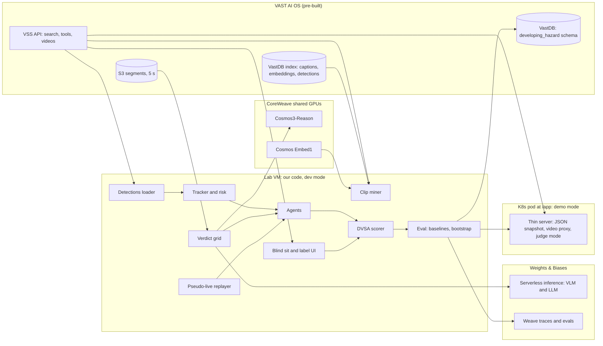
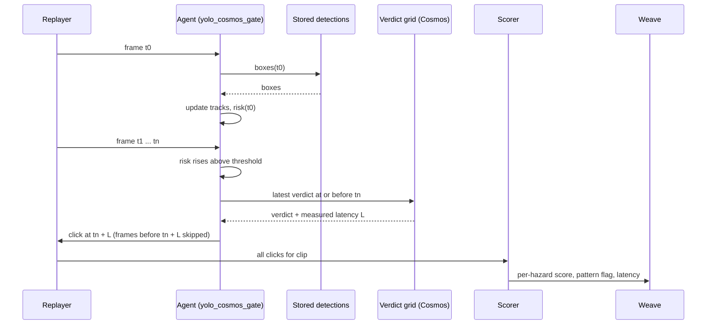

# Developing Hazard - full specification

> An AI sits the UK hazard perception test on real dashcam footage.

| Field | Value |
|---|---|
| Event | VAST Builders Challenge London - Real-Time Video Agents Hack |
| Date | Saturday 17 October 2026 |
| Doors | 08:30, keynotes 09:00 [S17] |
| Build starts | 09:30 [S16] |
| Submission deadline | **16:30 BST** [S16]. Submit at https://tokensand.com/vastlondon, "Submit your project". The VAST guide says submissions "start around 4:30pm" [S7]; treat 16:30 as the hard deadline |
| Demos | from 16:30. First round: judges visit each team to walk through the build [S7] |
| Close | 18:30, closing and awards [S17] |
| Hosts | tokens& with VAST Data |
| Partners | NVIDIA, CoreWeave, Weights & Biases, SpaceXAI (Cursor) [S16] |
| Team | Moses (mosesman831), Riyu-D1, fmdplt33 |
| Repo | github.com/mosesman831/developing-hazard (private now; reviewers must be able to access it at submission [S16]) |
| Status | Pre-event spec. Written 15 Oct 2026. Researched and revised 15 Oct 2026; reasons in NOTES-opus.md. |

## 0. How to read this document

- **Sections 1-4**: why, who, judging fit.
- **Sections 5-12**: what we build: architecture, components, data, APIs, algorithms.
- **Sections 13-15**: labelling, evaluation, Weave.
- **Section 16**: frontend.
- **Sections 17-19**: repo, setup, config.
- **Sections 20-23**: day plan, roles, MVP vs stretch, risks.
- **Sections 24-26**: demo, submission, open questions.
- **Appendices**: prompts, pseudocode in full, glossary, checklists.

### 0.1 Assumption markers

Anything we have not verified is tagged:

- **[ASSUMPTION]** - we believe it but have not checked. Check on the day.
- **[VERIFY-0930]** - must be checked in the first hour; plan changes if wrong.
- **[PRIOR-EVENT]** - seen in code or on a project page from the San Francisco or New York event in this series. Probably still true in London. Confirm at 09:30 before building on it.
- **[UNVERIFIED]** - from a third party or our own inference. Do not quote on stage.
- **[S1]**, **[S2]** ... - a source from 0.3. Each tag is a link.

We do not cite any statistic we have not verified. No made-up users, quotes or numbers. Source text is paraphrased; quotes are short.

### 0.2 Style rules for this repo

- UK spelling. Direct. No filler.
- No em dashes. Use hyphens.
- Code comments say why, not what.

### 0.3 Sources

All checked on 15 Oct 2026.

| ID | Source | Used for |
|---|---|---|
| S1 | gov.uk: Theory test (cars), hazard perception test | clip count, definition, 5 points, pattern rule, one viewing |
| S2 | gov.uk: Theory test (cars), pass mark and test result | car pass mark 44 of 75 |
| S3 | gov.uk news: Hazard perception clips get a modern makeover | CGI clips since 12 January 2015; 14 clips, 15 hazards |
| S4 | DSA FOI answer IA/00436/12, Annex A (October 2012) | inappropriate response algorithm; fixed click allowance |
| S5 | TRL558, Grayson and Sexton (2002), The development of hazard perception testing | window start and end, five equal bands, first response scored, 1-7 s windows |
| S6 | TRL PPR2071, Validation of CGI hazard perception clips (for DVSA) | window opens when the hazard is predictable, closes when it is obvious |
| S7 | vast-builders-challenge README (build day guide) | infra, rules, deploy, judging round |
| S8 | vast-builders-challenge BEFORE_YOU_BUILD.md | pre-event checklist |
| S9 | vast-builders-challenge ARCHITECTURE_REFERENCE.md | models, pipeline, corpus |
| S10 | vast-builders-challenge config.example | env var names |
| S11 | GPU skills README (`.cursor/skills/gpu/`) | bearer token, Cosmos, YOLO and Embed request formats |
| S12 | Retrieval skills (`.cursor/skills/retrieval/`) | search, videos, detections, tools routes |
| S13 | `deploy-app-no-registry` skill | ConfigMap app, `/app` ingress, port, health probe |
| S14 | `vastdb-read` and `vastdb-write` skills | reading the index, writing our own tables |
| S15 | `.cursor/rules/build-day.mdc` | env and secrets rules |
| S16 | tokens& event page | deadline, what to submit |
| S17 | Luma event page | agenda, judges |
| S18 | tokens& project gallery, San Francisco (45 projects) | uniqueness check |
| S19 | tokens& project gallery, New York (41 projects) | uniqueness check |
| S20 | CrossWise repo (New York) | per-frame boxes, 5 s segments in 30 s chunks, Cosmos latency, in-cluster API URL, segment player |
| S21 | Dashi repo (San Francisco) | `pie_cam-3` chunk counts, segment fields, search quirks, VM setup |
| S22 | NVIDIA NIM for VLMs: Query the Cosmos 3 Reasoner API (1.7.0) | video input, frame sampling, reasoning format |
| S23 | NVIDIA VSS documentation, introduction | CV alert, then VLM verification |
| S24 | Weave docs: EvaluationLogger | logging our own eval loop; compare view |
| S25 | CoreWeave Serverless Inference: available models | vision models on W&B inference |
| S26 | CoreWeave Serverless Inference API reference | base URL, team/project attribution |
| S27 | `weave` 0.53.12 package source | default eval parallelism 20, scorer `output` argument, API signatures |
| S28 | Rasouli et al., PIE dataset, ICCV 2019 | PIE camera, lens, resolution, fps |
| S29 | PIE annotations repo | annotation licence |
| S30 | BLACKBOX project page (New York) | nearest prior project |
| S31 | Warehouse best buddy project page (New York) | Cosmos says yes when asked directly |
| S32 | CloseCall project page (San Francisco) | prior human-vs-model game |
| S33 | Evidence Atlas project page (San Francisco) | 1,080 indexed Toronto clips |
| S34 | Grabbit Mining Co. project page (San Francisco) | W&B inference latency for short JSON |
| S35 | VLAlert, arXiv 2609.08130 | related research: when to alert |
| S36 | RiskCueBench, arXiv 2601.03369 | related research: earliest risk cue |
| S37 | ICO decision notice FS50115678 (31 May 2007), Driving Standards Agency | click allowance and minimum gap withheld on purpose; trial keying figures |

---

## 1. Problem

### 1.1 The one-line problem

Video agents are usually judged on *what* they see. Real-time video agents also have to decide *when* to act, and acting too early, too late or too often are all failures. There is no simple, familiar benchmark that tests that timing.

### 1.2 The benchmark we borrow

Great Britain's driving theory test includes a hazard perception section run by DVSA. A candidate watches clips filmed from the driver's seat and clicks when they see a *developing hazard*: something that would make the driver take action, such as changing speed or direction [S1]. The clips have been CGI since 12 January 2015 [S3].

What DVSA publishes:

- Up to 5 points per developing hazard. Click as soon as the hazard starts to develop [S1].
- Wrong clicks cost nothing, but clicking continuously or in a pattern scores nothing for that clip [S1].
- One attempt per clip. No review, no changing answers [S1].
- Car test: 14 clips, each with at least one developing hazard and one with two, so 15 hazards and 75 marks. Pass mark 44 [S2], [S3].

What DSA, DVSA's predecessor, has said about the anti-cheat rule:

- It is called the inappropriate response algorithm. It fires on a pattern of clicks, a large number of clicks in a very short time, or rapid clicking [S4].
- The candidate only finds out at the end of the clip, when an X appears [S4].
- The click allowance is a set number, the same for every clip however busy the scene [S4].
- DSA refused an FOI request for the number of clicks allowed and the shortest time gap that sets the algorithm off. In 2007 the Information Commissioner upheld the refusal: publishing it could help candidates beat the test [S37].
- In DSA's trials with 16,000 volunteer drivers, 30% of candidates tried some form of inappropriate keying, and 60% of those used continuous rapid responses [S37].

How scoring windows work, from the research that built the test [S5] and TRL's later CGI validation for DVSA [S6]:

- A window runs from the earliest point the hazard starts to develop to the point where it becomes obvious [S5], [S6].
- It is split into five equal parts scoring 5, 4, 3, 2, 1. Only the first response inside the window is scored. Anything outside scores 0 [S5].
- Window length was set per hazard from where trial participants clicked and what the video showed: from 1 s (five 200 ms bands) to 7 s (five 1.4 s bands) [S5].
- Responses were timed to the video frame shown [S5].

The first click inside a window is also its best click, since points only fall with time. "First click counts" and "best click counts" are the same rule. DVSA does not publish the windows of live clips, and we do not have DVSA clips. Our windows are our own (section 13).

This rule set is almost exactly what a real-time video agent needs:

- Reward early detection.
- Punish late detection.
- Punish spam (high recall, zero precision).
- One pass, no peeking at the future.

One more property matters for agents: false alarms are free until the click allowance runs out. Precision only counts through that budget, so the real question is how to spend a few clicks. That is the alerting problem.

### 1.3 Why it matters beyond the joke

- Fleet dashcam vendors, driver-coaching tools and ADAS teams all need "warn at the right moment" behaviour. A system that warns constantly gets ignored.
- NVIDIA's VSS blueprint has the pattern we test: computer vision raises an alert and a VLM verifies it [S23]. Verification takes time. We measure whether it pays for itself under a timing score.
- Video agent builders at this event mostly build search and summary. Our project tests the harder real-time decision on the same stack.
- It produces a scored, reproducible eval in Weave, which is what an evals-minded judge wants to see.

We do not claim any of these industries will buy this. The demo stands on the benchmark.

### 1.4 What we are not doing

- Not building a driving policy.
- Not claiming DVSA endorsement. We use the public scoring rules, not DVSA clips (we do not have them and must not use internet video).
- Not training a model. No time and no need.

---

## 2. Users and stakeholders

### 2.1 Primary user for the demo: the judge

They will see 3 minutes. They must understand the idea in one sentence and see a number go up or down.

### 2.2 Imagined users (framing only)

| User | What they want | What we give them |
|---|---|---|
| Video agent builder | A way to tell whether their agent acts at the right moment | A DVSA-style scorer and a harness that replays clips as pseudo-live |
| Driver coaching / fleet safety product teams | Evidence their alerting is early but not noisy | Per-hazard timing scores and spam detection |
| Learner drivers (playful) | "Can I beat the AI?" | Judge mode: human clicks the same clip |

[ASSUMPTION] These are framings. We have not spoken to any of these users. Say so if asked.

### 2.3 Stakeholders on the day

- Judges (section 4).
- tokens& organisers: want working apps deployed on the stack and submitted on time.
- Sponsors: want their product visibly used.

---

## 3. Goals and non-goals

### 3.1 Goals (must)

1. At least 10 test clips from the team index, each one 30 s PIE chunk (7.2), with an agreed scoring window per hazard.
2. A pseudo-live replay harness: the agent only sees frames up to time t, and its thinking time is charged.
3. Two detector agents (`yolo_naive` on presence, `yolo_risk` on change) scored by a faithful DVSA-style scorer including the click-allowance rule, next to a random clicker with the same number of clicks.
4. A deployed web app via `/deploy-app-no-registry` that shows a clip, its window, and the agent's clicks and score.

### 3.2 Goals (should)

5. YOLO + Cosmos Reason verification, blocking and non-blocking, with latency counted and a points-versus-latency curve.
6. Weave evaluation and comparison across agents.
7. Judge mode: a human clicks while the clip plays, scored the same way.
8. Labels, runs and per-hazard scores written to VastDB next to the index.

### 3.3 Goals (could)

9. W&B-hosted vision model as a second verifier (`vlm_wb`).
10. W&B-hosted text LLM agent (`llm_wb`).
11. Miss explanations written by an LLM from the trace.
12. "More like this" mining with Cosmos Embed vectors read from VastDB.
13. Cross-source test (I-24 or neighbourhood cam) to show generalisation or failure.

### 3.4 Non-goals

- Re-ingesting the corpus at all on the critical path. The shared pipeline lagged at an earlier event [S20].
- Training or fine-tuning.
- Perfect labels. ~20 clips hand-labelled by two people is the target.
- Mobile layout.

---

## 4. Judging fit

### 4.1 Judges [S17]

| Judge | Event page lists | What they will likely care about |
|---|---|---|
| Abubakr Karali | Senior Solutions Architect, NVIDIA. Our notes say Metropolis; the page does not | Real-time video analytics, smart-city and traffic use, proper use of Cosmos and detection |
| Brian Verkley | Director, AI Data Platform, VAST Data. Also the event speaker | Using the VAST AI OS: index, VastDB, DataEngine; data as a product |
| Ram B. | Sr. Developer Advocate, VAST Data. Surname not on the page; our notes say Bansal [UNVERIFIED] | Same as above; a working app on their stack |
| Junaid Butt | AI Solutions Engineer, Weights & Biases | Evaluation design, Weave traces, honest comparisons |

[ASSUMPTION] "likely care about" is inferred from their roles, not from anything they said. Say "Ram B." unless we confirm the surname.

### 4.2 Criteria we scored the idea against

Out of 80 (8 criteria x 10) in our pre-event ranking, Developing Hazard scored 65, the top of 10 ideas. Criteria:

1. Judge fit (London judges).
2. Fits the time (one day, not too small, not too big).
3. Advanced.
4. Unique (vs prior VAST hack projects).
5. Sponsor stack fit.
6. Demo-ability.
7. Measurable result.
8. Risk (inverse).

### 4.3 How each judge sees the stack in the demo

| Moment in demo | Judge it lands with |
|---|---|
| Clips found by semantic search over the VAST index; our labels and scores stored in VastDB next to the index rows | Verkley, Ram B. |
| YOLO tracks drawn on the clip; the Cosmos answer and its latency; the points-versus-latency curve | Karali |
| Weave compare view: per-hazard scores, chance baseline, intervals, traces | Butt |
| App deployed on the workshop stack | Everyone |

### 4.4 Uniqueness check

We read the titles and summaries of all 86 projects published from the two earlier events in this series (45 SF [S18], 41 NYC [S19]) and the nearest ones in full. None scores an agent against the DVSA rule or any other timing-based test. Nearest neighbours, so we are ready for "hasn't this been done?":

| Project | Event | What it did | How we differ |
|---|---|---|---|
| [BLACKBOX](https://tokensand.com/p/blackbox) [S30] | NYC | Replays a Toronto drive with YOLO tracks, in-path proximity, time to contact and Cosmos event times | We score timing against a published rule |
| [CrossWise](https://tokensand.com/p/crosswise) [S20] | NYC | GO / WAIT / NO-GO every 0.2 s from stored YOLO boxes; replays a robot under two policies | Their score is task-specific; ours is a public test with a human baseline |
| [CloseCall](https://tokensand.com/p/closecall) [S32] | SF | "Spot the Near-Miss": a 10-round game, you vs a three-model vote vs the label | Not scored on timing, as far as the page says |
| [Dashi](https://tokensand.com/p/dashi), [Drive Recap](https://tokensand.com/p/drive-recap) | SF, NYC | Coaching and a trip report card on `pie_cam-3` | Same footage, different question |
| [Vision Zero Agent](https://tokensand.com/p/vision-zero-agent-1) | NYC | Cosmos checks each 5 s segment as it arrives; precision and recall | Segment-level detection, not reaction timing |
| [Nostradamus](https://tokensand.com/p/nostradamus) | NYC | Prediction market on the next 5 s of video | A forecasting game, no timing score |

Research on when to alert from dashcam video exists, for example VLAlert [S35] and RiskCueBench [S36]. Neither abstract mentions the DVSA scoring rule. Do not claim "first ever" on stage. Say "we haven't seen anyone do this at a VAST hack".

---

## 5. What the platform gives us

From the build day guide, architecture reference and skills [S7], [S9]-[S15], plus what earlier teams found [PRIOR-EVENT].

### 5.1 Infra

- Cursor on our laptops, connected via Remote-SSH to a lab VM (`bc-<username>` host). The `vast-builders-challenge` repo, skills and credentials live on the VM [S7]. **[VERIFY-0930]** one VM each or one shared? If one each, share code and small JSON through git and make one VM the data box.
- Credentials and endpoints are environment variables from `/config/<team>.config` [S10]. List names with `env | cut -d= -f1 | sort`; never print values [S15].
- One video ingestion instance, one index and one set of credentials per team. Anything a teammate ingests appears for everyone [S7].
- Health check: "run a git pull", then "check that everything is working". If broken, `/ask-cosmos` writes a note that we post ourselves on the Cosmos community [S7].
- `/build-day-quickstart` gives a guided run [S7].
- Deploy with `/deploy-app-no-registry`, view at workshop.thecosmoslabs.com, click **App** [S7], [S13].
- At SF the VM had no `pip` and no `kubectl`. The fix was `python3 -m venv --without-pip` plus get-pip, and kubectl in `~/.local/bin` [PRIOR-EVENT] [S21].

### 5.2 Models (shared GPU endpoints on CoreWeave)

| Model | Role | Env var | How it is called |
|---|---|---|---|
| NVIDIA Cosmos3-Reason | Video understanding | `$COSMOS3_REASON_URL` | OpenAI-style `/v1/chat/completions` with `video_url` content [S11] |
| YOLO11 (`yolo11s`) | Object detection | `$YOLO_URL` | `/v1/infer` with a whole video as base64 and `include_frames` [S11]. Not per frame |
| NVIDIA Cosmos Embed1 | 256-dim text and video embeddings | `$COSMOS_EMBED1_URL` | `/v1/embeddings` with `request_type` [S11] |
| NVIDIA Canary-1B | ASR, not wired in | `$CANARY_1B_URL` | Not used |

- **Auth.** The architecture reference says no token is needed [S9]. The GPU skills say always send `Authorization: Bearer $GPU_BEARER_TOKEN` from the team config [S11], and CrossWise did [S20]. Send it.
- **Hosts.** The GPU skills hard-code the host and ports rather than use the env vars [S11]. Read the env var; fall back to the skill's host. Do not copy the host into our repo.
- **Model ids.** Ask `GET /v1/models` [S11]. `config.example` says `nvidia/cosmos3-reason` [S10]; at NYC the endpoint answered as `nvidia/cosmos3-nano-reasoner` [PRIOR-EVENT] [S20].
- **Cosmos input** [S22] (**[VERIFY-0930]** the shared endpoint accepts these NIM extensions):
  - video as a base64 `data:video/mp4` URL, or pre-decoded frames as `video_frames`, which keep frame order and use fewer tokens than separate images;
  - frame sampling with `media_io_kwargs` (`fps` or `num_frames`), default 4 fps; asking for more frames than the video has is a 400;
  - pixel budget with `mm_processor_kwargs`;
  - chain-of-thought only when the prompt asks for `<think>` and `<answer>` tags. We do not ask: it costs time.
- **Latency.** CrossWise captioned 30 five-second segments directly at NYC: 2.9 s to 9.1 s per call, median 4.3 s, with up to 400 output tokens and 4 calls in flight [PRIOR-EVENT] [S20]. Our verify call is smaller. Expect seconds anyway. **[VERIFY-0930]** time 10 calls.
- Endpoints are shared by every team. Expect contention, and expect it to change during the day.

### 5.3 Pipeline

`S3 chunks -> Segmenter -> S3 segments -> Detector (YOLO11, classes, counts, bbox sidecars) -> Reasoner (Cosmos Reason) -> Embedder (Cosmos Embed1) -> VastDB writer` [S9].

- Segments are 5 s; six make a 30 s chunk (`..._chunk_0015_segment_001_of_006.mp4`) [PRIOR-EVENT] [S20], [S21].
- The Detector's sidecar is served by `/videos/detections?source=<segment>`; a 404 means no sidecar for that segment [S12]. CrossWise built 5 fps tracks from the boxes stored for every frame [PRIOR-EVENT] [S20].
- `/tools/segments?original_video=<chunk>` returns each segment's `source`, `reasoning_content` (caption), `segment_start_sec`, `segment_end_sec`, `segment_number`, `object_counts` (a JSON string), `detection_frame_count` and more. Cast every field; types vary [PRIOR-EVENT] [S21].
- Re-ingest re-runs Detector to VastDB on existing segments only [S9]. At NYC the shared pipeline was replaying a backlog and did not index a team's clips in time [S20]; at SF the backend restarted mid-job and lost the job status [S21]. We do not depend on it.
- `vastdb-read` queries the database directly. `vastdb-write` creates our own schema and tables in the team bucket [S14].

### 5.4 Skills

| Skill | Our use |
|---|---|
| `login` | JWT for every retrieval route [S12] |
| `search` | Find candidates by text, filtered to `camera_id = pie_cam-3` |
| `list-metadata` | Check filter values exist before searching |
| `videos` | Stream a segment (`/videos/stream?source=...&token=...`, Range-capable); read its detections and metadata |
| `agent-qa` / `tools/*` | `tools/segments` for captions and timing per chunk |
| `dashboard` | What is indexed; `pie_cam-3` chunk count |
| `suggest-prompts` | Ideas for queries at 09:30 |
| `vastdb-read` / `vastdb-write` | Bulk reads; our own tables (7.13) |
| `gpu/model-health`, `gpu/model-smoke-test` | Endpoint checks at 09:30 |
| `deploy-app-no-registry` | Deploy (6.4) |
| `reingest-videos` / `reingest-chunk` | Not planned. If ever: one chunk, scenario `live_driving` [S9], Riyu only |

### 5.5 Footage [S9]

| Source | `camera_id` | Location | Indexed | Our use |
|---|---|---|---|---|
| PIE drives | `pie_cam-3` | toronto | 6 drive sets (`set01`-`set06`) | **Primary.** Ego-vehicle dashcam |
| I-24 / 3D traffic | `i24_cam-1` | nashville | ~51 multi-cam highway clips | Not ego view. Stretch: cross-source failure test |
| Neighbourhood cars | `neighborhood_cam-1` | neighborhood | 2 day merges | Not ego view. Not used for scoring |
| SF streets | `sf_streets_cam-1`..`4` | san_francisco | "ingesting soon" | Not ego view |
| Warehouse | `sdg_warehouse_cam-2` | warehouse3 | ~178 clips | Not used |
| Smart spaces | `smartspace_cam-1` | indoor | ~102 clips | Not used |

What earlier teams found on `pie_cam-3` [PRIOR-EVENT]:

- 180 chunks: 30 consecutive 30 s chunks per set, so about 90 minutes in all, named like `<timestamp>_set06_video_chunk_0003.mp4` [S21]. Evidence Atlas counted the same 1,080 clips [S33].
- YOLO is noisy on this footage (it reports cows, kites and airplanes) and person counts are low [S21].
- Captions rarely say what the camera car does. In one sample of 180 segments, 59% mentioned it, 18% said it slowed, 7% that it stopped and 2% that it yielded [S21].
- The top pedestrian hit they quoted shows the camera car stopped at a junction while people cross [S21]. That is not a developing hazard (13.2).

PIE is the Pedestrian Intention Estimation dataset (York University): downtown Toronto, daytime, a dashboard camera with a 157 degree lens, 1920x1080 at 30 fps [S28]. The paper describes pedestrian boxes, crossing intention and per-frame ego speed from an OBD sensor [S28]; the annotations repo is MIT-licensed [S29]. None of it is in our index, and we do not use it without organiser approval (26).

The London corpus may differ. The `reingest-chunk` skill's example filename is a London walk, which hints at new sources [UNVERIFIED]. Check the dashboard at 09:30: UK driving footage would beat Toronto for a UK test.

Rule: **Don't ingest videos from the internet.** [S7] We use only the provided corpus.

### 5.6 Hard constraints that shape the design

1. The only ego-view source is PIE, unless London adds one. Hazard perception needs ego view. So the product lives or dies on PIE. **[VERIFY-0930]**
2. Captions are written per 5 s segment and describe the whole segment, including its future. Use them for retrieval only: never as ground truth, never as agent input.
3. Per-frame YOLO boxes are stored [PRIOR-EVENT]. Detection on a frame uses only that frame, so replaying stored boxes in time order leaks nothing. If they are missing, call `$YOLO_URL/v1/infer` once per 5 s segment.
4. Cosmos costs seconds per call on a shared endpoint. Compute verdicts once on a time grid (12.3), at most 2 calls in flight.
5. Team shares one index: no re-ingest; one person owns anything that touches it.
6. The deployed app is a ConfigMap of about 1 MiB in total, run on `python:3.12-slim` with pip at start [S13]. No media and no heavy compute in the pod.
7. Do not write our media into the chunks or segments buckets: they feed the ingest pipeline [S9]. **[ASSUMPTION]** a write there would trigger ingest into the shared index. Ask before writing anywhere in S3.

---

## 6. Architecture

### 6.1 Overview



### 6.2 Offline vs live

There are two phases.

**Prepare (on the VM, before evaluation):**

1. Mine candidate chunks.
2. Everyone who has not seen a chunk sits it blind once (13.3).
3. Two labellers mark windows independently; agree or arbitrate.
4. Load stored detections, track, compute risk.
5. Compute the Cosmos verdict grid (12.3).
6. Freeze the test set (`testset_vN.json`).

**Sit the test (pseudo-live):**

1. Replayer releases frames in time order on a simulated clock.
2. Agent sees only frames up to now, decides whether to click.
3. A blocking call moves the clock on by its latency, and frames inside that time are skipped. A non-blocking result arrives at send time plus latency.
4. Scorer marks clicks against frozen windows.
5. Results go to Weave, VastDB and the app's JSON snapshot.

### 6.3 Sequence: one agent sits one clip



### 6.4 Deployment

The same FastAPI app runs in two places:

| Mode | Where | Data | Used for |
|---|---|---|---|
| `dev` | Lab VM under `uvicorn`, opened in the laptop browser through Cursor's port forwarding **[VERIFY-0930]** | read-write `data/` in the repo | Blind sits, labelling, our own runs |
| `demo` | K8s pod via `/deploy-app-no-registry` [S13] | read-only JSON snapshot in the ConfigMap | Judges: watch, leaderboard, judge mode |

Labels are only ever written in `dev` mode, straight into the repo. Every code update restarts the pod [S13], and anything stored in it is lost.

What the deploy skill fixes for us [S13]:

- Public image `python:3.12-slim`; code and data from a ConfigMap, about 1 MiB in total; `requirements.txt` installed at container start. At SF the first ~15 s after a restart returned errors while pip ran [PRIOR-EVENT] [S21].
- Listen on `0.0.0.0:$PORT`; serve `/health` for the readiness probe.
- Ingress path `/app` on `video-lab-team-<N>.cosmos.vastdata.com`. The prefix is stripped, so the app routes from `/`. Every browser URL must be relative (`api/clips`, not `/api/clips`).
- Code change: recreate the ConfigMap, then `rollout restart`.
- At NYC and SF the pod could not resolve the public `$INGRESS_URL`; teams used `http://video-backend-service.<team>.svc.cluster.local:8000` [PRIOR-EVENT] [S20], [S21]. **[VERIFY-0930]**
- For SSE through the nginx ingress, set the `proxy-buffering: "off"` annotation and a longer `proxy-read-timeout`. CrossWise set both [S20].

Pod budget: code plus JSON snapshot under 900 KB. Track overlays keep the top 3 tracks per frame at 5 fps, coordinates to 3 decimals. `make deploy` fails over budget. Pod dependencies: `fastapi`, `uvicorn`, `requests`. No numpy, no OpenCV, no weave.

Video never sits in the pod. The app proxies `/api/v1/videos/stream` with the JWT kept server-side and Range headers passed through, as CrossWise did [S20].

### 6.5 Why this shape

- Stored detections replayed in order make agents cheap to re-run and comparisons fair (same detections for every agent).
- Cosmos calls are the expensive part. The verdict grid makes them once per clip, not once per config.
- Labels live in git, not in a pod.
- Frozen test set means numbers do not drift during the afternoon.

---

## 7. Components

Each component lists: purpose, inputs, outputs, owner (see section 21), MVP or stretch.

### 7.1 Clip miner (`dh/mine.py`) - MVP

**Purpose:** find 30 s chunks where the camera car is moving and something develops that would make a careful driver slow down or steer.

**Inputs:** VSS search, `tools/segments` captions, VastDB rows via `vastdb-read`, human scrubbing.

**Method:**

1. Run a fixed list of text queries via `POST /api/v1/search` with `metadata_filters: {"camera_id": "pie_cam-3"}`, `top_k: 30`, `llm_top_n: 1` and `min_similarity: 0.3` [S12]. `llm_top_n: 0` was rejected with a 422 at SF [PRIOR-EVENT] [S21]. Captions are written in US English, so the queries say "curb":
   - "the camera vehicle slows down as a pedestrian steps off the curb ahead"
   - "pedestrian starts to cross the road in front of the moving car"
   - "pedestrian walks out between parked cars"
   - "car pulls out of a side street in front of the camera vehicle"
   - "vehicle ahead brakes suddenly, brake lights on, gap closing"
   - "cyclist moves out into the lane ahead"
   - "the camera vehicle turns while pedestrians are crossing"
   - "vehicle cuts in front of the camera vehicle"
   - "parked car door opening into the road"
   - "bus pulling away from a stop ahead"
2. Group hits by parent chunk (`original_video`). Each search took about 6 s at SF [PRIOR-EVENT] [S21].
3. Similarity scores for good hits sat at 0.34-0.39 at SF and did not separate good from bad [S21]. Rank by caption keywords instead, after dropping negated sentences ("No pedestrians ... are visible") [S21]. Prefer captions that say the camera car is moving.
4. Output `candidates.jsonl`: one row per chunk, with the matching segment and second.

**Reliable path:** scrub. Each set is 30 consecutive chunks, about 15 minutes [PRIOR-EVENT] [S21]. Riyu watches all six sets at 2x in the VSS UI, about 45 minutes, and notes the chunk and second of every candidate. Search runs alongside and adds to the list.

**Should:** "more like this". Embed a confirmed hazard segment with Cosmos Embed1 (`request_type: "query"`, video as a base64 data URL [S11]) and rank `pie_cam-3` rows by cosine against their stored `vectors_visual`. Select that column explicitly: selecting all columns can crash the SDK [S14]. **[VERIFY-0930]** visual vectors exist for PIE rows.

**Not allowed:** ranking candidates by our own YOLO risk score. That picks the clips our YOLO agents are good at and biases the test towards them.

### 7.2 Clip definition (`dh/clips.py`) - MVP

**Purpose:** fix what a test clip is, without making new video files.

- A clip is one 30 s chunk: its six segment sources and their offsets (0, 5, ... 25 s) [PRIOR-EVENT].
- Hazard onset should be at least 5 s into the clip, so the viewer has settled. If it is earlier, add the previous chunk of the same set (a 60 s clip), or pick another chunk.
- Clip time 0 is the start of the first segment. Every time in our data is clip time.
- On the VM, download the segments with `/videos/stream` and join them with ffmpeg (`-f concat -c copy`) for frame decoding and Cosmos inputs. **[VERIFY-0930]** ffmpeg on the VM; segments join without re-encoding.
- The browser plays the segments back to back with two `<video>` elements, swapping on `ended`, as CrossWise did [S20]. If `/videos/stream` also serves the parent chunk (`source=<original_video>`), use that **[VERIFY-0930]**.

Why 30 s: TRL's trial tests ran 13 scenarios in 10-12 minutes [S5], so roughly 45-55 s each by our arithmetic. Windows are short against the clip. Short clips make random clicking pay (14.5). 30 s is the corpus unit, so it is also free.

### 7.3 Frame extractor (`dh/frames.py`) - MVP

- ffmpeg at 5 fps to JPEG (quality 3, 960 px wide). Configurable `FPS_SAMPLE`.
- Output `data/frames/<clip_id>/000001.jpg` plus `frames.json` with clip-time timestamps.
- Needed only for Cosmos inputs, contact sheets and thumbnails. Detection does not need frames (7.4).

### 7.4 Detections loader (`dh/dets.py`) - MVP

- Primary: `GET /api/v1/videos/detections?source=<segment>` [S12]. CrossWise read `frames[]` with `time_sec` and `detections[]` of `{bbox (px), label, confidence}`, plus `video_shape` and `fps` [PRIOR-EVENT] [S20]. Add the segment offset to get clip time.
- Subsample to 5 fps (every 6th frame at 30 fps).
- Keep: person, bicycle, car, motorcycle, bus, truck, traffic light, stop sign, dog. Drop the rest (this footage throws up cows and kites [S21]). Confidence >= 0.35. Ignore boxes shorter than 3.5% of frame height: looming on tiny boxes is noise. CrossWise used the same floor for vehicles [S20].
- Cache to `data/det/<clip_id>.jsonl`. Never fetch the same segment twice.
- Fallback if sidecars are missing: `POST $YOLO_URL/v1/infer` with the 5 s segment as base64 and `include_frames: true` [S11]. **[VERIFY-0930]** how many frames per second it returns.
- **[VERIFY-0930]** on two PIE chunks with a known crossing: is the pedestrian boxed in most frames? Dashi found person counts low on this footage [S21].

### 7.5 Tracker (`dh/track.py`) - MVP

- Simple IoU tracker with a constant-velocity Kalman (or ByteTrack-lite). We do not need SOTA. Write it in 80 lines or use `supervision`'s ByteTrack if installable. **[VERIFY-0930]** pip access on VM.
- Track state per frame: bbox, centre, width, height, velocity (px/s), scale rate (d log h / dt).

### 7.6 Ego path and risk features (`dh/risk.py`) - MVP

No calibration, no depth. Image-space heuristics only. Good enough for timing.

- **Ego corridor:** a trapezoid in the bottom-centre of the frame. Default: bottom edge from 25% to 75% of width; top edge from 42% to 58% at 55% of height. Tune once by eye on 3 frames from different sets. **[ASSUMPTION]**
- **Lateral heading:** is the track's centre x moving towards the corridor centre line? `heading_in = sign(cx - corridor_cx_at_y) != sign(vx)` and `|vx| > v_min`.
- **Inside corridor:** bottom-centre of bbox within trapezoid.
- **Looming / TTC proxy:** for an object of image height h, `TTC ~= h / (dh/dt)`. Smoothed over 0.6 s. Only meaningful when `dh/dt > 0`.
- **Lateral time to corridor:** `t_lat = distance_to_corridor_edge / |vx|` when heading in.
- **Risk score** in [0, 1] per track:

```
risk = w1 * inside_corridor
     + w2 * sigmoid((T_ttc - ttc) / s_ttc)
     + w3 * heading_in * sigmoid((T_lat - t_lat) / s_lat)
     + w4 * class_weight[cls]
```

Defaults: w1 = 0.3, w2 = 0.35, w3 = 0.25, w4 = 0.1; T_ttc = 3 s, s_ttc = 0.7; T_lat = 2 s, s_lat = 0.5. class_weight: person 1.0, bicycle 1.0, motorcycle 0.9, car 0.7, bus 0.7, truck 0.7, dog 1.0. All numbers are starting guesses. **[ASSUMPTION]**

- **Scene risk** = max over tracks.

Two known weaknesses, so nobody is surprised:

- The camera car moves. Static objects drift away from the image centre as it approaches, and a slow walker crossing at distance can look still or even drift outwards. `heading_in` fires late in that case.
- PIE's 157 degree lens [S28] squeezes the edges of the frame. Pedestrians at the sides are small and their motion is compressed.

### 7.7 Window proposer (`dh/windows.py`) - should

Auto-propose a scoring window per hazard from tracks. **Labellers do not see it until they have saved their own window.** That keeps labels free of YOLO's view and makes proposer-vs-human error an honest secondary result.

- **Hazard track:** the track whose risk peaks highest in the clip, above 0.6.
- **Window start (onset):** first frame where the hazard track heads into the ego path (heading_in for 3 consecutive sampled frames, or enters the outer corridor margin).
- **Window end:** first frame the hazard track is inside the inner corridor: the point where the hazard is obvious [S5], [S6]. Not closest approach; by then it has long been obvious.
- Clamp window length to 1-7 s, the range used when the test was built [S5]. Flag anything outside.
- Output proposed windows with confidence.

### 7.8 Blind sit and labelling UI (`/label` screen, dev mode) - MVP

See 13 for protocol and 16.4 for the screen. A labeller's first view of a clip is always a blind sit (13.3).

### 7.9 Replayer (`dh/replay.py`) - MVP

- Given a clip and an agent, emit frames in time order with their detections.
- Modes: `realtime` (sleep to match the wall clock) and `fast` (simulated clock). Fast for evals; realtime for the demo.
- Simulated clock rules:
  - The clock moves to each frame's time.
  - A **blocking** call moves the clock on by its latency. Frames inside that time are skipped: the agent was busy.
  - A **non-blocking** call returns at once. Its result reaches the agent with the first frame at or after send time plus latency.
  - A click is stamped with the clock time when the agent decides, after any blocking call.
- Latency comes from the call record: measured wall time, a fixed value for sweeps, or zero (9.5).
- The agent only receives `(t, frame_ref, dets_at_t, ready_results)`. It cannot index ahead. The replayer passes a generator, not a list, and `ClipMeta` has no hazard fields.

### 7.10 Agents (`dh/agents/`)

All implement:

```python
class Agent(Protocol):
    name: str
    def reset(self, clip_meta: ClipMeta) -> None: ...
    def step(self, t: float, frame_ref: str, dets: list[Det],
             ready: list[CallResult]) -> StepResult: ...
    def resume(self, out: CallResult) -> StepResult: ...   # only agents that make blocking calls
```

`StepResult = {click: bool, risk: float, note: str | None, calls: list[CallRequest]}`. Each `CallRequest` says whether it blocks. The agent never holds the verifier: it asks, and the harness answers (12.1).

#### 7.10.1 `yolo_naive` - MVP (the straw man)

Clicks whenever any person or vehicle is inside the corridor, with 0.5 s debounce. Expected to trip the click allowance and score 0 on most clips. It is the obvious presence policy, fixed before we see any results and never tuned. Call it a straw man on stage before a judge does.

#### 7.10.2 `yolo_risk` - MVP

- Clicks when scene risk crosses `theta_up` (0.6) after being below `theta_down` (0.4) (hysteresis).
- Max 3 clicks per clip. Min 1.5 s between clicks.
- These limits keep it well inside the pattern rules (9.3).

#### 7.10.3 `yolo_cosmos_gate` - should (target before 14:30)

- Same trigger as `yolo_risk` but at a lower threshold (`theta_trig` 0.45) to get earlier candidates.
- On trigger, use the latest grid verdict at or before `t` (12.3). Blocking: any click lands at `t + latency`.
- Click if the verdict is HAZARD under the rule in A.1. If not, suppress that track for 1.5 s.
- Cap 4 verifications per clip.

#### 7.10.4 `yolo_cosmos_async` - should

Uses the fact that wrong clicks are free until the allowance runs out (1.2):

- Click at once on the first risk rise of a track (like `yolo_risk`, at `theta_trig`).
- At the same moment, send a non-blocking verification. When it returns:
  - HAZARD: click again on that track if its risk is still rising. This rescues hazards where the first click came before the window opened.
  - NOT_HAZARD: no more clicks on that track. Saves the budget for others.
- Max 4 clicks per clip.

#### 7.10.5 `vlm_wb` - could

Same gate as 7.10.3, but the verifier is a vision model on W&B inference, sent one contact sheet of 4 frames (A.4). Vision-capable models listed on 15 Oct include Gemma 4 31B, Qwen3.8 27B and NVIDIA Nemotron 3.5 Super VL [S25]. CrossWise sent single frames to Gemma 4 31B at NYC [S20]. Doubles as a fallback verifier if the shared Cosmos endpoint is overloaded.

#### 7.10.6 `llm_wb` - could

- Serverless LLM on W&B inference. Receives a text rendering of tracks every 0.5 s (class, position, heading, TTC). Responds CLICK or WAIT. Shows what a text-only reasoner does without pixels.
- Pick a fast model on the day. At SF, Llama 3.3 70B, DeepSeek V4 Flash and a Qwen3 30B model each returned JSON in under 1 s [PRIOR-EVENT] [S21]; Grabbit measured a median of 402 ms per call for short JSON [S34]. **[VERIFY-0930]** list models with `GET /v1/models`.

#### 7.10.7 Baselines - MVP

- `random@k`: k clicks per clip at uniform random times, seeded, averaged over 200 draws. k in {1, 2, 4, 6, 8}.
- `random@matched`: for each agent, a random clicker with the agent's own click count on each clip (14.3). The line every agent must clear.

#### 7.10.8 `human` - should

- Blind sits and judge mode: clicks from the browser (16.5).

### 7.11 Scorer (`dh/score.py`) - MVP

See section 9.

### 7.12 Miss explainer (`dh/explain.py`) - could

- For each hazard where an agent scored 0 or 1, build a context: window, agent clicks, risk curve summary, Cosmos verdicts, top tracks near window start.
- Send to W&B LLM with prompt Appendix A.3. Output 2-3 sentences.
- Cache the result. Show in results screen.
- A human reads each explanation before it goes on screen. Wrong ones are not shown.

### 7.13 Persistence (`dh/store.py`) - should

- Local: JSON files under `data/`. Always. This is the source of truth.
- VastDB: the `vastdb-write` skill creates schemas and tables in the team bucket and recommends a new schema for app data [S14]. CrossWise wrote its decisions to its own table this way [S20]. We write schema `developing_hazard` (10.10) from the VM after each frozen run.
- Key rows by segment `source` so they join with `vss-collection` (captions, embeddings). That is the VAST story: the benchmark is a dataset next to the index.
- Never write to `vss-collection` or `vss-prompts-events` [S14].

### 7.14 Backend API (`dh/server.py`) - MVP

FastAPI in two modes (6.4). See section 11.

### 7.15 Frontend (`web/`) - MVP

See section 16.

---

## 8. DVSA rules as we implement them

### 8.1 Rules

| # | Rule | Source | Our implementation |
|---|---|---|---|
| R1 | Each developing hazard has a scoring window, from the earliest sign it is developing to the point it is obvious | [S5], [S6] | `Hazard.window_start`, `Hazard.window_end` |
| R2 | Window divided into five equal parts, 5 to 1 points | [S5] | integer-ms bands (9.1) |
| R3 | Click outside the window scores 0 for that hazard | [S5] | yes |
| R4 | Only the first response in the window is scored (it is also the best) | [S5] | first click in window |
| R5 | Clicking continuously or in a pattern scores 0 for the clip | [S1], [S4] | pattern rules (9.3) |
| R6 | The click allowance is a set number, the same for every clip | [S4] | P1 is a fixed cap, not tied to hazard count |
| R7 | The candidate learns of R5 only at the end of the clip, when an X appears | [S4] | sit screen shows the X after the clip |
| R8 | Every clip has at least one developing hazard; one has two | [S1], [S3] | every test clip has a hazard; at least one has two |
| R9 | One viewing only | [S1] | replayer is one pass; sit screen has no controls |

[ASSUMPTION] Live DVSA clips still use five equal bands. That is how the test was built [S5]; current clip parameters are not published.

### 8.2 Things DVSA does that we do not

- CGI clips since 2015 [S3]. Ours are real Toronto dashcam footage, 30 s each, with no UK road furniture.
- Windows set from trial participants' responses plus expert judgement [S5]. Ours are set by two of us, blind to each other and to the auto proposal (13).
- A pass mark: 44 of 75 for cars [S2]. Ours is not the DVSA test, so we never say "pass". The leaderboard shows 44/75 (58.7%) as a reference line labelled "DVSA car pass rate, for reference only".
- A click allowance kept secret on purpose [S4], [S37]. Ours is published in the app (9.3), so ours can be gamed in a way DVSA's cannot. The matched-chance baseline (14.3) is how we show nobody is gaming it.

### 8.3 Left-hand vs right-hand traffic

Toronto drives on the right. Hazard perception concepts (pedestrian stepping out, car pulling out) are the same. The ego corridor is symmetric so it does not matter for the risk model. Mention once if asked.

---

## 9. Scoring algorithm

### 9.1 Per-hazard points

Times are converted to integer milliseconds with `round(t * 1000)` before scoring, so band edges are exact. `int()` is wrong: `int(2.01 * 1000)` is 2009. The first draft's float version had a related bug: `(6.6 - 6.0) // 0.6` is 0.0 in floating point, so a click on a band edge scored 5 instead of 4.

```python
def hazard_points(clicks_ms: list[int], ws_ms: int, we_ms: int) -> int:
    """First click inside [ws, we] scores 5..1 by fifth of the window (R2, R4)."""
    if we_ms <= ws_ms:
        raise ValueError("bad window")
    inside = [t for t in sorted(clicks_ms) if ws_ms <= t <= we_ms]
    if not inside:
        return 0
    band = min(4, 5 * (inside[0] - ws_ms) // (we_ms - ws_ms))   # 0..4
    return 5 - band
```

Edges: a click exactly at `ws` scores 5. A click on an inner band edge scores the later band. A click at `we` scores 1. A click before `ws` scores 0 even if it was "right" early: same as DVSA.

### 9.2 Per-clip score

```python
def clip_score(clicks_ms, hazards, flagged: bool) -> int:
    if flagged:
        return 0
    return sum(hazard_points(clicks_ms, h.ws_ms, h.we_ms) for h in hazards)
```

### 9.3 Anti-pattern detection (`PATTERN_V1`)

DVSA does not publish its algorithm, and its click allowance was withheld on purpose [S4], [S37]. We define a transparent one, show it in the UI, and freeze it before any test run. A clip is flagged if any rule fires:

| ID | Rule | Default | Grounding |
|---|---|---|---|
| P1 | Too many clicks: more than 8 in the clip | 8 | a set allowance, the same for every clip [S4] |
| P2 | Burst: more than 4 clicks in any 2.0 s span | 4 / 2 s | many clicks in a very short time [S4] |
| P3 | Rhythm: at least 5 clicks with inter-click interval coefficient of variation < 0.15 | 0.15 | a pattern of clicks [S4] |
| P4 | Coverage: more than 70% of 1 s bins contain a click | 70% | clicking continuously [S1] |

The rules see clicks and clip length only, never the labels. On clips of 12 s or more, P4 cannot fire unless P1 does too; it only matters for shorter clips.

```python
def pattern_flag(clicks: list[float], clip_len: float) -> tuple[bool, list[str]]:
    reasons = []
    c = sorted(clicks)
    if len(c) > 8:
        reasons.append("P1_too_many")
    j = 0
    for i in range(len(c)):
        while c[i] - c[j] > 2.0:
            j += 1
        if i - j + 1 > 4:
            reasons.append("P2_burst"); break
    if len(c) >= 5:
        gaps = [b - a for a, b in zip(c, c[1:])]
        mu = sum(gaps) / len(gaps)
        sd = (sum((g - mu) ** 2 for g in gaps) / len(gaps)) ** 0.5
        if mu > 0 and sd / mu < 0.15:
            reasons.append("P3_rhythm")
    bins = max(1, int(clip_len))
    hit = {int(t) for t in c if 0 <= t < clip_len}
    if len(hit) / bins > 0.7:
        reasons.append("P4_coverage")
    return (len(reasons) > 0, reasons)
```

Tune once against blind human clicks on dev clips, before 12:30, so a normal anxious human (3-5 clicks per clip) is not flagged. Then freeze as `PATTERN_V1`; every run records the version. If a judge gets flagged in judge mode, that is funny, not a bug; but check.

### 9.4 Test-level aggregates

- `total = sum(clip_score)`, `max_total = 5 * total_hazards`, `pct = total / max_total`.
- `hit_rate` = hazards with points >= 1 / total hazards.
- `mean_points_when_hit`.
- `pattern_rate` = clips flagged / clips.
- `clicks_per_clip`, and `false_clicks` = clicks not in any window. Diagnostic only: DVSA does not penalise them [S1].
- `median_reaction_s` = median of `(first_click_in_window - ws)` for hits. Points follow from this and the window length.
- `median_lead_s` = median of `(we - first_click_in_window)` for hits: warning given before the hazard became obvious.
- `lift_vs_chance` = `pct - pct(random@matched)` (14.3).
- `mean_latency_s` and calls per clip for agents with verification calls.

### 9.5 Latency accounting

`t_click = t_trigger + sum(latency of blocking calls made at that trigger)`.

Every run records its latency mode:

| Mode | Latency used | Purpose |
|---|---|---|
| `measured` | wall time recorded when the grid call was made | the headline number |
| `fixed:L` | L seconds for every call, L in {0.5, 1, 2, 4} | points-versus-latency curve |
| `zero` | 0 | upper bound: verdict quality alone |

The curve answers the NVIDIA question directly: how fast must the verifier be to be worth calling? If Cosmos loses points to latency, that is the finding, not a failure.

### 9.6 Worked example

Window 6.0 s to 9.0 s, so each part is 0.6 s.

| Click time | Part | Points |
|---|---|---|
| 5.8 | before | 0 |
| 6.0 | 1 | 5 |
| 6.6 | 2 (an edge goes to the later band) | 4 |
| 7.3 | 3 | 3 |
| 8.99 | 5 | 1 |
| 9.2 | after | 0 |

Clicks [5.8, 7.3, 8.99] on a one-hazard clip: the first click in the window is 7.3, so 3 points. 3 clicks, no pattern flag, clip score 3.

### 9.7 Unit tests (`tests/test_score.py`)

- Window edges: a click at ws scores 5, on the first inner edge 4, at we 1, at we + 10 ms 0.
- Seconds to ms: 6.6 s in [6.0, 9.0] scores 4, and 2.01 s converts to 2010 ms.
- The first click in the window counts, even when a later click is also inside.
- Two hazards: points add.
- Each pattern rule fires on a synthetic case and not on [6.5, 7.0, 12.0].
- Pattern flag zeroes the clip.
- Bad window raises.

These tests are written first (by 10:30). They are cheap and they make the leaderboard credible.

---

## 10. Data model

All files are JSON or JSONL under `data/`. Pydantic models in `dh/models.py`. Times are seconds of clip time, 3 decimals, unless named `_abs`. The scorer converts to integer ms (9.1). Numbers in the examples below are placeholders.

### 10.1 `Candidate`

```json
{
  "candidate_id": "pie_set03_c0014",
  "camera_id": "pie_cam-3",
  "location": "toronto",
  "original_video": "s3://<team>-vss-chunks/<team>/<ts>_set03_video_chunk_0014.mp4",
  "set": "set03",
  "chunk_index": 14,
  "segments": ["s3://<team>-vss-chunks-segments/segments/<ts>_set03_video_chunk_0014_segment_001_of_006.mp4", "..."],
  "found_by": "search",
  "queries": ["pedestrian starts to cross the road in front of the moving car"],
  "hit_second": 17.5,
  "search_score": 0.37,
  "caption_snippet": "...",
  "ego_moving": true,
  "status": "new"
}
```

`found_by`: `search | scrub | embed`. `status`: `new | rejected | sat_blind | labelled | frozen`.

The filename and URI formats are [PRIOR-EVENT] [S21]: map to whatever the London index uses.

### 10.2 `Clip`

```json
{
  "clip_id": "c07",
  "candidate_id": "pie_set03_c0014",
  "camera_id": "pie_cam-3",
  "original_video": "s3://<team>-vss-chunks/<team>/<ts>_set03_video_chunk_0014.mp4",
  "segments": [
    {"source": "s3://..._segment_001_of_006.mp4", "start_s": 0.0, "end_s": 5.0},
    {"source": "s3://..._segment_002_of_006.mp4", "start_s": 5.0, "end_s": 10.0}
  ],
  "duration_s": 30.0,
  "fps_native": 30,
  "fps_sample": 5,
  "local_path": "data/clips/c07.mp4",
  "split": "test",
  "seen_by": ["riyu"],
  "notes": ""
}
```

`local_path` is the joined file on the VM only (gitignored). `seen_by` lists who has watched the clip outside a blind sit (the miner, an arbitrator). Their human runs on that clip are not blind.

`split`: `dev` (used to tune thresholds) or `test` (frozen, used for leaderboard). Aim: 6 dev, 14+ test. Never tune on test. Say this on stage; it is the line an evals judge listens for.

### 10.3 `Det` (one detection)

```json
{"t": 6.4, "frame": 192, "cls": "person", "conf": 0.82, "xyxy": [812, 402, 861, 540]}
```

`frame` is the native frame index within the clip; `xyxy` is in pixels of the native frame.

### 10.4 `Track` (per frame state)

```json
{
  "track_id": 4, "t": 6.4, "cls": "person",
  "xyxy": [812, 402, 861, 540],
  "vx": -41.0, "vy": 3.0, "h_rate": 0.21,
  "in_corridor": false, "heading_in": true,
  "ttc": 3.8, "t_lat": 1.6, "risk": 0.57
}
```

### 10.5 `Hazard`

```json
{
  "hazard_id": "c07_h1",
  "clip_id": "c07",
  "type": "pedestrian_crossing",
  "window_start": 16.2,
  "window_end": 19.0,
  "labellers": {"riyu": [16.0, 19.1], "fmd": [16.4, 18.9]},
  "agreed": true,
  "arbitrated_by": null,
  "auto_window": [15.8, 19.6],
  "track_id": 4,
  "segment_sources": ["s3://..._segment_004_of_006.mp4"],
  "description": "Pedestrian steps out from between parked cars on the right"
}
```

`auto_window` is filled in only after both labellers have saved. `type` enum: `pedestrian_crossing | vehicle_pulling_out | vehicle_cut_in | lead_vehicle_braking | cyclist | vehicle_turning_across | other`.

### 10.6 `TestSet`

```json
{
  "testset_id": "testset_v2",
  "frozen_at": "2026-10-17T14:00:00+01:00",
  "clips": ["c01", "c02"],
  "hazards": ["c01_h1", "c02_h1", "c02_h2"],
  "scorer_version": "score_v1",
  "pattern_version": "PATTERN_V1",
  "sha256": "..."
}
```

Frozen means the file is committed and its hash recorded in every run.

### 10.7 `Run`

```json
{
  "run_id": "r_2026-10-17T14-02-11_yolo_cosmos_gate",
  "agent": "yolo_cosmos_gate",
  "agent_config": {"theta_trig": 0.45, "max_calls": 4, "verifier": "cosmos", "prompt": "cosmos_verify_v2"},
  "testset_id": "testset_v2",
  "testset_sha256": "...",
  "scorer_version": "score_v1",
  "pattern_version": "PATTERN_V1",
  "latency_mode": "measured",
  "git_sha": "...",
  "mode": "fast",
  "started_at": "...",
  "weave_url": "...",
  "totals": {"score": 41, "max": 75, "pct": 0.547, "hit_rate": 0.8, "pattern_rate": 0.0, "lift_vs_chance": 0.31, "median_reaction_s": 0.9, "mean_latency_s": 1.4}
}
```

### 10.8 `ClipResult`

```json
{
  "run_id": "...", "clip_id": "c07",
  "clicks": [{"t": 16.9, "t_trigger": 16.0, "latency_s": 0.9, "reason": "cosmos: pedestrian entering lane"}],
  "calls": [{"kind": "cosmos", "t_sent": 16.0, "grid_t": 16.0, "latency_s": 0.9, "blocking": true, "verdict": "HAZARD"}],
  "pattern": {"flag": false, "reasons": []},
  "hazard_points": {"c07_h1": 4},
  "clip_score": 4,
  "risk_curve": [[0.0, 0.05], [0.2, 0.06]],
  "explanation": null
}
```

### 10.9 `HumanSession`

```json
{"session_id": "h_...", "name": "Judge 1", "role": "judge", "blind": true, "clip_id": "c07", "clicks": [16.9], "ua": "...", "created_at": "..."}
```

`role`: `team | judge | guest`. `blind` is false if the person has seen the clip before, from `Clip.seen_by` or because they say so. Only blind sessions count as a human baseline. Names are whatever the person types. Default "Anonymous". Do not store emails.

### 10.10 VastDB tables (should)

Schema `developing_hazard` in `$VASTDB_BUCKET`, created with the `vastdb-write` pattern [S14]:

| Table | Columns |
|---|---|
| `hazards` | hazard_id (str), clip_id, type, window_start, window_end, segment_source (joins `vss-collection.source`), original_video, labeller_a, labeller_b, agreed, testset_id |
| `runs` | run_id (str), agent, agent_config (json str), testset_id, testset_sha256, scorer_version, pattern_version, latency_mode, git_sha, score, max, pct, hit_rate, pattern_rate, lift_vs_chance, median_reaction_s, mean_latency_s, weave_url |
| `hazard_scores` | run_id, clip_id, hazard_id, points, first_click_t, window_start, window_end, latency_s |
| `human_sessions` | session_id, role, blind, clip_id, clip_score, created_at (no names) |

Demo: read `hazards` and the matching `vss-collection` rows by `source`, and show our window next to the caption Cosmos wrote for the same 5 s. The SDK selects one table at a time, so join in Python [ASSUMPTION].

### 10.11 Directory layout of `data/`

```
data/
  candidates.jsonl
  clips.json
  clips/          c01.mp4 ...          VM only, gitignored
  frames/         c01/000001.jpg ...   VM only, gitignored
  det/            c01.jsonl
  tracks/         c01.jsonl
  hazards.json
  humans.jsonl
  testset_v1.json
  grid/           cosmos_verify_v2/c01.jsonl
  runs/           <run_id>/run.json, <run_id>/clips.jsonl
  snapshot/       what the pod serves (make snapshot)
  cache/explain/  <hash>.json
```

Media is gitignored. JSON is committed so teammates share labels. `det/` and `grid/` are committed too: they are small, and anyone can re-run evals from them without the endpoints.

---

## 11. API

FastAPI, JSON. All paths relative to the app root (served under `/app` in the pod; the prefix is stripped [S13]). No auth (lab environment, demo only). **[ASSUMPTION]** the deployed app is only reachable through the workshop portal.

### 11.1 Endpoints

| Method | Path | Purpose | Mode | MVP |
|---|---|---|---|---|
| GET | `/health` | readiness probe [S13] | both | yes |
| GET | `/api/health` | `{ok, vss_ok, cosmos_ok, wandb_ok, testset_id, mode}` | both | yes |
| GET | `/api/clips` | list clips with split, duration, n_hazards, label status | both | yes |
| GET | `/api/clips/{clip_id}` | clip meta, segment list, hazards (hidden if `?blind=1`) | both | yes |
| GET | `/video?source=` | proxy to `/api/v1/videos/stream`; Range passed through; JWT server-side; only sources in our clip list | both | yes |
| GET | `/api/clips/{clip_id}/tracks` | per-frame top tracks for overlay | both | yes |
| GET | `/api/clips/{clip_id}/proposal` | auto window, only once both labellers have saved | dev | should |
| PUT | `/api/hazards/{hazard_id}` | save labeller window `{labeller, ws, we, type, description}` | dev | yes |
| POST | `/api/hazards` | add a hazard to a clip | dev | yes |
| POST | `/api/testset/freeze` | freeze agreed hazards into `testset_vN` | dev | yes |
| POST | `/api/runs` | `{agent, config, testset_id, latency_mode}` start a run; returns run_id | dev | yes |
| GET | `/api/runs` | list runs with totals | both | yes |
| GET | `/api/runs/{run_id}` | run detail with clip results | both | yes |
| POST | `/api/human` | `{name, role, blind, clip_id, clicks[]}` -> scored result | both | yes |
| GET | `/api/leaderboard` | best run per agent + blind humans, on current test set | both | should |
| POST | `/api/explain/{run_id}/{hazard_id}` | fetch a miss explanation (pod: precomputed only) | both | could |
| GET | `/api/runs/{run_id}/stream?clip=` | SSE: a recorded run's events, replayed in clip time | both | stretch |

The pod scores judge-mode clicks with the same pure-Python scorer. It keeps sessions in memory and also prints one `HUMAN {...}` line per session to stdout, so `kubectl logs` recovers them after a restart.

The old `/api/live` (run an agent live in the pod) is dropped: it would need numpy, frames and endpoint access inside the pod. The SSE replay of a recorded run shows the same events. Label it "recorded run, replayed in clip time".

### 11.2 Response examples

`POST /api/human`

```json
// request
{"name": "Judge 1", "role": "judge", "blind": true, "clip_id": "c07", "clicks": [16.9, 21.2]}
// response
{
  "clip_score": 4,
  "pattern": {"flag": false, "reasons": []},
  "hazards": [{"hazard_id": "c07_h1", "window": [16.2, 19.0], "points": 4, "first_click": 16.9}],
  "agents": {"yolo_naive": 0, "yolo_risk": 3, "yolo_cosmos_gate": 4}
}
```

`GET /api/leaderboard`

```json
{
  "testset_id": "testset_v2",
  "max": 75,
  "dvsa_reference_pct": 0.587,
  "rows": [
    {"name": "yolo_cosmos_gate", "kind": "agent", "score": 41, "pct": 0.547, "ci90": [0.44, 0.65], "lift_vs_chance": 0.31, "hit_rate": 0.8, "pattern_rate": 0.0, "reaction_s": 0.9, "latency_s": 1.4, "weave_url": "..."},
    {"name": "yolo_naive", "kind": "agent", "score": 3, "pattern_rate": 0.86}
  ]
}
```

Numbers above are placeholders. Do not present them.

### 11.3 SSE event format (`/api/runs/{run_id}/stream`)

```
event: risk
data: {"t": 16.2, "risk": 0.52, "top_track": 4}

event: cosmos_call
data: {"t": 16.2, "status": "sent"}

event: cosmos_call
data: {"t": 16.2, "status": "done", "latency_s": 0.9, "verdict": "HAZARD", "reason": "pedestrian stepping into lane"}

event: click
data: {"t": 17.1}

event: score
data: {"clip_score": 4, "hazards": {...}}
```

The frontend draws these as they arrive. Nothing waits behind a spinner. Needs the ingress annotations in 6.4.

### 11.4 Internal clients

| Client | File | Notes |
|---|---|---|
| VSS | `dh/clients/vss.py` | `$INGRESS_URL` + `/api/v1`; JWT from `POST /auth/login` with the team user and password; re-login on 401 [S12]. In the pod, the in-cluster URL (6.4) |
| VastDB | `dh/clients/vastdb.py` | data VIP `$S3_ENDPOINT` with `$ACCESS_KEY`, `$SECRET_KEY`, `$VASTDB_BUCKET` [S14]. Name columns explicitly; never pull vector columns by accident |
| Detections | `dh/dets.py` | `/videos/detections?source=` (7.4) |
| YOLO (fallback) | `dh/clients/yolo.py` | `$YOLO_URL/v1/infer`, bearer token [S11] |
| Cosmos Reason | `dh/clients/cosmos.py` | `$COSMOS3_REASON_URL/v1/chat/completions`, bearer `$GPU_BEARER_TOKEN`, model id from `/v1/models` [S11], [S22] |
| Cosmos Embed | `dh/clients/embed.py` | `$COSMOS_EMBED1_URL/v1/embeddings`, `request_type: "query"`; must return 256 dims [S11] |
| W&B inference | `dh/clients/wandb_llm.py` | OpenAI client with `base_url="https://api.inference.wandb.ai/v1"`, `api_key=$WANDB_API_KEY`, `project=f"{WANDB_TEAM}/{WANDB_PROJECT}"` for attribution [S26]. CrossWise used exactly this [S20] |

Every client: timeout (VSS 30 s, 120 s for video; Cosmos 30 s; LLM 30 s), 2 retries with jitter, wrapped in `@weave.op`. Never log a bearer token, JWT or password [S15].

---

## 12. Agent logic in full

### 12.1 Main loop

The harness owns the clock, the verifier and the labels. The agent gets none of them.

```python
@weave.op
def sit_clip(agent: Agent, meta: ClipMeta, verifier: Verifier, latency: LatencyMode) -> SitResult:
    agent.reset(meta)                                   # meta has no hazard fields
    clock, clicks, calls, curve, pending = 0.0, [], [], [], []
    for t, frame_ref, dets in replay(meta):             # generator: no look-ahead
        if t < clock:
            continue                                    # blocked while thinking: these frames are gone
        clock = t
        ready = [p for p in pending if p.ready_at <= clock]
        pending = [p for p in pending if p.ready_at > clock]
        res = agent.step(clock, frame_ref, dets, ready)
        for req in res.calls:
            out = verifier.answer(meta.clip_id, req.t, req.track_id)   # latest grid point <= req.t
            lat = latency.apply(out.latency_s)                         # measured | fixed:L | zero
            calls.append(CallRecord(req, out, lat))
            if req.blocking:
                clock += lat                                           # thinking time is charged
                res = agent.resume(out)                                # decide with the answer in hand
            else:
                pending.append(Ready(out, ready_at=clock + lat))
        curve.append((t, res.risk))
        if res.click:
            clicks.append(Click(t=clock, t_trigger=t, latency_s=clock - t, reason=res.note))
    return SitResult(clicks=clicks, calls=calls, risk_curve=curve)

@weave.op
def score_clip(clicks: list[Click], hazards: list[Hazard], duration_s: float) -> ClipScore:
    ts = [c.t for c in clicks]
    flag, reasons = pattern_flag(ts, duration_s)
    ms = [round(x * 1000) for x in ts]
    pts = {h.id: 0 if flag else hazard_points(ms, h.ws_ms, h.we_ms) for h in hazards}
    return ClipScore(points=pts, pattern=(flag, reasons), total=sum(pts.values()))
```

When a blocking Cosmos answer takes 0.9 s, the agent misses those 0.9 s of frames, as a blocked real system would. A non-blocking answer arrives 0.9 s after it was asked, and the agent keeps watching meanwhile. Scoring is a separate function: the code that sits the clip never holds the labels.

### 12.2 `yolo_risk.step`

```python
def step(self, t, frame_ref, dets, ready):
    tracks = self.tracker.update(t, dets)
    feats = [risk_features(tr, self.corridor) for tr in tracks]
    r = max((f.risk for f in feats), default=0.0)
    self.ema = 0.6 * self.ema + 0.4 * r
    click = False
    if self.armed and self.ema >= self.theta_up and t - self.last_click >= 1.5 and self.n_clicks < 3:
        click, self.armed = True, False
        self.last_click, self.n_clicks = t, self.n_clicks + 1
    if self.ema <= self.theta_down:
        self.armed = True
    return StepResult(click=click, risk=self.ema, note=top_reason(feats) if click else None, calls=[])
```

The EMA delays a click by 0.2 s if raw risk jumps straight to 1.0, and by 0.6 s if it jumps to 0.7 (our arithmetic, 5 fps, threshold 0.6). On a 1 s window that is one to three bands. Its weight is one of the two dev-tuned parameters (12.6).

### 12.3 Verdict grid and the Cosmos agents

Cosmos is called once per clip on a fixed time grid, not once per agent config.

- **Grid points:** every 0.5 s of clip time where raw scene risk (no EMA) is at least 0.3, the lowest threshold any config uses. Plus one point every 3 s on dev clips, for the false-alarm check (14.5).
- **Input at grid time t:** frames from [t - 2, t] at 4 fps (8 frames), 640 px wide, with the top-risk track boxed in magenta. Send as `video_frames`; if the endpoint refuses, a 2 s mp4 data URL [S22]. Prompt A.1. Temperature 0, `max_tokens` 80, no reasoning tags.
- **Stored per point:** parsed answer, raw text, measured wall latency, time sent, prompt version, in `data/grid/<prompt_version>/<clip_id>.jsonl`.
- **At most 2 calls in flight,** so our own load does not inflate the latency we charge.
- **Lookup:** an agent gets the latest grid point at or before its trigger time. An earlier point only means the verifier saw slightly older frames: conservative, never a leak.
- **One track per point:** each grid point asks about the top raw-risk track at that moment. If an agent asks about a different track, the harness answers `unclear`, which never clicks. Agents use the same tracker, so this should be rare; count it.

Cost: about 20 clips x 30 s with maybe a third of the time above 0.3 gives a few hundred calls [ASSUMPTION]. At 2-5 s each and 2 in flight, 10-20 minutes. Start as soon as the first clips are frozen (12:00) and add clips as they arrive.

`yolo_cosmos_gate`:

```python
def step(self, t, frame_ref, dets, ready):
    base = self.inner.features(t, dets)               # tracks + risk, no click logic
    self.last_ema = base.ema
    if (self.armed and base.ema >= self.theta_trig and self.n_calls < self.max_calls
            and t >= self.suppress_until.get(base.top_track, 0.0)):
        self.armed, self.n_calls = False, self.n_calls + 1
        self.pending = (t, base.top_track)
        return StepResult(click=False, risk=base.ema, note=None,
                          calls=[CallRequest(t=t, track_id=base.top_track, blocking=True)])
    if base.ema <= self.theta_down:
        self.armed = True
    return StepResult(click=False, risk=base.ema, note=None, calls=[])

def resume(self, out):                                # clock has already moved on by the latency
    t, tid = self.pending
    if out.is_hazard:
        return StepResult(click=True, risk=self.last_ema, note=f"cosmos: {out.object}", calls=[])
    self.suppress_until[tid] = t + 1.5
    return StepResult(click=False, risk=self.last_ema, note=None, calls=[])
```

`yolo_cosmos_async`:

```python
def step(self, t, frame_ref, dets, ready):
    base = self.inner.features(t, dets)
    calls, click, note = [], False, None
    for out in ready:                                 # answers that have arrived by now
        self.verdict[out.track_id] = out.is_hazard
        if out.is_hazard and base.rising(out.track_id) and self.can_click(t):
            click, note = True, f"confirmed: {out.object}"
    tid = base.top_track
    if (not click and self.armed and base.ema >= self.theta_trig
            and self.verdict.get(tid) is not False and self.can_click(t)):
        click, note, self.armed = True, "first rise", False
        calls.append(CallRequest(t=t, track_id=tid, blocking=False))
    if base.ema <= self.theta_down:
        self.armed = True
    if click:
        self.n_clicks, self.last_click = self.n_clicks + 1, t
    return StepResult(click=click, risk=base.ema, note=note, calls=calls)

def can_click(self, t):
    return self.n_clicks < 4 and t - self.last_click >= 1.2
```

The same code runs with `verifier="vlm_wb"`; only the grid behind it changes (A.4).

### 12.4 `yolo_naive.step`

```python
def step(self, t, frame_ref, dets, ready):
    inside = any(in_corridor(d, self.corridor) and d.cls in ROAD_USERS for d in dets)
    click = inside and t - self.last >= 0.5
    if click: self.last = t
    return StepResult(click=click, risk=1.0 if inside else 0.0, note="object in path" if click else None, calls=[])
```

### 12.5 `llm_wb.step`

- Every 0.5 s (not every frame), serialise top 5 tracks:
  `person#4 x=0.62 y=0.71 h=0.18 moving_left fast heading_into_path ttc=2.9s`
- Prompt Appendix A.2. Parse `CLICK` / `WAIT`. Latency counted.
- Max 1 in-flight request. If the model is slow, it simply sees fewer updates. That is the point.
- This one calls live rather than from a grid: its inputs are cheap text. Cache by `(clip_id, t, prompt_version)` so re-runs reuse answers and their measured latency.

### 12.6 Threshold tuning

On dev split only:

- `yolo_risk`: `theta_up` in {0.5, 0.6, 0.7}, EMA weight in {0.4, 0.7}.
- Cosmos agents: `theta_trig` in {0.35, 0.45, 0.55}. Free to sweep: verdicts come from the grid.
- Objective: total score on dev. With 6 dev clips a big grid fits noise, so it stays this small.
- Log each config as a Weave evaluation. That gives Junaid a sweep to look at.
- Pick best, then run once on test. Never re-tune after seeing test. If we do, label it clearly as `test_contaminated`.

---

## 13. Labelling protocol

### 13.1 Who

- Riyu mines, so she has seen every clip. She is labeller A and never counts as a blind human.
- fmdplt33 sits each clip blind, then labels it. Labeller B.
- Moses sits each clip blind and does not label. He arbitrates disagreements, after his blind sit.

Every clip gets two independent windows and two blind team runs. If roles change, keep the rule: nobody labels or arbitrates a clip before their blind sit of it.

### 13.2 Definition of a developing hazard (our working definition)

> Something that would make a careful driver of the camera car change speed or direction, and that develops over time in view (it does not appear from nowhere in the last few frames).

Adapted in our own words from the DVSA definition [S1]. DVSA's own example: a parked car is not a developing hazard; once its indicator comes on and it starts to pull away, it is [S1]. Include:

- Pedestrian moving from kerb into the road ahead.
- Vehicle pulling out of a side road or driveway into or across our path.
- Lead vehicle braking hard.
- Cyclist moving out into our lane.
- Vehicle turning across our path at a junction.
- Pedestrian crossing the road we are turning into.

Exclude (these are "potential" not "developing"):

- Pedestrian standing on the pavement who does not move towards the road.
- Parked cars that stay parked.
- Traffic in other lanes keeping its lane.
- Oncoming traffic that stays its side.
- Anything that happens while our car is stopped and stays stopped, such as people crossing in front of us at a red light. We do not change speed or direction. If we are moving off, it counts.

### 13.3 Blind first view

Everyone's first view of a clip is a blind sit on the label screen: the clip plays once, no controls, Space to click, as in the real test [S1]. The clicks are saved as a `HumanSession` with `blind: true`. Only then does the labelling view open.

Why: it costs about 35 s per clip per person and gives every test clip two blind human runs before anyone has seen a window. It also follows how the test was built: windows were checked against where people actually responded [S5].

### 13.4 Window rules

Use the definitions from when the test was built [S5], [S6]:

- **Start:** the earliest frame at which a careful driver could see the hazard starting to develop: the pedestrian turns towards the road or steps to the kerb edge; the car's front starts to move out; the indicator starts; brake lights come on with the gap closing. If the hazard is hidden and then emerges, the first frame it can be seen [S5].
- **End:** the frame at which the hazard has become obvious: the pedestrian is in the carriageway, the car is in our lane, the gap is visibly collapsing [S5], [S6]. Not closest approach, and not the last moment to brake.
- Expect 1-7 s [S5]. The UI warns outside that range; the labeller can override with a note.
- Play at 0.5x. J/L step 0.2 s. Drag handles.
- Write a one-line description.
- Do not look at the auto proposal or the other labeller's window until yours is saved.

### 13.5 Agreement

- Two windows agree if start differs by <= 0.6 s and end by <= 0.8 s. Final window = mean.
- If they disagree, Moses picks one, edits it, or moves the hazard to dev. Record it in `arbitrated_by`.
- If neither labeller finds a clear developing hazard, move the clip to `dev` as a no-hazard control or reject it. DVSA clips always contain a hazard [S1], so no-hazard clips never enter the test score. They measure false clicks on calm footage.
- Report agreement simply as "x of y windows agreed within tolerance". Do not over-sell.
- Keep both labellers' windows: 14.4 rescores every run with each.

### 13.6 Blindness

- Agents never see labels. `ClipMeta` has no hazard fields, scoring is a separate step that the sitting code never calls (12.1), and a test checks that nothing in `dh/agents/` imports the label store, the VSS client or caption fields (Appendix F).
- Captions and segment-level counts summarise a whole 5 s segment, future included. No agent may read them.
- Labellers label after their blind sit, and before seeing any agent result on that clip.

### 13.7 Time budget

- Blind sit: about 35 s per clip per person, so about 12 minutes each for Moses and fmdplt33 over 20 clips.
- Labelling: target 3 minutes per clip per labeller including scrubbing. 20 clips x 2 labellers = 2 person-hours. That is why labelling is split across the morning (section 20).

### 13.8 Mix of clip types (target)

| Type | Target count |
|---|---|
| Pedestrian crossing / stepping out | 8 |
| Vehicle pulling out / turning across | 5 |
| Lead vehicle braking | 3 |
| Cyclist | 1-2 if found |
| Two-hazard clip | at least 1 |
| No-hazard control (dev only) | 2-3 |

Accept whatever the footage gives. PIE is pedestrian-heavy by design [S28]. At SF, Dashi's search found no convincing hits for pulling out from the kerb or following distance, and one for turning across a crossing [S21]. Vehicle hazards will come from scrubbing, if at all.

---

## 14. Evaluation design

### 14.1 Questions the eval answers

1. Does a raw detector policy pass a timing-based test? (Expect no: spam.)
2. Does a risk-thresholded detector beat a random clicker with the same number of clicks? By how much?
3. Does Cosmos verification help after paying its latency, blocking or non-blocking?
4. How fast would the verifier have to be to pay for itself? (9.5)
5. Is Cosmos a better verifier than a general vision model on W&B inference? (if `vlm_wb` ships)
6. How do blind humans (us, judges) compare on the same clips?
7. Where does each fail, by hazard type?

### 14.2 Competitors

| Name | Description |
|---|---|
| `random@k` | k uniform random clicks per clip, k in {1, 2, 4, 6, 8}, 200 seeded draws: a floor |
| `random@matched` | random clicks, same count per clip as the agent it is matched to |
| `yolo_naive` | click when anything in path |
| `yolo_risk` | thresholded risk with hysteresis |
| `yolo_cosmos_gate` | risk trigger, blocking Cosmos verify, latency counted |
| `yolo_cosmos_async` | click first, verify in the background, latency counted |
| `<agent>@fixed:L`, `<agent>@zero` | same agent with latency forced to L or 0 (analysis only) |
| `vlm_wb` | gate with a W&B-hosted vision model (could) |
| `llm_wb` | text-only LLM over tracks (could) |
| `human:<name>` | blind browser clicks |

### 14.3 Metrics

From 9.4: total, pct, hit_rate, mean points when hit, pattern_rate, clicks per clip, median reaction, median lead, mean latency. Plus:

- **Lift over chance at matched clicks.** For each agent and clip, place the agent's own number of clicks uniformly at random (1000 draws) and score them with the same scorer and pattern rules. `lift = pct(agent) - mean pct(random@matched)`. An agent that clicks a lot has to beat a random clicker with the same number of clicks.
- Per hazard type breakdown of points.
- Calls per clip and Cosmos seconds used.

### 14.4 Uncertainty and label noise

With ~15-20 hazards, differences of a few points are noise. We show:

- Bootstrap 90% interval on each agent's pct (1000 resamples over clips).
- **Paired** bootstrap for every comparison that goes on stage: resample clips once, score both agents on the same sample, report the interval of the difference. Overlapping marginal intervals do not answer "is A better than B"; this does (Appendix E).
- **Label sensitivity:** rescore every run with labeller A's windows and with labeller B's. Show the range. If two agents swap places between them, say so.
- We say "small test set" out loud. It is more credible than pretending.

### 14.5 Sanity checks before showing anything

- **Gaming check, on dev, before 12:30.** Plot `random@k` against k. Our own simulation of one hazard in a random place: with 6 random clicks, a 15 s clip with a 5 s window gives about 3.4 of 5 points on average; a 30 s clip gives about 2.2 [UNVERIFIED: our simulation, not data]. That is why clips are 30 s (7.2). If `random@6` gets close to `yolo_risk` on dev, windows are too wide or clips too short. Fix it before freezing.
- `yolo_naive` should have a high pattern_rate. If it does not, the corridor is too small or the rules too loose; check, but do not rig.
- **Verifier false alarms.** On dev grid points with no labelled hazard within 3 s, what share does Cosmos call HAZARD? At NYC a team that asked Cosmos directly whether a clip showed a near miss got yes on 168 of 180 clips [S31]. If ours looks like that, the gate is useless, and we say so.
- Blind humans should score reasonably. If blind teammates score near 0, our windows are wrong.
- Window proposal vs human-agreed window: report mean absolute error of start and end. Valid only because labellers did not see the proposal (7.7). A secondary result: "YOLO tracks can propose a hazard window to within x s".

### 14.6 Selection bias

- Clips are found by caption search and human scrubbing, never by our YOLO risk (7.1).
- Windows are set by humans who have not seen the proposal (13.4).
- Hazards YOLO cannot see stay in the test. A detector scoring 0 on a hazard it never boxed is a finding.

### 14.7 Reproducibility

- `make eval AGENT=yolo_risk SPLIT=test` regenerates a run from cached detections and the verdict grid. No endpoint needed.
- Every run records git SHA, testset hash, scorer and pattern versions, agent config, prompt versions and latency mode.

---

## 15. Weave instrumentation

### 15.1 Setup

```python
import os, weave
weave.init(f"{os.environ['WANDB_TEAM']}/{os.environ['WANDB_PROJECT']}")
```

The VM provides `WANDB_API_KEY`, `WANDB_TEAM` and `WANDB_PROJECT`, one project per team [S10]. CrossWise and Dashi initialised Weave this way [S20], [S21]. Install `weave` in our own venv. **[VERIFY-0930]** whether we may create our own `developing-hazard` project; if not, use the team project.

### 15.2 Ops

| Op | Inputs logged | Outputs logged |
|---|---|---|
| `mine_candidates` | queries, filters | candidate ids, scores |
| `propose_window` | clip_id, track summary | proposed window, confidence |
| `load_detections` | clip_id, segment sources | frames, boxes kept |
| `cosmos_verify` | clip_id, grid t, contact sheet image, prompt version | parsed answer, raw text, latency |
| `vlm_verify` | same | same |
| `llm_decide` | track text | CLICK/WAIT, latency |
| `sit_clip` | agent, clip_id, latency mode | clicks, calls, risk curve |
| `score_clip` | clicks, hazards | points, pattern flag |
| `explain_miss` | context | text |

Do not make `step` an op: 150 frames x 20 clips x every agent is too many calls. Log an image only on verifier calls and clicks; the weave package has type handlers for images and video [S27].

### 15.3 Evaluations

Use `weave.EvaluationLogger` [S24], not `weave.Evaluation`:

- `Evaluation.evaluate` runs predictions concurrently, 20 at once by default (`WEAVE_PARALLELISM`) [S27]. Twenty live Cosmos calls in parallel would inflate the latency we charge. Our harness already runs clips in order; the logger just records the results.
- One logger per run: `EvaluationLogger(name="dh-test-v2", model=<agent name and config>, dataset=<published test set>)` [S24], [S27].
- One `log_prediction` per hazard row; `log_score` for `points`, `hit`, `reaction_s`, `pattern_flag`, `latency_s`; then `finish()`. `log_summary` with pct, lift over chance and the interval.
- Publish the frozen test set once as a `weave.Dataset` and log its rows, so every evaluation links to the same rows [S24].
- Compare runs side by side in the Evals tab [S24].

If anyone does use `weave.Evaluation`: set `WEAVE_PARALLELISM=1` for runs with live calls, and name the scorer argument `output`; `model_output` is deprecated [S27].

### 15.4 What we show Junaid

1. The compare view: agents side by side on the same hazard rows.
2. One `sit_clip` trace expanded: risk rising, the Cosmos call with its frames, answer and latency, the click.
3. The points-versus-latency sweep.
4. Lift over chance and the paired interval.

### 15.5 Naming

- Project: `$WANDB_TEAM/$WANDB_PROJECT` (15.1).
- Eval names: `dh-test-v2`, `dh-dev-sweep`.
- Model names: agent names.
- Attributes on every eval: git SHA, testset hash, `PATTERN_V1`, latency mode.

---

## 16. Frontend

### 16.1 Principles

- Dark UI. Background `#0d0f12`, panels `#15181d`, borders `#262a31`, text `#e6e8eb`, muted `#8b929c`.
- Accent colours carry meaning only: window bands amber `#f5a524`; agent clicks cyan `#22d3ee`; human clicks magenta `#e879f9`; pattern flag red `#ef4444`; points green `#22c55e`.
- Fonts: **not Inter.** Use `IBM Plex Sans` for UI and `IBM Plex Mono` for numbers and timestamps. Fallback `system-ui`. Self-host one weight of each as woff2 in `web/fonts/`; they count against the pod budget (6.4). Use system fonts if over budget. **[VERIFY-0930]** whether the deployed app can fetch Google Fonts.
- **No loading screens, no full-page spinners.** Everything renders immediately with whatever data exists; parts fill in as they arrive (SSE or polling). Empty states say what to do next in one line. Skeleton blocks are not used either: show the real layout with "-" values.
- Big type for the demo. Score numbers at least 48 px. Test on the projector resolution if we can (assume 1920x1080).
- Keyboard first: Space = click (hazard), P = play/pause, J/L = step back/forward 0.2 s in label mode.
- Every fetch and media URL is relative, and routes are hash routes (`#/sit/c07`), so the `/app` prefix cannot break them (6.4).

### 16.2 Screens

| # | Screen | Route | Mode | MVP |
|---|---|---|---|---|
| 1 | Home / test overview | `#/` | both | yes |
| 2 | Sit the test (judge mode) | `#/sit/:clipId` | both | should |
| 3 | Watch the agent | `#/watch/:runId/:clipId` | both | yes |
| 4 | Blind sit, then label | `#/label/:clipId` | dev | yes |
| 5 | Leaderboard | `#/leaderboard` | both | should |
| 6 | Miss explained | panel inside 3 | both | could |

### 16.3 Home

- Title: "Developing Hazard". Subtitle: "An AI sits the hazard perception test."
- Three cards: "Sit a clip yourself", "Watch the AI", "Leaderboard".
- Test set summary: clips, hazards, frozen at, hash (short).
- Health strip: VSS / Cosmos / W&B dots (green, amber, red), from `/api/health`.

### 16.4 Label screen

- First view of each clip is a blind sit (13.3), using the sit screen's player. The labelling tools open after it ends.
- Video at top (native size, max 960 px wide). YOLO boxes overlay (canvas over video, synced via `requestVideoFrameCallback` where available, else `timeupdate`) is off until you save.
- Timeline under video: full clip length, labeller window as solid amber with drag handles. The risk curve and the auto-proposed window (dashed amber band) appear only after you save, so YOLO's view does not anchor the label (14.6).
- Fields: hazard type (select), description (one line), labeller (select: riyu, fmd; moses for arbitration).
- Buttons: "Add hazard", "Save", "No hazard in this clip", "Reject clip".
- Shows other labeller's window as a thin outline after you save (not before).

### 16.5 Sit screen (judge mode)

- Name box (optional), role (judge / guest), and "Have you seen this clip before?" "Start" stays disabled until every segment is fetched into a blob URL, so playback never stalls mid-clip. **[VERIFY-0930]** segment file size on event wifi.
- Clip plays once, no controls, no scrubbing. Press Space or click the video to register a hazard click. Each click shows a small flag on the timeline at the bottom. Third-party guides say the real test shows a flag per click [UNVERIFIED]; the pattern X only appears at the end of the clip [S4].
- At the end: the X if the pattern rule fired (R7), window bands revealed, your clicks plotted, points per hazard, the rule that fired.
- Next to it, the agents' clicks on the same clip with their scores. The point of this screen in the demo is the side-by-side.
- Timing: the media time of the frame on screen at keydown (`mediaTime` from `requestVideoFrameCallback`, else `video.currentTime`), plus the segment offset. Ignore auto-repeat keydown events.
- The app may be framed inside the workshop portal. The Start click gives the page focus so Space reaches it [ASSUMPTION].

### 16.6 Watch screen

- Video with YOLO boxes; hazard track highlighted.
- Live risk meter (vertical bar) and risk curve drawn as the clip plays.
- Event feed on the right, newest at top:
  - `16.20s  risk 0.52  person#4 heading into path`
  - `16.20s  asking Cosmos...`
  - `17.10s  Cosmos (0.90s): pedestrian stepping into lane - HAZARD`
  - `17.10s  CLICK`
- Agent selector tabs: naive / risk / gate / async / vlm. Switching replays that agent's recorded run on the same clip (from run files, instant). Labelled "recorded run, replayed".
- "Open in Weave" link on each Cosmos call.
- After clip: score card same as sit screen.

### 16.7 Leaderboard

- Table: rank, name, kind (agent/human), score / max, pct with interval bar, lift over chance, hit rate, pattern rate, median reaction, mean latency.
- A dashed line at 58.7%: "DVSA car pass rate (44/75), for reference only" [S2].
- Humans are shown on the full set only if they did the full set; otherwise a separate "per clip" table: clip, human, human score, best agent score.
- Latency toggle: measured / 0.5 s / 1 s / 2 s / 4 s / zero.
- Bar chart per hazard type (small multiples).

### 16.8 Miss panel

- For hazards where the selected agent scored 0-1: the window, the clicks, the explanation text, and a still at window start with boxes.

### 16.9 Tech

- MVP: plain HTML + vanilla JS modules + one CSS file. No build step. Fastest to deploy.
- If someone is quick in React, fine, but then the build output goes in `web/dist` and the server serves that. It still has to fit the pod budget.
- Charts: hand-drawn SVG or canvas. No chart library needed.
- Player: two `<video>` elements, swapping on `ended`, for gapless segment playback (7.2).

---

## 17. Repo layout

```
developing-hazard/
  README.md
  SUMMARY.md
  SPEC.md
  NOTES-opus.md
  Makefile
  pyproject.toml
  requirements-pod.txt      # fastapi, uvicorn, requests only
  .env.example              # variable names only, no values
  .gitignore
  deploy/
    k8s.yaml                # Deployment + Service + Ingress /app, no secrets
    deploy.sh               # ConfigMap -> Secret -> apply -> restart -> curl /app/health
  dh/
    __init__.py
    config.py               # env and defaults
    models.py               # pydantic models (section 10)
    clients/
      vss.py
      vastdb.py
      yolo.py
      cosmos.py
      embed.py
      wandb_llm.py
    mine.py
    clips.py
    frames.py
    dets.py
    track.py
    risk.py
    windows.py
    grid.py                 # verdict grid (12.3)
    replay.py
    score.py                # stdlib only: the pod imports it too
    baselines.py            # random@k, random@matched
    agents/
      __init__.py
      base.py
      yolo_naive.py
      yolo_risk.py
      yolo_cosmos.py        # gate and async
      llm_wb.py
    evals.py                # EvaluationLogger wiring, bootstrap
    explain.py
    store.py
    snapshot.py             # builds data/snapshot for the pod; checks the budget
    server.py               # FastAPI, dev and demo modes
    cli.py                  # typer: mine, build, detect, grid, run, eval, freeze, snapshot
  prompts/
    cosmos_verify_v2.txt
    vlm_verify_v1.txt
    llm_decide_v1.txt
    explain_miss_v1.txt
  web/
    index.html
    app.js
    player.js               # two-element segment player
    label.js
    sit.js
    watch.js
    leaderboard.js
    style.css
    fonts/
  tests/
    test_score.py
    test_pattern.py
    test_no_label_leak.py
    test_replay_no_lookahead.py
    test_baselines.py
  data/                     # see 10.11; media gitignored
  scripts/
    smoke.sh                # hits every endpoint once, on the VM and on /app
    secret_scan.sh          # run before the repo goes public
```

CrossWise's deploy script is a good model: ConfigMap, Secret, apply, restart, then curl `/app/health` [S20].

### 17.1 `.gitignore`

```
data/clips/
data/frames/
data/cache/
*.mp4
.env
.venv/
__pycache__/
web/dist/
```

### 17.2 Branching

- `main` is always deployable after 13:00.
- Short-lived branches per person, merge often. No long PRs on the day; push and tell the others.
- Conflicts most likely in `data/hazards.json`. Rule: only the labelling API writes it; do not hand-edit while others label.
- Reviewers must be able to open the repo at submission [S16]. Decide by 12:00 whether it goes public; run `scripts/secret_scan.sh` over the full history first.

---

## 18. Environment and setup

### 18.1 Before the day (each person)

- [ ] Join the Cosmos Community (community.vastdata.com) and sign up. [S8]
- [ ] Sign up for Cursor with the same personal email used to register. Credits land on that email. [S8]
- [ ] Create a W&B account. [S8]
- [ ] Accept the GitHub invite to this repo.
- [ ] Personal laptop and charger.
- [ ] Read SUMMARY.md and sections 9, 13, 20 and 21 of this spec.
- [ ] Optional: install ffmpeg and Python 3.11 locally for offline work if the VM is slow.

### 18.2 On arrival (08:30-09:30)

- [ ] Sit together, pick the assigned team number in the portal. One shared team. It can only be chosen once [S7].
- [ ] Each person: follow the lab page, set up SSH, connect Cursor via Remote-SSH to `bc-<username>`, open `vast-builders-challenge`.
- [ ] Set Cursor agent model to Auto to save credits. [S7]
- [ ] Confirm Cursor credits show as Free at cursor.com/dashboard/usage. If not, use the request form linked in the README. [S7]
- [ ] In Cursor: "run a git pull" then "check that everything is working".
- [ ] Open the Video Search & Summary UI from the lab page; search "pedestrian crossing in front of the car" filtered to Toronto.

### 18.3 Repo on the VM

```bash
cd ~
git clone https://github.com/mosesman831/developing-hazard.git   # needs a token or gh auth on the VM
cd developing-hazard
python3 -m venv --without-pip .venv && . .venv/bin/activate
python -m pip --version || curl -fsSL https://bootstrap.pypa.io/get-pip.py | python   # SF VMs had no pip [S21]
pip install -e .
make test
```

**[VERIFY-0930]** Can we reach GitHub and PyPI from the VM? If not: develop inside `vast-builders-challenge/tools/developing-hazard` and copy code via Cursor; push from a laptop later.

GitHub auth on the VM: use a fine-grained token scoped to this repo only, or push from laptops. Do not put a token in the repo.

`kubectl` may be missing; at SF a team installed it in `~/.local/bin` [S21].

### 18.4 Python dependencies (`pyproject.toml`)

- fastapi, uvicorn, pydantic>=2, requests, numpy, opencv-python-headless, pillow, weave, wandb, openai (for OpenAI-compatible endpoints), typer, python-dotenv, pytest.
- Optional: supervision (ByteTrack); vastdb and pyarrow (7.13) [S14].
- Pod: `requirements-pod.txt` only (6.4).
- System: ffmpeg. **[VERIFY-0930]** present on VM.

### 18.5 Environment variables

| Var | From | Used by |
|---|---|---|
| `INGRESS_URL`, `USERNAME`, `PASSWORD` | team config [S10] | VSS client |
| `GPU_BEARER_TOKEN` | team config [S11] | Cosmos, YOLO, Embed clients |
| `COSMOS3_REASON_URL`, `YOLO_URL`, `COSMOS_EMBED1_URL` | team config; else the gpu skill's host [S11] | GPU clients |
| `S3_ENDPOINT`, `ACCESS_KEY`, `SECRET_KEY`, `VASTDB_BUCKET`, `VDB_SCHEMA`, `VDB_COLLECTION` | team config [S10] | VastDB client |
| `S3_CHUNKS_BUCKET`, `S3_SEGMENTS_BUCKET` | team config [S10] | read only; never write (5.6) |
| `WANDB_API_KEY`, `WANDB_TEAM`, `WANDB_PROJECT` | VM env [S10] | weave, W&B inference |
| `DH_MODE` | ours: `dev` or `demo` | server |
| `DH_FPS_SAMPLE` | ours, default 5 | dets, frames |
| `DH_DATA_DIR` | ours, default `./data` | all |
| `DH_LLM_MODEL`, `DH_VLM_MODEL` | ours | llm and vlm agents, explainer |
| `PORT` / `DH_PORT` | `PORT` set by the Deployment in the pod [S13]; `DH_PORT` on the VM, default 8000 | server |

Team config lives at `/config/<team>.config` [S10]. Read env from there; never copy secrets into git. On zsh, `USERNAME` is a reserved shell variable, so the skills parse the config file for it rather than source it [S13], [S14]. Our code does the same.

### 18.6 Makefile targets

```
make test          # pytest
make mine          # candidates.jsonl
make build         # clips.json, local joined clips and frames
make detect        # detections cache from sidecars
make grid          # Cosmos verdict grid, 2 in flight
make propose       # windows, after labels
make serve         # dev server on DH_PORT
make run AGENT=yolo_risk SPLIT=dev
make eval SPLIT=test   # all agents, EvaluationLogger, baselines, bootstrap
make freeze        # freeze test set
make snapshot      # data/snapshot for the pod; fails over budget
make deploy        # deploy/deploy.sh
make smoke         # scripts/smoke.sh
```

---

## 19. Configuration defaults (single source: `dh/config.py`)

| Key | Default | Notes |
|---|---|---|
| fps_sample | 5 | stored boxes subsampled |
| det_conf_min | 0.35 | |
| min_box_h | 0.035 | fraction of frame height |
| corridor | bottom 25-75%, top 42-58% at y=55% | tune once on PIE |
| theta_up / theta_down | 0.6 / 0.4 | yolo_risk |
| ema_weight | 0.4 | weight on the new value |
| theta_trig | 0.45 | Cosmos agents |
| max_clicks | 3 | yolo_risk; 4 for async |
| min_click_gap_s | 1.5 | 1.2 for async |
| max_verify_calls | 4 | per clip |
| grid_step_s | 0.5 | where raw risk >= grid_risk_min |
| grid_risk_min | 0.3 | |
| verify_context_s | 2.0 | 8 frames at 4 fps |
| verify_in_flight | 2 | |
| llm_period_s | 0.5 | |
| pattern | `PATTERN_V1` (9.3) | P1 cap 8 clicks |
| window_len_bounds_s | 1-7 | [S5] |
| agree_tol_s | start 0.6, end 0.8 | |
| bootstrap_n | 1000 | |
| random_draws | 200 per k; 1000 for matched | |
| pod_budget_kb | 900 | 6.4 |

---

## 20. Timeline (Saturday 17 October 2026, all times BST)

Roles: **M** = Moses, **R** = Riyu-D1, **F** = fmdplt33. Role detail in section 21. Swap names if strengths differ; the split matters, not who.

The deadline is 16:30 and a demo video is required [S16], so code freezes at 15:30. The first draft froze at 16:00 and submitted at 16:30, which left no time for the video.

| Time | M (lead, agents + eval) | R (data + labelling) | F (app + deploy) | Gate |
|---|---|---|---|---|
| 08:30-09:30 | Arrive, infra, Cursor SSH, health check | Same; open VSS UI; dashboard: count `pie_cam-3` chunks | Same; read the deploy skill; install kubectl if missing | Everyone connected |
| 09:30-10:00 | Probe: sidecar on 2 PIE segments (frames, fps, pedestrians boxed?); 10 Cosmos verify calls (latency, model id, `video_frames` accepted?); one W&B inference call; `weave.init`. Numbers in `NOTES.md` | Run the 10 queries; start scrubbing set01 at 2x; count moving-ego hazards | Hello-world deploy to `/app`; stream one segment through the pod's proxy; check port forwarding from the VM | **Go / no-go at 10:00** (see 20.1) |
| 10:00-11:00 | `score.py` + tests first, `replay.py`, `dets.py`, `track.py` | Scrub sets 2-6; pick 20+ candidate chunks (moving ego, onset >= 5 s); `candidates.jsonl` | Server skeleton, video proxy, two-element player, blind sit + label screen v0 (dev mode) | Tests pass; 12+ candidates |
| 11:00-12:00 | 11:00-11:15 blind sits. Then `risk.py`, `yolo_naive`, `yolo_risk`, baselines | Label as labeller A, dev clips first | 11:00-11:15 blind sits. Then label as labeller B | First scored dev run by 12:00 |
| 12:00-12:30 | Gaming check (14.5); tune pattern rules on blind human clicks; freeze `PATTERN_V1`; start the verdict grid in the background; arbitrate label disagreements | Apply M's arbitration; freeze `testset_v1` | Watch screen v0 from run files; `make snapshot` | **MVP: 10 clips, windows, detector clicks + scores, app shows it** |
| 12:30-13:00 | Lunch (eat at the desk if behind) | Lunch | Deploy MVP | MVP deployed |
| 13:00-14:30 | `yolo_cosmos_gate`, then `yolo_cosmos_async`; latency sweep; `vlm_wb` if Cosmos is slow | Mine, get blind sits (M, F), label 8-10 more; freeze `testset_v2` at 14:00; VastDB tables | Judge mode, human scoring endpoint, leaderboard v0 | Test set frozen 14:00 |
| 14:30-15:30 | Final runs on test via EvaluationLogger; bootstrap, matched chance, label sensitivity; `llm_wb` only if all else is done | Sanity checks (14.5); submission text; secret scan; repo access for reviewers | Leaderboard, pass-rate line, Weave links, polish dark UI; final deploy | **Numbers final 15:30** |
| 15:30-16:00 | Pick demo clip and the miss; record the demo video with F | Screenshots; fill in the submission form | Record and upload the demo video; smoke test on the deployed URL | **Code freeze 15:30** |
| 16:00-16:20 | Submit | Submit | Check every link opens logged out | **Submitted by 16:20** |
| 16:20-16:30 | Rehearse the table walkthrough | Rehearse | Rehearse | Buffer |
| 16:30-18:30 | Demos and judging | | | |

### 20.1 Go / no-go at 10:00

Answer four questions:

1. Are there at least 8 usable developing hazards in PIE with the camera car moving? If fewer: switch to **near-miss mode** (20.2).
2. Do per-frame boxes exist for PIE segments, with pedestrians boxed in most frames? If not: call `$YOLO_URL/v1/infer` per segment; if that is slow too, run agents at 2 fps and say so.
3. Is the median Cosmos verify call under ~3 s? If not: lead with `yolo_cosmos_async` and the latency curve, and bring `vlm_wb` forward as a second verifier. "Verification costs X points of latency" is still the finding.
4. Does a segment play through the pod's proxy? If not: demo clips play from the VM dev server through port forwarding, and the pod shows results only. Tell judges honestly.

### 20.2 Near-miss mode (fallback A)

Use any clip with a close interaction (pedestrian or vehicle close to the ego path), even if not calm first, and accept the camera car moving off from a stop. Window still from the first sign to the point it is obvious. Same scorer. Story unchanged.

### 20.3 Fallback B: wrong footage

If PIE is missing or not ego view: use SF street or neighbourhood cams with a fixed "virtual ego zone" (a polygon on the road) and ask "would a car at this spot need to react?". Weaker story. Decide by 10:15. **[ASSUMPTION]** we will not need it.

### 20.4 Fallback C: total infra failure

Stay on laptops with ffmpeg + a local YOLO (ultralytics `yolo11n`) on CPU on a few clips we can legally use. **We cannot use internet video**, so this only works if organisers let us download provided segments. Ask on Cosmos immediately via `/ask-cosmos`.

---

## 21. Roles

### 21.1 Moses - lead, agents and eval

- Owns: `score.py`, `replay.py`, `dets.py`, `track.py`, `risk.py`, `windows.py`, `grid.py`, `agents/`, `baselines.py`, `evals.py`, Weave.
- Calls go / no-go, sits every clip blind, arbitrates labels, owns the demo and speaks.
- Merges to main.

### 21.2 Riyu-D1 - data and labelling

- Owns: `mine.py`, `clips.py`, `frames.py`, `store.py` (VastDB), `data/hazards.json`, test set freeze, sanity checks.
- Labeller A on every clip.
- Only person who re-ingests anything (if at all).
- Writes submission text; runs the secret scan.

### 21.3 fmdplt33 - app and deploy

- Owns: `server.py`, `web/`, `snapshot.py`, `deploy/`, smoke tests, demo laptop setup, the demo video.
- Sits every clip blind, then is labeller B.

### 21.4 Shared rules

- Say in the team chat before touching someone else's file.
- Every 30 minutes, 1-line status in team chat: done, next, blocked.
- If blocked for 15 minutes, ask a teammate. 30 minutes, ask organisers / `/ask-cosmos`.
- Nobody re-ingests without telling Riyu.
- Nobody watches a clip outside a blind sit unless they mined it (13.1).

---

## 22. MVP vs stretch

### 22.1 MVP (by 12:30)

- 10 clips with agreed windows and two blind team runs each.
- `yolo_naive`, `yolo_risk` and the random baselines, scored with the full DVSA scorer including the pattern rules.
- Deployed app: clip list, watch screen with boxes, windows and clicks, score.
- Tests for the scorer.

If only MVP ships, the demo still works: "YOLO clicking on presence trips the allowance and scores 0; clicking on change scores X of Y, Z above a random clicker with the same clicks".

### 22.2 Stretch, in priority order

1. Verdict grid and `yolo_cosmos_gate` with latency counted.
2. Frozen 15-20 clip test set.
3. Weave EvaluationLogger comparison.
4. Judge mode in the pod.
5. Leaderboard screen with intervals and the pass-rate line.
6. Paired bootstrap and label sensitivity (cheap; high value for the evals judge).
7. `yolo_cosmos_async` and the points-versus-latency curve.
8. Results in VastDB.
9. `vlm_wb` second verifier.
10. Miss explanations via W&B LLM.
11. `llm_wb` agent.
12. SSE replay of a recorded run.
13. Cross-source test on I-24 (expected to fail; that is the point).

### 22.3 Cut list (if behind at 14:30)

Cut from the bottom of 22.2 upwards. Never cut: scorer tests, the matched-chance baseline, frozen test set, deploy, demo video.

---

## 23. Risks and mitigations

| # | Risk | Likelihood | Impact | Mitigation | Owner |
|---|---|---|---|---|---|
| 1 | Too few moving-ego developing hazards in ~90 min of PIE | Medium | High | Scrub all six sets 09:30-11:00; near-miss mode; accept moving-off cases | R |
| 2 | Cannot get segment video onto the VM | Low | High | `/videos/stream` worked at NYC [S20]; ask at 09:30 | R |
| 3 | Per-frame boxes missing, or pedestrians not boxed | Medium | High | Check at 09:30 (7.4); YOLO endpoint fallback; a detector scoring 0 on hazards it never saw is a finding | M |
| 4 | Shared endpoints slow or rate-limited | Medium | Medium | Verdict grid once, 2 in flight; cache; fewer grid points | M |
| 5 | Cosmos too slow for "real-time" | High | Medium | Async agent; latency curve; present as a finding | M |
| 6 | Cosmos says HAZARD to almost everything | Medium | Medium | Structured prompt (A.1); false-alarm check on dev (14.5); `vlm_wb` as comparison | M |
| 7 | Cosmos rejects `video_frames` or our extra parameters | Medium | Low | Fall back to a 2 s mp4 data URL with default sampling | M |
| 8 | Captions wrong | High | Low | Never use captions as truth or as agent input | R |
| 9 | Footage is Canadian, not UK | Certain | Low | Hazard perception concepts are universal; say it once | M |
| 10 | Windows are subjective | Certain | Medium | Two blind labellers, tolerance, agreement reported, label sensitivity (14.4) | R |
| 11 | Random clicking scores well | Medium | High | 30 s clips; gaming check before freeze; lift over matched chance on every row | M |
| 12 | Test set biased towards YOLO | Medium | Medium | Mine by search and scrubbing only; proposal hidden from labellers (14.6) | R |
| 13 | Pattern rule seen as invented or tuned to zero YOLO | Medium | Medium | Grounded in [S4]; tuned on blind human clicks only; frozen before test runs; shown in UI | M |
| 14 | Deploy path unfamiliar | Medium | High | Hello-world deploy at 09:30 | F |
| 15 | Pod cannot reach VSS or play video | Medium | High | In-cluster service URL (6.4); fallback: demo from the VM dev server | F |
| 16 | ConfigMap over ~1 MiB | Medium | Medium | Snapshot budget check; trim tracks; system fonts | F |
| 17 | Labels lost when the pod restarts | High if labelling in the pod | High | Label only in dev mode on the VM, straight into git | F |
| 18 | VM cannot reach GitHub / PyPI | Low-Med | Medium | Work in the pre-cloned repo folder; push from laptop; get-pip if pip is missing | F |
| 19 | Re-ingest breaks the shared index | Low | High | Do not re-ingest; if needed, one chunk, Riyu only | R |
| 20 | Our media written to a pipeline bucket gets ingested | Low | High | Never write to the chunks or segments buckets (5.6) | all |
| 21 | Overclaiming on stage | Medium | High | No unverified stats; say "small test set"; never say "pass" (8.2) | M |
| 22 | Missing the 16:30 deadline or the required video | Medium | High | Code freeze 15:30; video 15:30-16:00; submit by 16:20 | F |
| 23 | Wi-fi / projector issues at demo | Medium | High | The demo video doubles as backup; local copy of screenshots | F |
| 24 | "Internet video" rule ambiguity ([a prior team used Wikimedia footage](https://tokensand.com/p/vision-zero-agent-1)) | - | - | Do not use any. Ask organisers if we want to add anything | M |
| 25 | Running out of Cursor credits | Low | Medium | Model on Auto; top-up form in README | all |

---

## 24. Demo script

The first judging round is at our table [S7]. A stage final is possible [UNVERIFIED]. Prepare both.

### 24.1 Table walkthrough (90 s, then questions)

1. "Every UK learner sits this test. Can an AI pass it?" Hand a judge the laptop on a test clip in judge mode. 30 s.
2. Reveal their score and the window. Show the agents' clicks on the same clip.
3. Leaderboard: agents, blind humans, chance at matched clicks, the pass-rate line.
4. Let them drive: Weave, a trace, the latency curve.

### 24.2 Stage version (3 minutes)

Timings are targets. Rehearse with a timer twice.

**0:00-0:15 Hook (Moses)**
> "Every UK learner driver sits this test. You watch a clip and click when you see a developing hazard. Click early, up to five points. Click at everything, zero. Can an AI pass it?"

**0:15-0:50 Judge clicks live (judge on the laptop)**
- Open Sit screen on a pre-chosen 30 s test clip with a strong single pedestrian hazard. Hand the laptop to a judge or ask them to say "now" and we press Space.
- Reveal: their score and the window.

**0:50-1:30 The AI sits the same clip (Watch screen)**
- Play the best Cosmos agent on the same clip. Point at: boxes, the risk curve rising, "asking Cosmos", the answer, the latency, the click.
- One line: "Cosmos thinking time counts against it, like a driver's reaction time."

**1:30-1:50 The punchline (Watch screen, naive tab)**
- Switch to `yolo_naive`: clicks everywhere, the X, 0.
> "YOLO sees everything. That's the problem. Seeing isn't the same as knowing when to act."
- Then: "That one is a straw man on purpose. The fair detector is on the leaderboard."

**1:50-2:30 Leaderboard and the latency curve**
- Agents and blind humans, scores out of max, interval bars, and the line for a random clicker with the same number of clicks. Say how many clips, that the test set was frozen before evaluation, and that thresholds were tuned on a separate dev split.
- The dashed line is the DVSA car pass rate: "this isn't the DVSA test, so we don't call it a pass".
- The points-versus-latency curve: "this is how fast verification has to be to be worth it". Read whatever the data says.

**2:30-2:50 One miss explained**
- Pick a real miss. Show the still and the 2-line explanation, checked by us first.

**2:50-3:00 Close**
> "Built on VAST's index, Cosmos and YOLO on CoreWeave, scored and traced in Weave, written in Cursor. Any video agent that has to act in time can sit this test."

### 24.3 Demo prep checklist

- [ ] Demo clip chosen; every agent has a recorded run on it.
- [ ] Judge clip is a test clip, *not* in the dev set used for tuning, and new to the judge.
- [ ] Browser zoom set; dark theme readable on projector.
- [ ] Weave tab pre-opened and logged in.
- [ ] Demo video uploaded; the link opens logged out. It is also the backup.
- [ ] Every number on screen is from a real run. No placeholders.

### 24.4 Likely judge questions and honest answers

| Question | Answer |
|---|---|
| Who set the windows? | Two of us, independently, before seeing the auto proposal, with the start and end definitions the test was built with; x of y agreed. Scores under each labeller's windows are shown. |
| Isn't the footage Canadian? | Yes. Hazards are the same idea; we use DVSA scoring, not DVSA clips. |
| How is the anti-pattern rule defined? | DVSA does not publish theirs. A 2012 FOI answer says it is a fixed click allowance plus checks for bursts and patterns; the numbers were withheld in 2007 so candidates could not game them. Ours is four transparent rules shown in the app, tuned on blind human clicks and frozen before testing. |
| Isn't YOLO-only a straw man? | The naive one is, on purpose. The fair detector is `yolo_risk`, and every agent is shown against a random clicker with the same number of clicks. |
| Why not just run Cosmos on every frame? | Too slow and too costly; latency counts. That trade-off is the point, and the latency curve shows it. |
| Did the AI pass? | It scored X% against the DVSA car pass rate of 58.7%, but this is not the DVSA test, so we do not call it a pass. |
| How big is the test set? | n clips, n hazards. Small. Intervals shown, paired for the comparisons we make. |
| What would you do next? | More clips, more labellers, test other agents, publish the harness. |
| Could this be a product? | Possibly a test harness for alerting systems. We have not validated that with customers. |

---

## 25. Submission checklist

Submit at https://tokensand.com/vastlondon -> "Submit your project". Deadline 16:30 BST [S16].

Required [S16]:

- [ ] A GitHub repository reviewers can access (public, or reviewers added). Secret scan first.
- [ ] A short demo video with a shareable link. Recorded 15:30-16:00; check it opens logged out.
- [ ] What we built and the tools we used.
- [ ] Team names and contact emails.

Welcome [S16]:

- [ ] Working website: the workshop portal App link.
- [ ] Screenshots: sit screen result, watch screen with Cosmos answer, leaderboard, miss explained.

Ours:

- [ ] Project name: Developing Hazard
- [ ] One-liner: "An AI sits the UK hazard perception test on real dashcam footage."
- [ ] Team members and GitHub handles
- [ ] Weave project link (make shareable if required) **[VERIFY-0930]**
- [ ] Stack used: VAST AI OS (VSS search, videos, VastDB), Cosmos3-Reason, Cosmos Embed1, YOLO11 on CoreWeave, W&B inference + Weave, Cursor
- [ ] Short description (150 words, drafted in SUMMARY.md style)
- [ ] Honest limitations line: small test set, our own windows, non-UK footage

---

## 26. Open questions for the day

Answered by research, no need to ask:

- What to submit and when: section 25 [S16].
- How the deployed app runs: [S13] and 6.4.
- Whether we can create VastDB tables: yes, in the team bucket, per the `vastdb-write` skill [S14].
- Segment length and per-frame boxes: 5 s and yes at earlier events [PRIOR-EVENT]. Confirm in the 09:30 probe.

Ask organisers or check in the first hour:

1. Is the London corpus the same as SF and NYC? Any UK driving footage?
2. One VM per person, or one per team?
3. Does writing to the chunks or segments bucket trigger ingest? Is there a scratch bucket or prefix we may use?
4. May we use the public PIE annotations (not videos), e.g. ego speed, to check our windows? (Assume no.)
5. Can the pod reach `video-backend-service.<team>.svc.cluster.local`, and pull from PyPI?
6. Can judges view our Weave project, and may we create our own project?
7. Is the first judging round at the table, and is there a stage final? How long per team?
8. Is a hazard-perception framing (UK test) fine given footage is from Toronto? (Should be.)
9. Is any external footage allowed at all? (Assume no.)

---

## Appendix A. Prompts

### A.1 `cosmos_verify_v2.txt`

```
You are looking at the last 2 seconds of video from a forward-facing dashcam in a car,
oldest frame first. One road user is outlined in magenta.

Answer each question about the outlined road user with one option, from what you can see:
1. where: in_our_lane | at_lane_edge_or_kerb | on_pavement | other_lane | unclear
2. motion: moving_into_our_path | moving_along_our_path | moving_away | stationary | unclear
3. our_car: moving | slowing | stopped | unclear
4. act: would a careful driver of this car need to slow down or steer in the next
   3 seconds because of it? yes | no | unclear

Reply with JSON only, no reasoning:
{"where": "...", "motion": "...", "our_car": "...", "act": "...", "object": "<2-4 words>"}
```

HAZARD is decided in our code, not by the model:

```python
is_hazard = (a["act"] == "yes"
             and (a["motion"] == "moving_into_our_path" or a["where"] == "in_our_lane")
             and a["our_car"] != "stopped")
```

Why structured: asked directly whether clips showed a near miss, Cosmos said yes to 168 of 180 for another team [S31]. Observable facts first, decision in code, gives us something to check and calibrate on dev (14.5). No confidence number: it would not be calibrated.

### A.2 `llm_decide_v1.txt`

```
You are sitting a hazard perception test. You cannot see the video; you get a tracker
summary every 0.5 seconds. Coordinates are normalised (0,0 top-left). The car's path
is the bottom-centre of the image.
Click only when a road user starts to move into the car's path. Clicking too often
scores zero.

t={t}s
{tracks}

Reply with exactly one word: CLICK or WAIT.
```

### A.3 `explain_miss_v1.txt`

```
An AI agent sat a hazard perception clip and scored {points}/5 on this hazard.
Hazard: {description}, window {ws}s-{we}s.
Agent clicks: {clicks}.
Risk around the window: {risk_summary}.
Cosmos verdicts: {verdicts}.
Top tracks at window start: {tracks}.

In 2 short sentences, plain English, say why the agent was late or missed it.
Do not speculate beyond the data given.
```

### A.4 `vlm_verify_v1.txt`

```
This image is a 2x2 grid of frames from a forward-facing dashcam in a car, 0.5 s apart,
in reading order: top-left is oldest. Each frame is stamped with its time.
One road user is outlined in magenta.

[the same four questions and JSON reply as cosmos_verify_v2]
```

The contact sheet is one 1280x720 JPEG of four 640x360 frames from t - 1.5 s to t. A single image works with any vision model on the list [S25]. CloseCall sent 8-frame storyboards to W&B-hosted models [S32].

Prompts are versioned. Changing one bumps the version and invalidates its grid or cache.

---

## Appendix B. Track summary text format

```
person#4 x=0.62 y=0.71 h=0.18 vx=-0.09/s heading_into_path ttc=2.9s in_path=no
car#2    x=0.48 y=0.60 h=0.22 vx=0.00/s  lead_vehicle      ttc=6.1s in_path=yes
```

- x, y = bbox bottom-centre normalised. h = bbox height / image height.
- `ttc` omitted if not closing.
- Max 5 rows sorted by risk.

---

## Appendix C. Tracker sketch

```python
class Track:
    def __init__(self, tid, det, t):
        self.id, self.cls = tid, det.cls
        self.hist = [(t, det.xyxy)]
        self.misses = 0

class IoUTracker:
    def __init__(self, iou_min=0.3, max_misses=3):
        self.tracks, self.next_id = [], 1
        self.iou_min, self.max_misses = iou_min, max_misses

    def update(self, t, dets):
        unmatched = list(dets)
        for tr in self.tracks:
            pred = tr.predict(t)                  # constant velocity on box corners
            best = max(unmatched, key=lambda d: iou(pred, d.xyxy) if d.cls == tr.cls else -1, default=None)
            if best and best.cls == tr.cls and iou(pred, best.xyxy) >= self.iou_min:
                tr.hist.append((t, best.xyxy)); tr.misses = 0; unmatched.remove(best)
            else:
                tr.misses += 1
        self.tracks = [tr for tr in self.tracks if tr.misses <= self.max_misses]
        for d in unmatched:
            self.tracks.append(Track(self.next_id, d, t)); self.next_id += 1
        return [tr for tr in self.tracks if tr.misses == 0]
```

Velocities from a least-squares fit over the last 0.6 s of history. Scale rate from `log(h)` slope.

---

## Appendix D. Window proposer pseudocode

```python
def propose(tracks_by_id, corridor, clip_len):
    best = None
    for tid, states in tracks_by_id.items():
        peak = max(states, key=lambda s: s.risk)
        if peak.risk < 0.6:
            continue
        if best is None or peak.risk > best[1].risk:
            best = (tid, peak)
    if not best:
        return None
    tid, peak = best
    states = tracks_by_id[tid]
    onset, run = None, 0
    for s in states:
        run = run + 1 if (s.heading_in or s.in_outer_margin) else 0
        if run >= 3:
            onset = s.t - 0.4   # back to the first of the 3 frames at 5 fps
            break
    if onset is None:
        onset = peak.t - 3.0
    # end = first moment the hazard is obvious: inside the inner corridor [S5], [S6]
    obvious = next((s for s in states if s.t > onset and s.in_inner_corridor), peak)
    ws, we = max(0.0, onset), min(clip_len, obvious.t)
    conf = 1.0
    if not (1.0 <= we - ws <= 7.0):
        conf = 0.4
        we = min(ws + 7.0, max(we, ws + 1.0))
    return {"track_id": tid, "window": [ws, we], "confidence": conf}
```

---

## Appendix E. Bootstrap, paired difference, matched chance

```python
def bootstrap_pct(clip_scores, clip_max, n=1000, seed=0):
    rng = np.random.default_rng(seed)
    s, m = np.array(clip_scores), np.array(clip_max)
    idx = rng.integers(0, len(s), size=(n, len(s)))
    pct = s[idx].sum(1) / m[idx].sum(1)
    return float(np.percentile(pct, 5)), float(np.percentile(pct, 95))

def paired_diff(scores_a, scores_b, clip_max, n=1000, seed=0):
    """Same resampled clips for both agents: interval of pct(A) - pct(B)."""
    rng = np.random.default_rng(seed)
    a, b, m = map(np.array, (scores_a, scores_b, clip_max))
    idx = rng.integers(0, len(m), size=(n, len(m)))
    d = (a[idx].sum(1) - b[idx].sum(1)) / m[idx].sum(1)
    return float(np.percentile(d, 5)), float(np.percentile(d, 95))

def matched_chance(clicks_per_clip, clips, n=1000, seed=0):
    """Expected pct of a random clicker with the agent's click count on each clip."""
    rng = np.random.default_rng(seed)
    got = 0.0
    for k, clip in zip(clicks_per_clip, clips):
        for _ in range(n):
            ts = sorted(rng.uniform(0, clip.duration_s, size=k))
            got += clip_points(ts, clip) / n     # pattern_flag + hazard_points, as score_clip
    return got / sum(5 * len(c.hazards) for c in clips)
```

---

## Appendix F. Tests that guard the eval

```python
# tests/test_no_label_leak.py
import ast, pathlib

BANNED_MODULES = {"dh.store", "dh.clients.vss", "dh.clients.vastdb"}
BANNED_STRINGS = {"hazards.json", "reasoning_content", "object_counts", "caption"}

def test_agents_do_not_read_labels_or_captions():
    for p in pathlib.Path("dh/agents").glob("*.py"):
        for node in ast.walk(ast.parse(p.read_text())):
            if isinstance(node, ast.ImportFrom):
                assert node.module not in BANNED_MODULES, p
            if isinstance(node, ast.Import):
                assert not {a.name for a in node.names} & BANNED_MODULES, p
            if isinstance(node, ast.Constant) and isinstance(node.value, str):
                assert node.value not in BANNED_STRINGS, p

def test_clip_meta_has_no_labels():
    from dh.models import ClipMeta
    assert not {"hazards", "window_start", "window_end"} & set(ClipMeta.model_fields)

# tests/test_replay_no_lookahead.py
def test_replay_is_generator(sample_clip):
    g = replay(sample_clip)
    assert hasattr(g, "__next__") and not isinstance(g, list)

def test_blocking_call_skips_frames(sample_clip, grid_with_1s_latency):
    agent = AskEveryFrameAgent()            # records the t of every frame it is shown
    sit_clip(agent, sample_clip, grid_with_1s_latency, LatencyMode.measured())
    assert all(b - a >= 1.0 for a, b in zip(agent.seen, agent.seen[1:]))

# tests/test_baselines.py
def test_matched_chance_scores_with_the_real_scorer(sample_clip):
    # k = 20 clicks must trip P1, so matched chance at k = 20 is exactly 0
    assert matched_chance([20], [sample_clip], n=50) == 0.0
```

---

## Appendix G. Glossary

| Term | Meaning |
|---|---|
| DVSA | Driver and Vehicle Standards Agency, runs GB driving tests |
| DSA | Driving Standards Agency, DVSA's predecessor; it answered the 2012 FOI [S4] |
| Developing hazard | Something that would make the driver change speed or direction, developing over time |
| Scoring window | Time span in which a click scores 5 to 1 |
| Click allowance | The fixed number of clicks per clip before the pattern rule fires; DVSA keeps its number secret [S4], [S37] |
| Pattern flag | Our anti-spam rule set; zeroes the clip |
| Blind sit | A person's first, unlabelled viewing of a clip, clicks recorded |
| Chunk / segment | A 30 s indexed video / one of its six 5 s pieces |
| Verdict grid | Cosmos answers computed once per clip at fixed times, reused by every agent config |
| Lift over chance | Agent pct minus the pct of a random clicker with the same click counts |
| Ego | The camera car |
| Corridor | Image region we treat as the car's path |
| TTC | Time to collision, here a proxy from bbox growth |
| Reaction time | Seconds from window start to the first click inside it |
| Lead time | Seconds between first scoring click and window end |
| VSS | Video Search and Summary, the VAST pipeline and UI |
| Weave | W&B tracing and evaluation library |
| PIE | Toronto dashcam drive sets in the index (`pie_cam-3`) |

---

## Appendix H. Changelog

| Date | Change |
|---|---|
| 2026-10-15 | First full spec and summary. |
| 2026-10-15 | Research pass. DVSA rules sourced (gov.uk, 2012 FOI, 2007 ICO decision, TRL558, PPR2071): window ends when the hazard is obvious, five equal bands, first click scored, fixed and secret click allowance, 44/75 pass mark. Integer-ms scorer. 30 s chunk clips and stored per-frame boxes. Cosmos verdict grid; gate and async agents; points-versus-latency curve. Blind-first labelling with the proposal hidden. Matched-chance baseline, paired bootstrap, label sensitivity. EvaluationLogger. Two-mode app inside the ConfigMap limit. Deadline 16:30 with a required video. Reasons in NOTES-opus.md. |

[S1]: https://www.gov.uk/theory-test/hazard-perception-test
[S2]: https://www.gov.uk/theory-test/pass-mark-and-result
[S3]: https://www.gov.uk/government/news/hazard-perception-clips-get-a-modern-makeover
[S4]: https://assets.publishing.service.gov.uk/media/5a78e203e5274a2acd18a860/dsa-ia0043612a.pdf
[S5]: https://www.trl.co.uk/uploads/trl/documents/TRL558.pdf
[S6]: https://www.trl.co.uk/uploads/trl/documents/PPR2071-Validation-of-CGI-hazard-perception-clips.pdf
[S7]: https://github.com/vast-data/vast-builders-challenge/blob/main/README.md
[S8]: https://github.com/vast-data/vast-builders-challenge/blob/main/BEFORE_YOU_BUILD.md
[S9]: https://github.com/vast-data/vast-builders-challenge/blob/main/ARCHITECTURE_REFERENCE.md
[S10]: https://github.com/vast-data/vast-builders-challenge/blob/main/config.example
[S11]: https://github.com/vast-data/vast-builders-challenge/blob/main/.cursor/skills/gpu/README.md
[S12]: https://github.com/vast-data/vast-builders-challenge/tree/main/.cursor/skills/retrieval
[S13]: https://github.com/vast-data/vast-builders-challenge/blob/main/.cursor/skills/deployment/deploy-app-no-registry/SKILL.md
[S14]: https://github.com/vast-data/vast-builders-challenge/tree/main/.cursor/skills/vast-database
[S15]: https://github.com/vast-data/vast-builders-challenge/blob/main/.cursor/rules/build-day.mdc
[S16]: https://tokensand.com/vastlondon
[S17]: https://luma.com/vastlondon
[S18]: https://tokensand.com/vastsf/projects
[S19]: https://tokensand.com/vastnyc/projects
[S20]: https://github.com/sairamveereddy/CROSSWISE
[S21]: https://github.com/vaishnav-16/dashi
[S22]: https://docs.nvidia.com/nim/vision-language-models/1.7.0/examples/cosmos-reason3/api.html
[S23]: https://docs.nvidia.com/vss/latest/
[S24]: https://docs.coreweave.com/products/wandb/weave/guides/evaluation/evaluation_logger
[S25]: https://docs.coreweave.com/inference/models
[S26]: https://docs.coreweave.com/products/inference/serverless/api-reference
[S27]: https://pypi.org/project/weave/0.53.12/
[S28]: https://openaccess.thecvf.com/content_ICCV_2019/papers/Rasouli_PIE_A_Large-Scale_Dataset_and_Models_for_Pedestrian_Intention_Estimation_ICCV_2019_paper.pdf
[S29]: https://github.com/aras62/PIE
[S30]: https://tokensand.com/p/blackbox
[S31]: https://tokensand.com/p/warehouse-best-buddy
[S32]: https://tokensand.com/p/closecall
[S33]: https://tokensand.com/p/evidence-atlas
[S34]: https://tokensand.com/p/grabbit-mining-co
[S35]: https://arxiv.org/abs/2609.08130
[S36]: https://arxiv.org/abs/2601.03369
[S37]: https://ico.org.uk/media2/migrated/decision-notices/401338/fs_50115678.pdf
